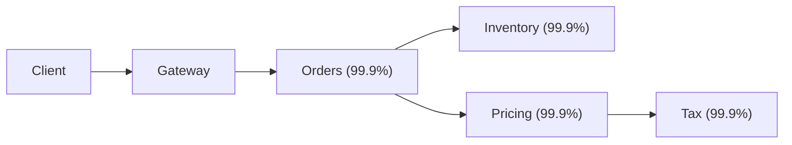
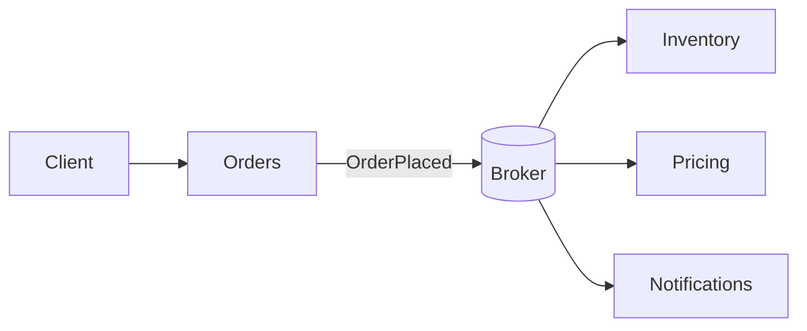
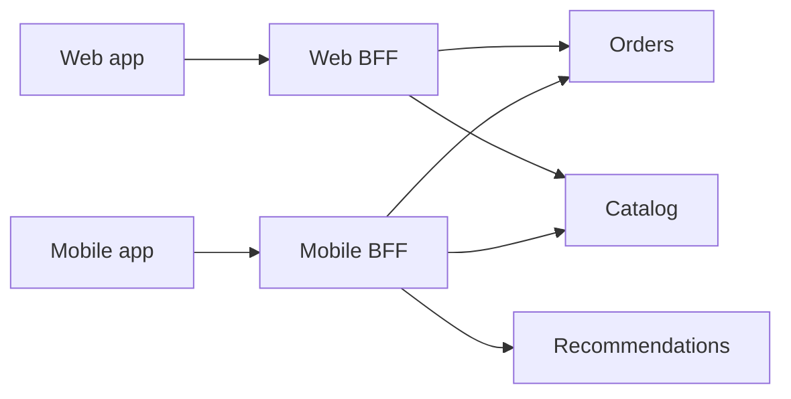
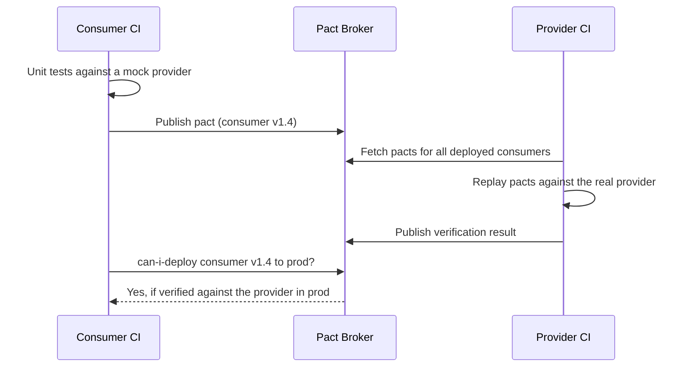
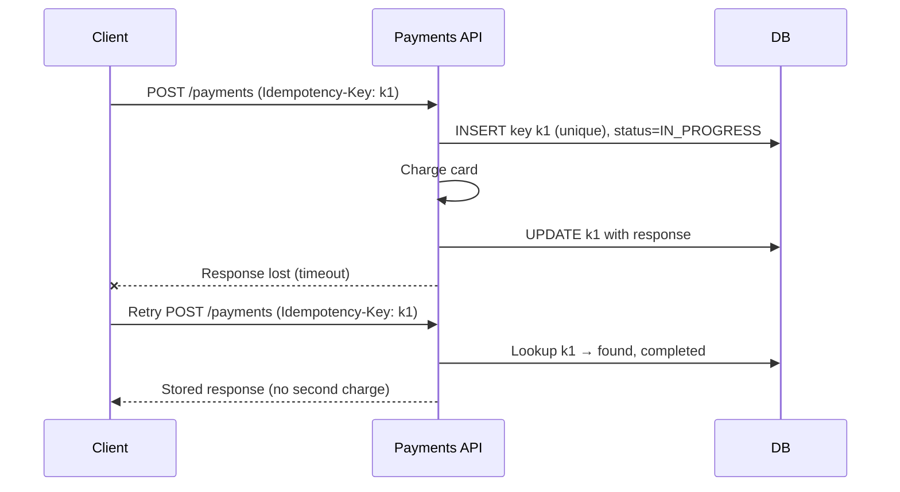

:::tip Key takeaways
- **Sync calls couple services in time.** A chain of N synchronous calls is only as available as the product of its parts.
  Prefer async events for anything that doesn't need an answer now.
- **Pick protocols by boundary:** REST or GraphQL at the edge, gRPC or async messaging east-west.
- **Backward compatibility is a discipline, not a version number.** Additive changes, tolerant readers and
  expand/contract keep you off `/v2` for years.
- **Consumer-driven contract tests** replace most cross-service end-to-end tests.
- Retries on non-idempotent endpoints need **idempotency keys**, or a timeout becomes a double charge.
:::

## Sync vs. async

| | Synchronous (request/response) | Asynchronous (events, commands over a broker) |
|---|---|---|
| Temporal coupling | Caller and callee must both be up | Producer and consumer run independently |
| Latency | Adds up along the call chain | Caller returns fast; work finishes later |
| Failure behaviour | Errors and slowness propagate upstream | Broker buffers; consumer catches up |
| Consistency | Read-your-writes is easy | Eventual; the UI must tolerate lag |
| Debugging | One trace, one stack | Needs correlation IDs and tracing across the broker |
| Use when | The caller needs the answer to continue (queries, validation) | Notifying others, long-running work, fan-out |

<details>
<summary>Diagram: the availability math of a sync chain</summary>



Each hop is 99.9% available, but the request needs all four: 0.999⁴ ≈ 99.6%, which is about 35 hours of downtime a
year instead of 9. Latency compounds the same way: the slowest dependency sets your p99.

The async version: Orders accepts the request, writes `OrderPlaced` and returns `202 Accepted`. Inventory and Pricing
consume the event when they can. A Tax outage delays orders; it no longer fails them.



</details>

:::warning A synchronous call to a service is a runtime dependency on it
If service A can't serve any request without B, they deploy separately but fail together. That's a distributed monolith.
See [Pitfalls](./pitfalls) and [Resilience](./resilience).
:::

## Choosing a protocol

| | REST/JSON | gRPC | GraphQL | Async messaging |
|---|---|---|---|---|
| Best fit | Public and partner APIs, CRUD resources | Internal east-west calls, low latency | Edge/BFF serving many UI shapes | Events, fan-out, workflows |
| Contract | OpenAPI (optional, often drifts) | Protobuf (required, codegen) | Typed schema, introspection | Schema registry (Avro/Protobuf/JSON Schema) |
| Streaming | No (use SSE/WebSockets) | Client, server and bidirectional | Subscriptions | Native |
| HTTP caching | Excellent (GET, ETags, CDNs) | None | Hard (POST to one endpoint) | n/a |
| Browser support | Native | Needs gRPC-Web or a proxy | Native | n/a |
| Main trap | Chatty APIs, over/under-fetching | Load balancing long-lived HTTP/2 connections | N+1 resolvers, query cost limits | Ordering, duplicates, eventual consistency |

For server push to browsers, use **SSE** for one-way updates (simple, works over HTTP/1.1 and proxies) and
**WebSockets** when you need two-way messages.

<details>
<summary>GraphQL: where it fits and where it doesn't</summary>

GraphQL's sweet spot is the **perimeter**: one schema in front of many services, serving web and mobile clients that
each need different shapes of data. It is a poor fit for service-to-service calls.

- **Writes are awkward.** Mutations work, but teams often end up with GraphQL for reads and REST for writes.
- **Caching is hard.** Every query is a POST to one URL, so CDN and HTTP caching don't apply. You need persisted
  queries or client-side normalized caches.
- **Cost is unbounded by default.** A deeply nested query can fan out to thousands of backend calls. Enforce depth and
  complexity limits, and batch resolvers (DataLoader) to avoid N+1.

</details>

<details>
<summary>gRPC: the load-balancing trap</summary>

gRPC multiplexes requests over one long-lived HTTP/2 connection. A Layer 4 load balancer (including a plain
Kubernetes `ClusterIP` Service) balances **connections**, not requests, so one pod can get all the traffic from a
client. Fix it with client-side load balancing (headless Service + gRPC's `round_robin`), a Layer 7 proxy (Envoy,
a service mesh) or periodic connection recycling (`MAX_CONNECTION_AGE`).

</details>

## Backend for Frontend (BFF)

A BFF is a thin API layer owned by a client team (web, iOS, partner). It aggregates and reshapes calls to downstream
services for that one client. Use it when one general-purpose gateway API keeps growing client-specific endpoints.

<details>
<summary>Diagram and trade-offs</summary>



- **Pros:** each client gets payloads shaped for its screens; client teams ship without waiting on backend teams.
- **Cons:** duplicated aggregation logic across BFFs. Keep business rules in the services; a BFF only orchestrates and
  shapes data.
- A GraphQL gateway is often a single BFF for all clients.

</details>

## API versioning and backward compatibility

The goal is to **never break a consumer**, not to version well. Most changes can be made compatibly.

| Change | Compatible? |
|---|---|
| Add an optional field to a response | Yes, if clients are tolerant readers |
| Add an optional request field with a default | Yes |
| Add a value to an enum in a response | **No** for strict clients; treat as breaking unless clients handle unknowns |
| Rename or remove a field, change its type or format | No: use expand/contract |
| Make an optional request field required | No |
| Change status codes, error shape or HTTP method | No |
| Tighten validation (shorter max length, new required format) | No |

<details>
<summary>Techniques: tolerant reader, expand/contract, deprecation</summary>

- **Tolerant reader.** Consumers read only the fields they need and ignore unknown ones. This is what makes additive
  change safe. Configure JSON mappers not to fail on unknown properties.
- **Expand/contract (parallel change).** To rename `firstname` to `first_name`:
  1. **Expand:** write and return both fields.
  2. **Migrate:** consumers move to the new field; track usage with metrics or logs.
  3. **Contract:** remove the old field once usage is zero.
- **Deprecation.** Announce with the `Deprecation` and `Sunset` response headers and docs. Measure who still calls the
  old version before removing it.
- **Semantic versioning for APIs.** Only the major version matters to consumers. Put it in the path (`/v2/orders`) or a
  media type (`application/vnd.shop.v2+json`). Path versions are easier to route and see in logs.
- **Running two major versions** doubles testing and support. Keep the window short, and implement v1 as an adapter
  over v2 rather than as a fork.

</details>

## Consumer-driven contract testing

Each consumer publishes the requests it makes and the responses it relies on (a **pact**). The provider's CI replays
those pacts against the real provider. A provider change that breaks any consumer fails the provider's build, before
deployment. This replaces most slow, flaky cross-service end-to-end tests.

<details>
<summary>Diagram: the Pact workflow</summary>



- Contracts only capture **what consumers actually use**, so providers can change everything else freely.
- `can-i-deploy` checks compatibility against the versions running in each environment, which gives you safe
  independent deployment.
- Contract tests check shape and semantics of the interface, not business behaviour. Keep a thin layer of end-to-end
  smoke tests for critical journeys.
- For async APIs, the same idea applies to message schemas. A schema registry with compatibility rules is the minimum;
  see [Kafka schemas](/docs/platform/kafka/schemas).

</details>

## Idempotency keys

Clients retry on timeouts, but a timeout doesn't tell you whether the request succeeded. For non-idempotent operations
(`POST /payments`), the client sends an `Idempotency-Key` header. The server stores the key with the result and
returns the stored result for repeats.

<details>
<summary>How the server implements it</summary>



- Make the key insert part of the same transaction as the business write, or use a unique constraint so concurrent
  duplicates fail fast. Return `409 Conflict` if the original is still in progress.
- Scope keys per client and expire them (e.g. after 24 hours).
- Reject a reused key with a different request body: return `422`.
- `PUT` and `DELETE` are idempotent by definition; `GET` must be safe. Only `POST` and `PATCH` need keys.

</details>

## Error responses

Use one error format across all services. **RFC 9457 Problem Details** (`application/problem+json`) is the standard
choice. Pick status codes precisely; clients and retry logic depend on them.

<details>
<summary>Problem Details example and status-code nuances</summary>

```http
HTTP/1.1 422 Unprocessable Content
Content-Type: application/problem+json

{
  "type": "https://api.example.com/problems/validation",
  "title": "Request validation failed",
  "status": 422,
  "detail": "2 fields are invalid",
  "instance": "/orders/8f2c",
  "errors": [
    { "field": "email", "code": "invalid_format" },
    { "field": "quantity", "code": "must_be_positive" }
  ]
}
```

| Situation | Status |
|---|---|
| Client asks for XML (`Accept: application/xml`), API only produces JSON | `406 Not Acceptable` |
| Client sends XML (`Content-Type: application/xml`), API only accepts JSON | `415 Unsupported Media Type` |
| Well-formed request, but fails business validation | `422`, not `400` |
| Not authenticated vs. authenticated but not allowed | `401` vs. `403` (or `404` to hide existence) |
| Downstream dependency failed or timed out | `502` / `504`, not `500` |
| Shedding load or rate limiting | `503` or `429` with `Retry-After` |

Clients should retry only `408`, `429`, `502`, `503` and `504`, and only for idempotent requests or requests with an
idempotency key. Never leak stack traces or internal hostnames in `detail`.

</details>

<details>
<summary>Richardson Maturity Model (rarely worth more than a minute)</summary>

| Level | What it adds |
|---|---|
| 0 | One endpoint, HTTP as a tunnel for RPC (e.g. SOAP, `POST /api` with an action field) |
| 1 | Resources: separate URIs like `/orders/42` |
| 2 | HTTP verbs and status codes used properly (`GET` is safe, `201` + `Location` on create) |
| 3 | Hypermedia (HATEOAS): responses link to the next allowed actions |

Most good production APIs are level 2. Level 3 is rare outside of public, long-lived APIs, because clients almost
always hard-code URLs anyway.

</details>

## References
- [RFC 9457: Problem Details for HTTP APIs](https://www.rfc-editor.org/rfc/rfc9457)
- [Pact documentation](https://docs.pact.io/)
- [Martin Fowler: Tolerant Reader](https://martinfowler.com/bliki/TolerantReader.html) and
  [Parallel Change](https://martinfowler.com/bliki/ParallelChange.html)
- [Sam Newman: Backends For Frontends](https://samnewman.io/patterns/architectural/bff/)
- [Stripe: Idempotent requests](https://docs.stripe.com/api/idempotent_requests)
- [IETF draft: The Idempotency-Key HTTP header](https://datatracker.ietf.org/doc/draft-ietf-httpapi-idempotency-key-header/)
