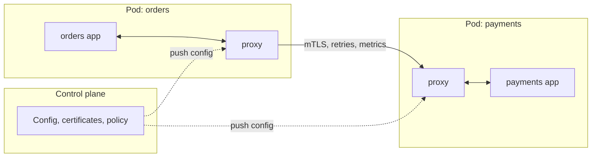

import Tabs from '@theme/Tabs';
import TabItem from '@theme/TabItem';

:::tip Key takeaways
- On Kubernetes, **platform DNS and Services are the service discovery**. Eureka and client-side registries are legacy there.
- The gateway owns **edge** concerns (authn, rate limits, routing). Keep business logic out of it; use a BFF for client-specific aggregation.
- A **service mesh** moves mTLS, retries and telemetry out of every codebase, at the cost of an operational layer. Adopt it for a problem, not by default.
- **OpenTelemetry** is the standard for traces, metrics and logs. Propagate context on every hop, including through message brokers.
- Each concern needs **one owner**: library, mesh or platform. Two owners means double retries and conflicting timeouts.
:::

## Cheat sheet

| Concern | Options | Current tooling |
|---|---|---|
| Service discovery | Platform DNS, client-side registry, server-side load balancer | Kubernetes Services/DNS; Consul (multi-platform); Eureka (legacy) |
| Edge / API gateway | Gateway, BFF per client, GraphQL federation | Kong, Envoy Gateway, Spring Cloud Gateway, cloud API gateways |
| Service-to-service traffic | Library (in-process) vs. mesh (sidecar or ambient) | Resilience4j; Istio, Linkerd |
| Observability | Traces, metrics, logs with shared context | OpenTelemetry SDK + Collector; Prometheus, Grafana, Tempo/Jaeger, Loki/ELK |
| Identity and authz | Edge authn, token propagation, mTLS, policy engine | OIDC provider, JWT, SPIFFE/SPIRE, OPA |
| Configuration and secrets | Push (env/files) vs. pull (config server) | ConfigMaps/Secrets, External Secrets, Vault, Spring Cloud Config |

## Service discovery

On Kubernetes, a Service gives each workload a stable DNS name and virtual IP, and the platform tracks healthy Pods.
Client-side registries (Eureka) duplicate that and add a component to run. They still make sense across platforms
(VMs plus Kubernetes) where Consul is the common choice.

Client-side vs. server-side discovery

| | Client-side (Eureka, Consul + library) | Server-side (Kubernetes Service, cloud LB) |
|---|---|---|
| Who picks the instance | Client library | Proxy / kube-proxy / LB |
| Language coupling | Needs a library per language | None |
| Smarter balancing | Possible (zone-aware, latency-aware) | Basic unless you add a mesh |
| Moving parts | Registry cluster + library | Part of the platform |

Long-lived connections (gRPC over HTTP/2) defeat connection-level balancing through a ClusterIP: all requests ride one
connection to one Pod. Use a headless Service with client-side balancing, or a mesh that balances per request.

## API gateway and BFF

The gateway is the single entry point for external traffic: TLS termination, authentication, rate limiting, routing
and request shaping. A **Backend for Frontend (BFF)** is a client-specific API (web, mobile) that aggregates
downstream calls for that client.

Gateway vs. BFF vs. mesh: who does what

| | API gateway | BFF | Service mesh |
|---|---|---|---|
| Traffic | North-south (into the system) | North-south, per client type | East-west (between services) |
| Owns | Authn, rate limits, routing, WAF | Aggregation, client-shaped responses | mTLS, retries, timeouts, telemetry |
| Owned by | Platform team | The client's team | Platform team |

:::warning The gateway as a new monolith
Once business rules, orchestration or data transformations creep into the gateway, every team needs the platform
team to ship a feature. Keep the gateway generic; put client logic in BFFs and business logic in services.
:::

## Service mesh vs. libraries

A mesh puts a proxy in the data path of every call (as a sidecar per Pod, or per node in ambient / sidecar-less
mode). The proxy handles mTLS, retries, timeouts, traffic splitting and telemetry, uniformly across languages.

Diagram: sidecar data plane and control plane

<Tabs>
<TabItem value="mesh" label="Mesh: when it pays">

- Many services in several languages need the same mTLS, retry and telemetry behaviour.
- Zero-trust requirements: every call authenticated with a workload identity.
- Traffic shifting for canaries without changing application code.

</TabItem>
<TabItem value="library" label="Library: when it's enough">

- One or two languages with a mature library (Resilience4j, OpenTelemetry SDK).
- Small number of services; the team can't absorb another platform to operate and upgrade.
- You need application-level semantics (fallbacks with business defaults) that a proxy can't express.

</TabItem>
<TabItem value="costs" label="Mesh costs">

- Latency per hop (usually sub-millisecond to a few ms) and memory per sidecar. Ambient mode reduces this.
- Upgrades and certificate rotation become platform-critical; a broken control plane affects every service.
- Debugging gets harder: a 503 may come from a proxy, not the app.

</TabItem>
</Tabs>

## Observability

Use **OpenTelemetry** for traces, metrics and logs, and propagate W3C `traceparent` on every hop. Put the trace ID
in every log line so logs and traces join up. Spring Cloud Sleuth is replaced by **Micrometer Tracing** in Spring
Boot 3.

What to measure: RED and USE

| Method | For | Signals |
|---|---|---|
| RED | Request-driven services | **R**ate, **E**rrors, **D**uration (latency histograms, not averages) |
| USE | Resources (CPU, pools, queues) | **U**tilisation, **S**aturation, **E**rrors |

- Alert on SLO burn rate (user-facing symptoms), not on every cause.
- Keep metric label cardinality bounded: never use user IDs or order IDs as labels.
- Sample traces at the Collector with tail-based sampling so errors and slow traces are always kept.

:::warning Context is lost at async boundaries
Traces break at message brokers and thread pools unless you propagate context explicitly: put `traceparent` in
message headers, and use context-aware executors. Otherwise a request's trace ends at the producer.
:::

## Security

Authenticate users **once at the edge**, then pass identity downstream. Authenticate **services** to each other with
mTLS-based workload identity. Authorise in each service; never trust a call just because it's on the internal network.

Token propagation patterns

| Pattern | How | Trade-off |
|---|---|---|
| Pass-through JWT | Gateway forwards the user's access token | Simple; every service sees broad scopes, and a leaked token works everywhere |
| Token exchange (RFC 8693) | Gateway or service swaps it for a narrower, audience-specific token | Least privilege; needs an authorisation server in the path |
| Internal signed context | Gateway issues a short-lived internal token with user claims | Decouples internal services from the external IdP |

- Validate tokens locally (signature, `aud`, `exp`) with cached JWKS. Calling the IdP per request adds a dependency.
- Service identity: mesh-issued certificates or SPIFFE IDs, with policy such as "only `orders` may call `payments`".
- Centralise policy decisions where they're complex (OPA), but enforce them in each service.

## Configuration and secrets

Configuration is supplied by the environment, not baked into the artifact, so the **same image** is promoted through
every environment. Secrets come from a secret manager, never from Git in plain text.

Push vs. pull configuration

| | Push (env vars, mounted files) | Pull (config server) |
|---|---|---|
| Examples | Kubernetes ConfigMaps/Secrets, External Secrets Operator | Spring Cloud Config, Consul KV, AWS AppConfig |
| Change at runtime | Needs a restart, or a file watcher on mounted files | Refresh endpoints or polling |
| New dependency | None at runtime | The config server is on the startup path; run it highly available |
| Audit trail | Git (GitOps) | Server backend (often Git) |

Feature flags are runtime configuration with targeting. Use a flag service rather than overloading config for them.
See [Deployment](./deployment).

## Microservice chassis vs. platform

A **chassis** is a shared library or service template that bakes in logging, metrics, tracing, health checks and
config loading. A **platform** provides the same concerns outside the code (mesh, sidecars, operators). Most mature
organisations use both: a thin chassis (or golden-path template) for in-process concerns, and the platform for the rest.

:::warning Fat shared libraries couple services
A chassis that includes domain models or client SDKs for other services forces lock-step upgrades across teams.
Keep it to infrastructure concerns, version it, and allow teams to lag a version behind.
:::

## References

- [OpenTelemetry documentation](https://opentelemetry.io/docs/)
- [Micrometer Tracing (Spring Boot 3)](https://docs.micrometer.io/tracing/reference/)
- [Pattern: Backends for Frontends (Sam Newman)](https://samnewman.io/patterns/architectural/bff/)
- [Istio ambient mode](https://istio.io/latest/docs/ambient/overview/)
- [OAuth 2.0 Token Exchange (RFC 8693)](https://www.rfc-editor.org/rfc/rfc8693)
- [SPIFFE](https://spiffe.io/docs/latest/spiffe-about/overview/)
- [The RED Method (Grafana)](https://grafana.com/blog/2018/08/02/the-red-method-how-to-instrument-your-services/)
