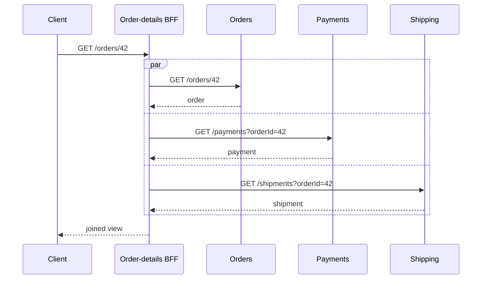
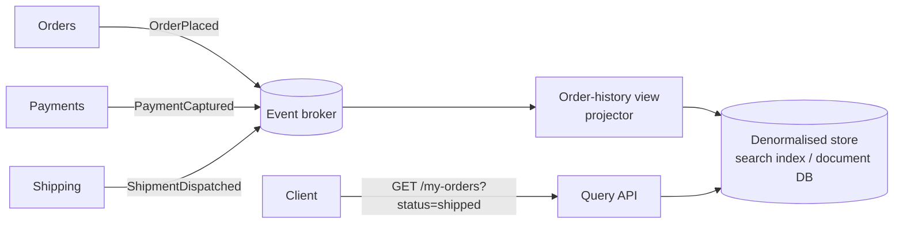
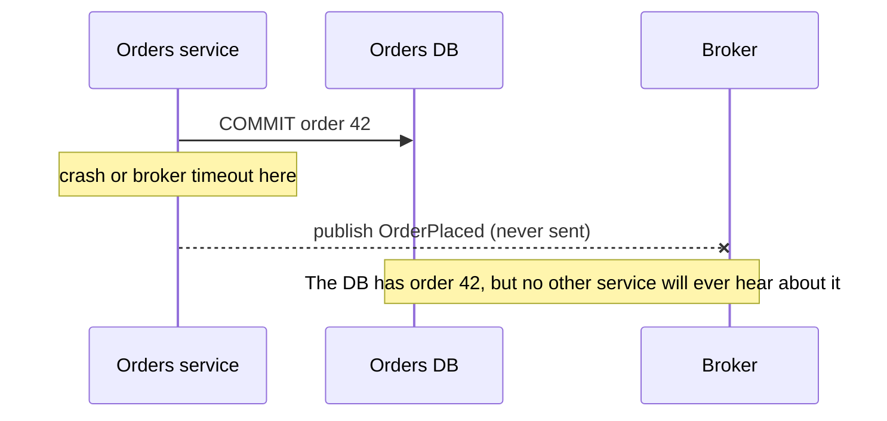

import Tabs from '@theme/Tabs';
import TabItem from '@theme/TabItem';

:::tip Key takeaways
- **Database per service** means one writer per piece of data, not one database server per service. A shared schema
  couples every service that touches it.
- There are no distributed ACID transactions in practice. Multi-service writes are **sagas**; multi-service reads are
  **API composition**, **CQRS views** or **local replicas**.
- Eventual consistency is a **product decision** as much as a technical one. Design the UX for "pending" states and
  read-your-writes.
- Every write that can be retried needs an **idempotency key**. At-least-once delivery makes duplicates certain.
- Publish state changes with an **outbox or CDC**, never with a dual write.
:::

## Database per service

Each service is the only writer of its data, and others reach it only through the service's API or events. The
storage can be a separate cluster, a separate database or a separate schema on shared infrastructure; what matters is
that no other service reads or writes the tables directly.

| Shared database | Database per service |
|---|---|
| Schema changes need every consumer to agree and redeploy | The owner changes its schema freely behind its API |
| One service's heavy query slows all others | Load and scaling are isolated |
| Joins and transactions across domains are easy | Cross-service joins and transactions need patterns (below) |
| Hidden coupling: nobody knows who reads a column | The API or event contract is the only coupling |

:::danger The shared database is the distributed monolith
If two services write the same tables, they can't be deployed, migrated or scaled independently. You pay for
microservices and keep the monolith's coupling. Shared **read-only** access is less harmful but still freezes the
schema.
:::

## Querying across services

Pick per query, based on how fresh the data must be and how often it's read.

| Option | How | Freshness | Good for | Cost |
|---|---|---|---|---|
| **API composition** | A gateway or BFF calls each owner and joins in memory | Live | Low-volume detail pages, few services | Latency and availability of every callee; no cross-service paging or sorting |
| **CQRS read model** | A dedicated view service builds a denormalised store from events | Seconds behind | Search, dashboards, lists that filter and sort across domains | Another store to run; event replay and rebuild tooling |
| **Local replica** | A service keeps the slice of another's data it needs, updated from events | Seconds behind | Hot-path lookups (e.g. orders keeps product name and price) | Duplicated data; the replica must tolerate reordering and missed events |
| ~~Direct DB read~~ | Read the other service's tables | Live | Nothing | Couples schemas; breaks on every migration |

<details>
<summary>Diagram: API composition vs. CQRS read model</summary>

<Tabs>
<TabItem value="composition" label="API composition">



Call the owners in parallel. Decide per field what to show when one callee is down (hide the section, show "pending",
or fail the request).

</TabItem>
<TabItem value="cqrs" label="CQRS read model">



The view is disposable: you can drop it and rebuild it by replaying events. This needs events that carry enough data
(or a way to fetch it) and retention long enough to replay.

</TabItem>
</Tabs>

</details>

## Consistency trade-offs

Without distributed transactions, other services see a change after a delay. The engineering question is how long, and
what users see meanwhile.

| Concern | Pattern |
|---|---|
| A user writes and immediately reads | **Read-your-writes:** serve the read from the owning service, or return the new state in the write response |
| Multi-step business process (order → pay → reserve stock) | **Saga** with compensating actions. See [Sagas](/docs/architecture/patterns/sagas) |
| Process in flight | Model explicit **pending states** (`PENDING_PAYMENT`) instead of hiding them |
| Two writers race on the same entity | **Optimistic locking** (version column, `If-Match` ETag) in the owning service |
| Events arrive out of order | Partition by entity key; carry a version or timestamp and ignore stale updates |
| Drift between services | Periodic **reconciliation** jobs that compare and repair, plus alerts on mismatch |

<details>
<summary>Why not two-phase commit (2PC / XA)?</summary>

- **Availability:** the coordinator and every participant must be up for the transaction to commit. Each added
  participant lowers the success rate.
- **Locks held across the network:** participants hold locks until the coordinator decides. A slow or crashed
  coordinator blocks them.
- **Support:** most brokers and NoSQL stores don't support XA, and cloud managed databases often limit it.

Use 2PC only inside one trust and failure domain, such as one database's internal replicas. Between services, use
sagas, the outbox and idempotent consumers.

</details>

## Publishing changes reliably

A service that writes its database and then publishes an event in two steps will eventually lose one of them on a
crash. Write the event in the same transaction as the state change (**transactional outbox**), or derive events from
the database log (**CDC**). Details and diagrams are in [Messaging](./messaging-brokers).

<details>
<summary>Diagram: the dual-write problem</summary>



Reversing the order (publish, then commit) gives the opposite bug: an event for an order that never existed.

</details>

## Idempotency

Retries happen at every layer: clients, gateways, meshes and message redelivery. Any operation with side effects must
produce the same result when applied twice.

| Where | Technique |
|---|---|
| Synchronous API | Client sends an `Idempotency-Key` header; the server stores key → response and replays it on repeats |
| Message consumer | Record processed message IDs in the same transaction as the state change; skip repeats |
| Natural idempotency | Prefer "set status to PAID" over "add 10 to balance"; use upserts keyed by business ID |

<details>
<summary>Idempotency key: what the server stores</summary>

```sql
CREATE TABLE idempotency_keys (
  idem_key      VARCHAR(64) PRIMARY KEY,
  request_hash  CHAR(64)    NOT NULL,  -- reject the same key with a different body
  status        VARCHAR(16) NOT NULL,  -- IN_PROGRESS | DONE
  response_code INT,
  response_body JSONB,
  created_at    TIMESTAMP   NOT NULL DEFAULT now()
);
```

- Insert the key **before** doing the work, so a concurrent duplicate sees `IN_PROGRESS` and gets `409` or waits.
- Store the response, so a retry after a timeout gets the original result, not a second charge.
- Expire keys after a window longer than any client's retry period (e.g. 24 hours).

</details>

## Reference data

Small, rarely changing data (countries, currencies, tax categories, product categories) causes needless calls if every
service fetches it live.

| Option | Use when |
|---|---|
| Owner service + **cache** in each consumer | Data changes occasionally and staleness of minutes is fine |
| **Replicate via events** into each consumer's store | Consumers need it in joins or must work when the owner is down |
| **Static config / library** shipped with each service | Data changes on release timescales (ISO codes) |

:::warning Don't create a "reference data service" that everything calls synchronously
It becomes a single point of failure on every request path. Cache aggressively or replicate.
:::

## References

- [Database per service](https://microservices.io/patterns/data/database-per-service.html),
  [API composition](https://microservices.io/patterns/data/api-composition.html) and
  [CQRS](https://microservices.io/patterns/data/cqrs.html), Chris Richardson
- [Transactional outbox](https://microservices.io/patterns/data/transactional-outbox.html), Chris Richardson
- [Designing robust and predictable APIs with idempotency](https://stripe.com/blog/idempotency), Stripe
- *Designing Data-Intensive Applications*, Martin Kleppmann (O'Reilly, 2017), chapters 7–9 and 11
