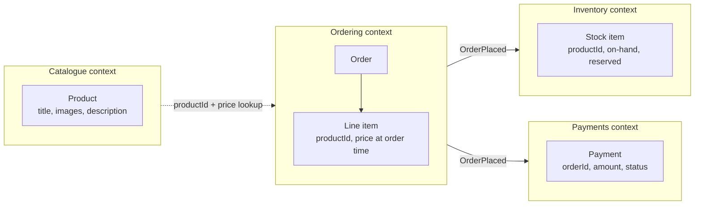
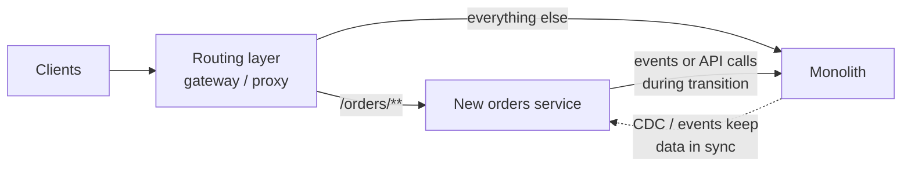
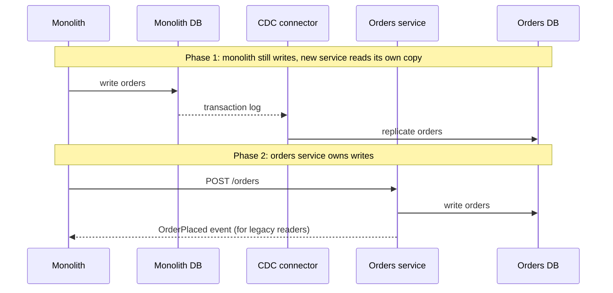

import Tabs from '@theme/Tabs';
import TabItem from '@theme/TabItem';

:::tip Key takeaways
- A good boundary keeps **change local**: most features touch one service, and each service owns its data.
- Start from **bounded contexts** ([DDD](/docs/architecture/ddd)). Business capability and subdomain decomposition are
  two ways of finding them.
- Size by **team ownership and change cadence**, not lines of code. One team can own several services; one service
  should never need two teams.
- Migrate with the **strangler fig**: route traffic around the monolith piece by piece. Never do a big-bang rewrite.
- The database is the hardest part to split. **Split the data before or with the code**, or you've built a
  distributed monolith.
:::

## Finding boundaries

Both standard approaches aim for the same thing: a **bounded context**, where one model and one vocabulary apply.
"Order" means something different to checkout, fulfilment and billing; that difference marks a boundary.

| Approach | Start from | Strength | Risk |
|---|---|---|---|
| **Business capability** | What the business does: catalogue, ordering, payments, shipping | Stable over time; maps to teams | Can be too coarse for complex capabilities |
| **Subdomain (DDD)** | Core, supporting and generic subdomains | Puts effort where the business differentiates | Needs domain experts and modelling time |
| ~~Entity / data table~~ | `Customer`, `Product`, `Order` services | Looks tidy on a diagram | CRUD services with no behaviour; every feature spans many of them |
| ~~Technical layer~~ | UI, business logic, data access services | None for microservices | Every change crosses every layer |

Diagram: bounded contexts for an online shop

"Product" exists in three contexts with three different models. Each context keeps only the fields it needs and refers
to the others by ID. That is what lets each one change independently.

## Sizing heuristics

There is no right size. These tests find boundaries that are wrong.

| Test | Healthy | Merge or re-cut when… |
|---|---|---|
| Change locality | Most features change one service | You routinely change **N services together** for one feature |
| Team ownership | One team owns it end to end | Two teams must coordinate to ship it |
| Data ownership | It is the only writer of its data | Others write to its tables, or it needs another service's data in a transaction |
| Release cadence | Ships on its own schedule | Releases are lock-stepped with another service |
| Call pattern | Mostly self-sufficient per request | Chatty: many synchronous calls to one neighbour per request |

:::warning If you change N services together, they are one service
Lock-step changes and coordinated deployments mean the boundary is in the wrong place. Merging two services is a valid,
often cheaper, fix than adding more coordination.
:::

Conway's law and Team Topologies

**Conway's law:** a system's structure mirrors the communication structure of the organisation that builds it. Use it
deliberately (the "inverse Conway manoeuvre"): design team boundaries to match the architecture you want.

**Team Topologies** gives the vocabulary:

- **Stream-aligned teams** own a business flow (e.g. checkout) and its services end to end.
- **Platform teams** provide self-service infrastructure (CI/CD, Kubernetes, observability) so stream teams don't
  rebuild it.
- **Enabling** and **complicated-subsystem** teams support the others temporarily or own specialist parts.

Keep each team's cognitive load bounded. A team that owns ten services in five domains will cut corners in all of them.

## Migrating off a monolith: strangler fig

Put a routing layer in front of the monolith. Move one capability at a time into a new service, switch its routes, and
delete the old code. The monolith shrinks until it's gone or small enough to keep.

Diagram and steps

1. **Pick the first capability** with clear boundaries, frequent change and few inbound dependencies. Avoid the core
   of the monolith as the first target.
2. **Add the routing layer** (API gateway, reverse proxy, or a facade in the monolith) before extracting anything.
3. **Build the new service** behind the router. Run it in shadow mode or for a small share of traffic first.
4. **Switch routes**, keep a fast rollback path, then **delete the dead code** in the monolith.
5. Repeat. Measure progress by code and data removed from the monolith, not services created.

Related migration patterns

- **Branch by abstraction:** introduce an interface inside the monolith, implement it twice (old in-process, new remote
  call), and switch with a flag.
- **Parallel run:** call both implementations and compare results before trusting the new one. Useful for pricing,
  tax and other high-risk logic.
- **Anti-corruption layer:** translate between the monolith's model and the new service's model, so the legacy model
  doesn't leak into the new service.

## Splitting the database

Extracting the code but keeping a shared database is the most common failure. Data has to move, with the service as
the only writer.

<Tabs>
<TabItem value="steps" label="Steps">

1. **Separate the schema** inside the existing database. Only the new module may touch its tables. Replace joins
   across the boundary with API calls or views.
2. **Move the tables** to the service's own database. Keep the old copy in sync with **CDC or events** while readers
   migrate.
3. **Switch writes** to the new service. It becomes the source of truth; the monolith reads through its API or a
   replicated copy.
4. **Remove** the old tables and sync once nothing reads them.

</TabItem>
<TabItem value="traps" label="Traps">

- **Foreign keys across the boundary** disappear. Referential integrity becomes an application concern (store IDs,
  tolerate deletes, reconcile).
- **Cross-boundary transactions** become sagas. See [Data Consistency](./data-consistency).
- **Reports and BI jobs** that join everything break. Give them a read-only analytical store fed by events or CDC.
- **Dual writes** from application code (write DB, then publish) lose data on crashes. Use an
  [outbox or CDC](./messaging-brokers) instead.

</TabItem>
</Tabs>

Diagram: moving one table out with CDC

## Signs the split is wrong

| Symptom | Likely cause | Fix |
|---|---|---|
| Every feature needs a coordinated multi-service release | Boundaries cut across a business capability | Merge, or re-cut along the capability |
| A request fans out to 5+ synchronous calls | Services too fine-grained, or data in the wrong place | Merge, or keep a local replica of the data |
| CRUD-only services (`CustomerService.getById`) | Entity decomposition | Move behaviour to where the business process lives |
| A "common" or "shared" service everything calls | A hidden shared database | Push the data and logic back to the owners |
| Shared library changes force all services to redeploy | Domain logic in shared libraries | Share only infrastructure code; duplicate small domain bits |

More traps are in [Pitfalls](./pitfalls).

## References

- [Decompose by business capability](https://microservices.io/patterns/decomposition/decompose-by-business-capability.html)
  and [by subdomain](https://microservices.io/patterns/decomposition/decompose-by-subdomain.html), Chris Richardson
- [StranglerFigApplication](https://martinfowler.com/bliki/StranglerFigApplication.html), Martin Fowler
- [BoundedContext](https://martinfowler.com/bliki/BoundedContext.html), Martin Fowler
- *Monolith to Microservices*, Sam Newman (O'Reilly, 2019)
- *Team Topologies*, Matthew Skelton and Manuel Pais (IT Revolution, 2019)
