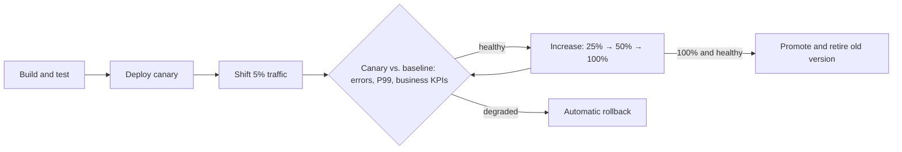
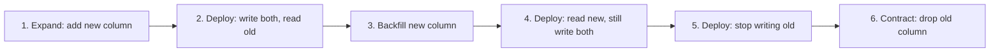

import Tabs from '@theme/Tabs';
import TabItem from '@theme/TabItem';

:::tip Key takeaways
- **Independent deployability** is the point of microservices. If services must ship together, you have a distributed monolith.
- **Decouple deploy from release.** Ship code dark, then release with flags or traffic shifting.
- Build **one artifact** and promote it through environments. Branch-per-environment rebuilds differ from what you tested.
- Database changes use **expand/contract**, so old and new versions run against the same schema during a rollout.
- Measure delivery with the **DORA** metrics, not with the number of services.
:::

This page is tool-agnostic. For the Kubernetes side, see [Workloads](/docs/platform/kubernetes/workloads) (Deployments and
rollout settings), [Deployment Strategies & GitOps](/docs/platform/kubernetes/deployment-strategies) and
[Health Probes](/docs/platform/kubernetes/observability#health-probes).

## Packaging options

| | JAR on a VM | VM image | Container | Serverless function |
|---|---|---|---|---|
| Isolation | Weak (shared host, runtime) | Strong | Good (kernel shared) | Strong, managed |
| Density | High | Low | High | Very high, per request |
| Startup | Seconds | Minutes | Seconds | Cold start: ms to seconds |
| Ops burden | High (config drift, patching) | Medium (image pipeline) | Medium (orchestrator) | Low, but limits on runtime, state and connections |
| Fits | Legacy estates | Strict isolation, licensing | Default for services | Spiky, event-driven, glue code |

Containers on an orchestrator are the default. Serverless trades control for zero idle cost; see
[Cloud](/docs/platform/cloud).

## Release strategies

| Strategy | How | Blast radius | Rollback | Cost |
|---|---|---|---|---|
| Rolling | Replace instances in batches | Grows during rollout | Roll forward or back, minutes | None extra |
| Blue-green | Full parallel stack, switch traffic | All users at switch | Instant switch back | 2× capacity during switch |
| Canary | Small % of traffic to new version, then increase | Small, controlled | Shift traffic back | Needs traffic splitting + metrics |
| Feature flag | Deploy dark, enable per user or cohort | Chosen cohort | Toggle off, seconds | Flag debt; test both paths |

:::warning Mixed versions always run together
During any rollout except a strict blue-green switch, old and new versions serve traffic at the same time, and
consumers may see both message formats. Every change must be backward- and forward-compatible for at least one
release. See [Communication](./communication).
:::

## Progressive delivery

Canary plus automated analysis: shift a small share of traffic, compare the canary's error rate and latency with the
baseline, and promote or roll back automatically.

Diagram: automated canary

- Compare against a **baseline** running the old version at the same time, not against last week's numbers.
- Include a business signal (checkout conversion) as well as technical ones; some regressions return 200 OK.
- Tools: Argo Rollouts, Flagger, or the cloud provider's deployment service, usually with a mesh or gateway doing
  the traffic split.

Why decouple deploy from release

- **Deploy** puts code in production; **release** exposes behaviour to users. Separating them lets you deploy many
  times a day and release on a business schedule.
- Incomplete features merge to trunk behind a flag, which removes long-lived branches and merge pain.
- Rollback of a feature becomes a flag toggle instead of a redeploy.
- Cost: flags must be removed after launch, and both code paths need tests until they are.

## CI/CD and repository layout

Each service has its **own pipeline** that can ship it to production without coordinating with other teams. Contract
tests in the pipeline replace big end-to-end environments as the main safety net.

<Tabs>
<TabItem value="mono" label="Monorepo">

- Atomic changes across services and shared libraries; one place for tooling.
- Needs build tooling that only builds and tests what changed (Bazel, Nx, Gradle build cache).
- Risk: easy cross-service changes encourage coupling that independent deploys can't handle.

</TabItem>
<TabItem value="poly" label="Polyrepo">

- Clear ownership and independent pipelines by default.
- Shared library changes need versioned releases and upgrades in each repo.
- Risk: drift in tooling and dependencies; needs templates or a golden path to stay consistent.

</TabItem>
</Tabs>

## Environment strategy

Build the artifact once, tag it with the commit, and promote **the same image** through dev, staging and prod.
Environment differences live in configuration, not in code or branches.

Why branch-per-environment is an anti-pattern

| Branch per environment (`develop` → staging, `main` → prod) | Trunk + artifact promotion |
|---|---|
| Each merge rebuilds, so prod runs a binary that was never tested | Prod runs the exact image that passed staging |
| Merges between environment branches drift and conflict | One branch; promotion is a config or tag change |
| Hotfixes need cherry-picks across branches | Fix on trunk, promote the new image |
| Environments become long-lived and diverge | Environments defined in Git and recreated |

With GitOps, promotion is a pull request that changes the image tag in the environment's config directory.

## Database migrations: expand/contract

Never make a schema change that the currently running version can't handle. Split breaking changes into steps that
are each compatible with both the old and new code.

Example: renaming a column

- Each step is a separate deploy, so any single step can be rolled back.
- Migrations run as a separate pipeline step or job, not on every instance's startup (concurrent instances race).
- The same pattern applies to API fields and event schemas.

## Measuring delivery: DORA metrics

| Metric | Measures | Elite performers (DORA) |
|---|---|---|
| Deployment frequency | How often you deploy to production | On demand, many per day |
| Lead time for changes | Commit to running in production | Less than a day |
| Change failure rate | Share of deployments causing a failure | Low (around 5–15%) |
| Time to restore service | Detection to recovery | Less than an hour |

Throughput (frequency, lead time) and stability (failure rate, restore time) improve together. A team that ships
rarely to be safe usually has worse stability, not better.

:::tip Coupling signal
If most changes touch several services that must deploy in a set order, the boundaries are wrong. Consider merging
those services. See [Pitfalls](./pitfalls) and [Decomposition](./decomposition).
:::

## References

- [DORA research](https://dora.dev/)
- [Continuous Delivery (Humble and Farley)](https://continuousdelivery.com/)
- [Parallel Change / expand and contract (Martin Fowler)](https://martinfowler.com/bliki/ParallelChange.html)
- [Feature Toggles (Martin Fowler)](https://martinfowler.com/articles/feature-toggles.html)
- [Argo Rollouts](https://argo-rollouts.readthedocs.io/)
- [Trunk-Based Development](https://trunkbaseddevelopment.com/)
