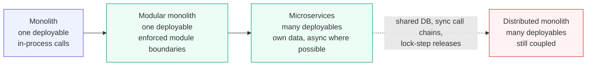

import DocCardList from '@theme/DocCardList';

:::tip Key takeaways
- Microservices buy **independent deployability**, nothing more. Everything else (scaling, tech choice, team autonomy)
  follows from it or can be had more cheaply in a monolith.
- The price is the **distributed-systems tax**: network failures, partial failure, eventual consistency, and
  observability and platform costs paid on every request.
- **Boundaries matter more than size.** Services cut along business capabilities with their own data survive. Services
  cut along entities or layers become a distributed monolith.
- If services must be **deployed together**, or **share a database**, you have the costs of microservices without the
  benefit.
- Default to a **modular monolith**. Extract a service when a module needs a different release cadence, scaling
  profile, failure isolation or owning team.
:::

## The trade-off

Independent deployment is only real if coupling is low. As coupling rises, a microservice system slides into the worst
quadrant: many deployables that still have to change and ship together.

Diagram: the coupling spectrum

Moving right adds operational cost at each step. Only the green boxes are good places to stop: the modular monolith
gives most of the design benefits with none of the network costs. The distributed monolith has the costs of both.

## When microservices are the wrong answer

| Signal | Why it hurts | Better alternative |
|---|---|---|
| One team, or a few teams on one product | No coordination cost to remove; you just add network hops | Modular monolith |
| Domain still unclear (new product, frequent pivots) | Boundaries drawn too early are expensive to move across services | Monolith first, extract later |
| No CI/CD, tracing or on-call per service | Each service multiplies the operational gaps | Invest in the platform first |
| Most features touch most modules | Every change becomes a multi-service release | Rethink boundaries, or merge |
| Strong cross-entity consistency is required | Sagas and eventual consistency replace simple transactions | Keep that data in one service |
| Latency budget is tight | Each synchronous hop adds latency and failure probability | Fewer, coarser services; in-process calls |

Microservices vs. SOA: the one difference worth knowing

Both structure a system as services. The difference is where the intelligence sits. SOA put routing, transformation and
orchestration in a central **smart pipe** (an ESB), often with a shared enterprise data model. Microservices keep the
**pipes dumb** (HTTP, gRPC, a broker that just moves messages) and put the logic in the **endpoints**, each owning its
data. That move is what makes independent change and deployment possible.

## Cheat sheet

| Concern | Senior-level one-liner | Page |
|---|---|---|
| Boundaries | Split by business capability or subdomain, never by entity or layer | [Decomposition](/docs/architecture/microservices/decomposition) |
| Communication | Synchronous calls couple availability; async messaging couples schemas. Choose per interaction. | [Communication](/docs/architecture/microservices/communication) |
| Messaging | At-least-once delivery + idempotent consumers + outbox is the standard reliable setup | [Messaging](/docs/architecture/microservices/messaging-brokers) |
| Data | Database per service. Cross-service reads use composition, CQRS views or local replicas. | [Data Consistency](/docs/architecture/microservices/data-consistency) |
| Resilience | Timeouts on every call; retries with backoff and a budget; circuit breakers to stop cascading failures | [Resilience](/docs/architecture/microservices/resilience) |
| Platform | Gateway, mesh, tracing and config are bought or shared, not rebuilt per service | [Cross-Cutting](/docs/architecture/microservices/cross-cutting) |
| Delivery | Each service has its own pipeline; progressive rollout limits the blast radius | [Deployment](/docs/architecture/microservices/deployment) |

## Pages in this section

<DocCardList />

## References

- [Microservices](https://martinfowler.com/articles/microservices.html), James Lewis and Martin Fowler
- [MonolithFirst](https://martinfowler.com/bliki/MonolithFirst.html), Martin Fowler
- [Microservices patterns](https://microservices.io/patterns/), Chris Richardson
- *Building Microservices*, 2nd ed., Sam Newman (O'Reilly, 2021)
