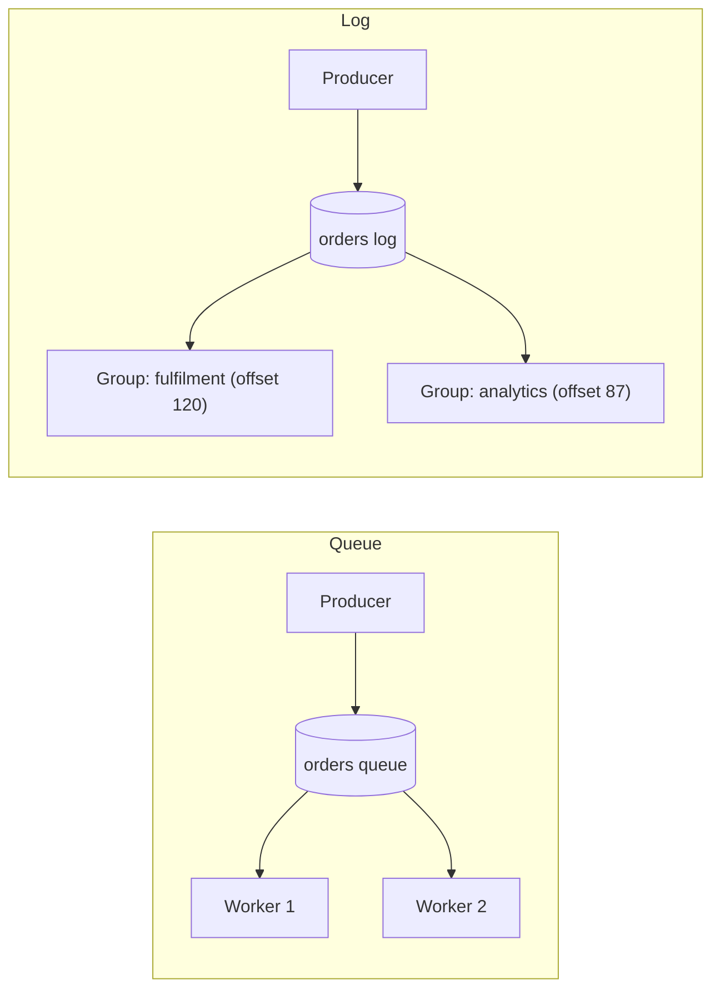
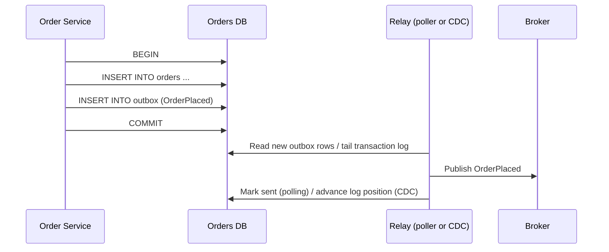
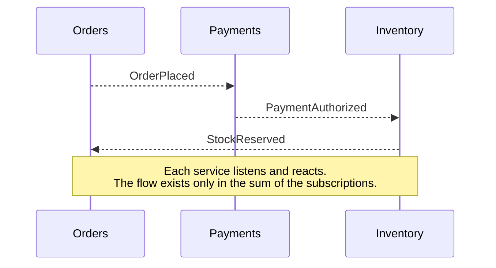
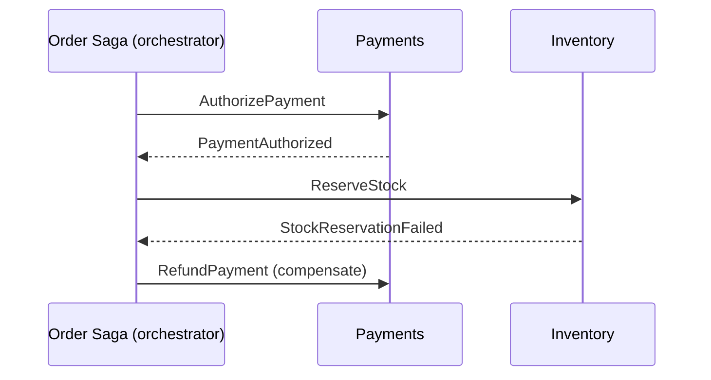

import Tabs from '@theme/Tabs';
import TabItem from '@theme/TabItem';

:::tip Key takeaways
- Brokers deliver **at-least-once** in practice. Design every consumer to be **idempotent**.
- Ordering is only guaranteed **per partition key**, never globally. Choose the key that matches your invariants
  (usually the aggregate ID).
- Never "write to the DB, then publish". Use a **transactional outbox**; relay it by polling or by tailing the log (CDC).
- **Choreography** keeps services decoupled but hides the workflow. **Orchestration** makes it explicit but centralizes it.
- A message that always fails must go to a **dead-letter queue**, or it blocks everything behind it.
:::

Kafka specifics (partitions, consumer groups, offsets, exactly-once) are in [Kafka](/docs/platform/kafka). This page
covers broker-agnostic patterns.

## Message types

| Type | Intent | Naming | Coupling |
|---|---|---|---|
| **Command** | Ask one receiver to do something; it may refuse | Imperative: `ReserveStock` | Sender knows the receiver |
| **Event** | State that something happened; can't be refused | Past tense: `OrderPlaced` | Publisher doesn't know who listens |
| **Document** | Carry a full state snapshot | Noun: `CustomerProfile` | Consumers depend on the shape |

<details>
<summary>Thin events vs. fat events</summary>

- **Thin (notification) events** carry IDs only (`OrderPlaced { orderId }`). Consumers call back for details. Small
  and safe to evolve, but the callback re-creates sync coupling and load on the publisher.
- **Fat (event-carried state transfer)** events carry the data consumers need. Consumers can keep a local replica and
  never call back, but the event schema becomes a public contract.
- Every message should carry a `messageId` (for deduplication), a `correlationId` (to trace a business flow) and a
  `causationId` (the message that caused this one).

</details>

## Broker vs. brokerless

| | Broker-based (Kafka, RabbitMQ, SQS) | Brokerless (direct, e.g. ZeroMQ, gRPC streams) |
|---|---|---|
| Availability | Producer works while consumers are down; broker buffers | Sender and receiver must both be up |
| Latency | One extra hop | Lowest; direct |
| Discovery | Sender only knows the broker | Sender must discover receivers |
| Bottleneck / SPOF | The broker is a component to scale and keep available | No central component to fail |
| Operations | A cluster to run (or a managed service) | Nothing extra to run |

Almost every microservice system uses a broker. The buffering and decoupling are the point.

## Queues vs. topics vs. logs

| Model | Delivery | After consumption | Example |
|---|---|---|---|
| **Queue** (point-to-point) | Each message to **one** of the competing consumers | Deleted on ack | RabbitMQ queue, SQS |
| **Topic** (pub/sub) | Each message to **every** subscription | Deleted per subscription | SNS → SQS, RabbitMQ fanout exchange |
| **Log** | Every consumer group reads independently, at its own offset | Kept until retention expires; replayable | Kafka, Pulsar, Kinesis |

<details>
<summary>Diagram: queue vs. log</summary>



In a queue, workers compete and each message is processed once. In a log, each group gets every message, and a new
group can replay history from the start.

</details>

## Ordering

Brokers that scale out (partitions, shards, multiple consumers) only preserve order **within a partition**. Send all
messages for one entity with the same **partition key** (e.g. `orderId`) so `OrderCreated` is always processed before
`OrderCancelled`.

<details>
<summary>Traps that break ordering anyway</summary>

- **Wrong key.** Keying by `customerId` orders all of a customer's events, but creates hot partitions for big
  customers. Keying by `orderId` doesn't order events across a customer's orders. Pick the key that matches the
  invariant you need.
- **Consumer-side parallelism.** A consumer that hands messages to a thread pool reorders them. Parallelize by key,
  not by message.
- **Retries.** Retrying a failed message later (a retry topic) lets newer messages for the same key pass it. Either
  block the key, or design handlers to tolerate out-of-order events (version numbers, ignore stale updates).
- **Producer retries without idempotence** can reorder writes. In Kafka, enable the idempotent producer; see
  [Producers](/docs/platform/kafka/producers).
- Changing the partition count moves keys to different partitions.

</details>

## Duplicates and idempotent consumers

A consumer can crash after processing a message but before acknowledging it, so the broker redelivers it.
Exactly-once *delivery* across a network isn't achievable; exactly-once *effect* is, by making processing idempotent.

| Technique | How | Use when |
|---|---|---|
| Naturally idempotent writes | Upsert, `SET status = 'PAID'`, not `balance = balance - 10` | The operation can be expressed as setting state |
| Dedup table | Record `messageId` in the same transaction as the business change | Side effects aren't naturally idempotent |
| Version check | Apply only if `event.version > row.version` | Events carry entity versions; also fixes reordering |

<details>
<summary>Dedup table (code)</summary>

The dedup insert and the business update **must commit together**. Otherwise a crash between them either loses the
message or processes it twice.

```sql
CREATE TABLE processed_messages (
  consumer   VARCHAR(100),
  message_id VARCHAR(100),
  processed_at TIMESTAMP DEFAULT CURRENT_TIMESTAMP,
  PRIMARY KEY (consumer, message_id)
);
```

```java
@Transactional
void on(PaymentAuthorized msg) {
    // Unique-key violation means we've already processed it: skip
    if (dedupRepo.insertIfAbsent("billing", msg.messageId()) == 0) return;
    invoiceService.markPaid(msg.orderId());
}
```

Prune old rows on a schedule; keep them longer than the broker's maximum redelivery window.

</details>

## Transactional outbox

"Save to the DB, then publish" fails if the process dies between the two steps, and 2PC across the DB and broker is
slow and poorly supported. Instead, write the event to an **outbox table in the same local transaction** as the
business change. A separate relay publishes it.

<details>
<summary>Diagram: outbox with a CDC relay</summary>



</details>

<Tabs>
<TabItem value="polling" label="Polling relay">

A job queries `SELECT ... FROM outbox WHERE sent = false ORDER BY id` and publishes the rows.

- **Pros:** simple; works on any database; no extra infrastructure.
- **Cons:** polling load and latency; ordering needs care with multiple pollers (`FOR UPDATE SKIP LOCKED`, or one
  poller per partition).
- Fine for moderate volumes.

</TabItem>
<TabItem value="cdc" label="Log tailing (CDC)">

A CDC tool such as **Debezium** reads the database's transaction log (Postgres WAL, MySQL binlog) and publishes each
committed outbox insert.

- **Pros:** low latency; no polling load; preserves commit order.
- **Cons:** another component to run (often Kafka Connect); depends on database-specific log access and retention.
- The standard choice at scale. See [Kafka Connect](/docs/platform/kafka/streams-connect).

</TabItem>
</Tabs>

:::warning The relay is at-least-once
The relay can publish a row and crash before marking it sent, so it publishes it again. The outbox guarantees no lost
events, not no duplicates. Consumers still need to be idempotent.
:::

## Choreography vs. orchestration

Multi-step business flows across services (a saga) are coordinated in one of two ways. Details and compensation
design are in [Sagas](/docs/architecture/patterns/sagas).

<Tabs>
<TabItem value="choreography" label="Choreography">

Each service reacts to events and emits its own. No central coordinator.



- **Pros:** loose coupling; no single owner or bottleneck; easy to add listeners.
- **Cons:** the workflow is implicit and hard to see; cyclic dependencies creep in; "where is order 42 stuck?" needs
  tracing across services.
- Good for short flows with few steps.

</TabItem>
<TabItem value="orchestration" label="Orchestration">

A coordinator (orchestrator) sends commands and tracks state.



- **Pros:** the flow is explicit, in one place, with its state queryable; compensation logic is easier.
- **Cons:** the orchestrator can become a "god service" holding business logic that belongs in the participants.
- Good for long or complex flows. Workflow engines (Temporal, Camunda, AWS Step Functions) provide durable state and
  retries.

</TabItem>
</Tabs>

## Poison messages and dead-letter queues

A message that fails every time (bad data, a bug) is retried forever. In ordered or partitioned consumers it blocks
everything behind it. Retry a bounded number of times with backoff, then move it to a **dead-letter queue (DLQ)**.

<details>
<summary>Making DLQs operable</summary>

- **Separate transient from permanent failures.** Retry timeouts and `503`s; send validation and deserialization
  errors straight to the DLQ.
- **Keep context:** original topic, partition and offset, exception, and attempt count as headers.
- **Alert on DLQ depth.** An unmonitored DLQ is data loss with extra steps.
- **Have a redrive path:** a tool to replay DLQ messages after the fix, which works because consumers are idempotent.
- For Kafka-specific retry topics and the ordering trade-off, see [Consumers](/docs/platform/kafka/consumers).

</details>

## Choosing a broker

| | Kafka | RabbitMQ | SQS / SNS | Pulsar |
|---|---|---|---|---|
| Model | Partitioned log | Queues + exchanges (routing) | Queue / pub-sub (managed) | Log + queue semantics |
| Ordering | Per partition | Per queue, single consumer | FIFO queues, per message group | Per partition / key |
| Retention and replay | Yes, by time or size; compaction | No (deleted on ack); streams add replay | No (max 14 days in queue) | Yes, with tiered storage |
| Throughput | Very high | Moderate | High, scales automatically | Very high |
| Routing | By key only | Rich (topic, headers, fanout) | SNS filter policies | Topic-based |
| Best for | Event streaming, event sourcing, CDC, many consumers | Task queues, complex routing, RPC-over-messaging | AWS-native decoupling with zero ops | Multi-tenant, geo-replication |

<details>
<summary>How to decide in an interview</summary>

- Need **replay**, many independent consumers or stream processing? A log: Kafka or Pulsar.
- Need **per-message routing**, priorities or work queues with acks? RabbitMQ.
- On AWS and want **no operations**? SQS (with SNS for fan-out); use FIFO only if you need ordering, since it limits
  throughput.
- Ask about the delivery guarantee, ordering scope, retention and operational cost before naming a product.

</details>

## References
- [Chris Richardson: Transactional outbox](https://microservices.io/patterns/data/transactional-outbox.html)
- [Debezium: Outbox event router](https://debezium.io/documentation/reference/stable/transformations/outbox-event-router.html)
- [Martin Fowler: What do you mean by "Event-Driven"?](https://martinfowler.com/articles/201701-event-driven.html)
- [Enterprise Integration Patterns](https://www.enterpriseintegrationpatterns.com/patterns/messaging/)
- *Microservices Patterns*, Chris Richardson (Manning), chapter 3
