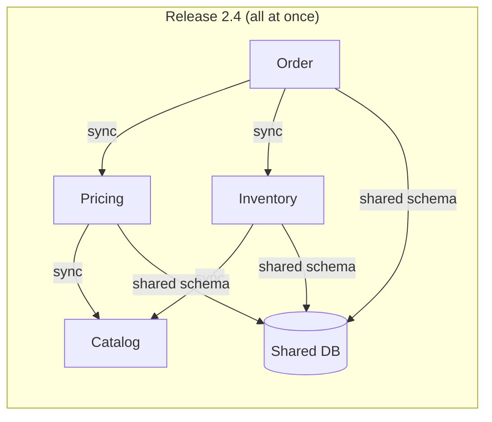

import Tabs from '@theme/Tabs';
import TabItem from '@theme/TabItem';

:::tip Key takeaways
- If services have to be **deployed together**, you have a distributed monolith: all the cost of microservices with none of the independence.
- A **shared database** is a hidden API. Any schema change couples every team that reads it.
- **Synchronous call chains** multiply latency and failure. Availability is the product of every hop.
- Most breakage comes from **contracts**: renamed fields, narrowed enums, reused DTOs. Version and test them.
- Split late. A wrong boundary costs far more than a modular monolith that you split later.
:::

## Anti-patterns at a glance

| Anti-pattern | Symptom | Fix |
|---|---|---|
| Distributed monolith | Releases need several services to deploy in lockstep | Re-draw boundaries around business capabilities; use backward-compatible contracts so each service ships alone |
| Shared database | A column rename needs sign-off from three teams | One owner per table; others use an API, events or a read replica of *their own* |
| Chatty sync call chains | p99 latency and error rate grow with every hop | Fewer hops: denormalise, cache, or switch to events; set deadlines, not just timeouts |
| Entity services / nanoservices | `CustomerService`, `AddressService`, … every use case calls five services | Merge into a capability-sized service; boundaries follow behaviour, not nouns |
| Shared domain library | A model change forces every service to upgrade | Share only technical libraries (logging, tracing); duplicate small domain types |
| Breaking API changes | Clients fail after a "minor" release | Additive changes only; expand/contract; consumer-driven contract tests |
| Same DTO for read and write | Clients send `id`, `createdBy`, `status` and the server silently ignores or trusts them | Separate request and response DTOs |
| Missing idempotency | Retries charge a card twice | Idempotency keys on commands; dedupe on message ID |
| Retry storms | A brief slowdown becomes a full outage | Retry budgets, exponential backoff with jitter, circuit breakers |
| Distributed transactions (2PC) | Coordinator becomes a bottleneck and a single point of failure; locks held across services | Sagas with compensations, plus the outbox pattern |
| Premature decomposition | Boundaries churn; most changes touch several services | Start with a modular monolith; extract when a seam is stable and has a reason to scale or deploy alone |
| No clear ownership | Pages go to "everyone"; services rot | One team owns each service end to end; publish an owner in the service catalogue |

See [Resilience](./resilience) for retry and timeout patterns, and [Data Consistency](./data-consistency) for sagas and the outbox.

## The distributed monolith

The test is simple: can one team deploy one service on a Tuesday afternoon without telling anyone? If not, the
services are coupled, whatever the repository layout says.



<details>
<summary>How it happens and how to get out</summary>

**How it happens**

- Services are split by technical layer or by entity instead of by business capability.
- A shared database or shared domain library means a schema change ripples everywhere.
- Contracts aren't versioned, so every change is breaking and needs a coordinated release.

**Getting out**

1. Map which services change together (commit history is a good source). Services that always change together are one service.
2. Merge them, or move the shared logic to the service that owns the data.
3. Give each table one owner. Readers move to APIs, events, or their own projections.
4. Make contract changes additive and add contract tests, so deploys stop needing coordination.

</details>

:::warning
Moving a monolith onto Kubernetes as twenty containers doesn't make it microservices. If the deploy is still one
pipeline that ships everything, you've added network hops and kept the coupling.
:::

## Contract breakage

Most production breakage between services is a contract change that someone thought was safe.

<details>
<summary>Breaking vs. non-breaking changes</summary>

Example contract: `PUT /users/{id}/prefs`, with a request that has `firstname`, `phone`, `currency` (enum
`USD | GBP | INR`) and a response with `date` (`YYYY-MM-DD`), `age` (number) and `country` (enum `US | UK | IN`).

| Change | Breaking? | Why |
|---|---|---|
| Rename `firstname` → `first_name` | Yes | Old clients send a field the server no longer reads |
| Remove `phone` from the response | Yes | Clients that read it get null |
| Add an optional request field | No | Old clients don't send it; the server uses a default |
| Add a response field | No, if clients ignore unknown fields | Tolerant readers are a requirement, not a nicety |
| Server accepts a new `currency` value `EUR` | No | Widening input is safe |
| Server *returns* a new `country` value `DE` | Yes, for strict clients | Widening output breaks clients with exhaustive enums |
| Remove an accepted `currency` value | Yes | Narrowing input rejects valid old requests |
| Change `date` format to `DD-MM-YYYY` | Yes | Same field, different meaning |
| Change `age` from number to string | Yes | Deserialisation fails |
| `phone` becomes an array | Yes | Type change |
| `PUT` becomes `POST` | Yes | Different method, different semantics (idempotency) |

**Rule of thumb:** be liberal in what you accept and conservative in what you emit. Widen inputs, never narrow them;
never widen output enums without warning consumers.

</details>

<details>
<summary>How to change a contract safely: expand and contract</summary>

1. **Expand.** Add the new field alongside the old one. The server writes both and reads either.
2. **Migrate.** Consumers move to the new field. Track usage of the old one (logs, metrics).
3. **Contract.** Remove the old field once usage is zero, in a new major version if the API is public.

The same three steps apply to database schema changes: add the column, backfill and dual-write, then drop the old
column in a later release.

</details>

## Same DTO for reading and writing

One class used as both the `POST` body and the `GET` response hides which fields a client may set.

<Tabs>
<TabItem value="problem" label="Problem">

```java
@GetMapping("/products/{id}")
public Product getProduct(@PathVariable Long id) {
    return productService.getProduct(id);
}

@PostMapping("/products")
public Product createProduct(@RequestBody Product product) {
    return productService.createProduct(product);
}
```

The schema advertises `id`, `status`, `activationDate`, `createdBy` and `createdDate` as inputs. On `POST`, they're
either ignored (confusing) or trusted (a security bug: clients can set `createdBy` or `status`). A JPA entity used
this way also leaks persistence details and invites mass-assignment.

</TabItem>
<TabItem value="fix" label="Fix">

```java
// What a client may send
public record CreateProductRequest(
        @NotBlank String name,
        @NotNull Long supplierId,
        String description,
        @Positive BigDecimal price) {}

// What the server returns
public record ProductResponse(
        Long id, String name, Long supplierId, String supplierName,
        String description, BigDecimal price, ProductStatus status,
        LocalDate activationDate, String createdBy, Instant createdAt) {}

@PostMapping("/products")
public ResponseEntity<ProductResponse> create(@Valid @RequestBody CreateProductRequest req) {
    ProductResponse created = productService.create(req);
    return ResponseEntity.created(URI.create("/products/" + created.id())).body(created);
}
```

The OpenAPI schema now tells clients exactly what they can set, and server-owned fields can't be spoofed.

</TabItem>
</Tabs>

## References

- [Microservices anti-patterns (Chris Richardson)](https://microservices.io/microservices/antipatterns/-/the/series/2019/06/18/microservices-adoption-antipatterns.html)
- [Tolerant Reader (Martin Fowler)](https://martinfowler.com/bliki/TolerantReader.html)
- [Parallel Change / expand and contract (Martin Fowler)](https://martinfowler.com/bliki/ParallelChange.html)
- [MonolithFirst (Martin Fowler)](https://martinfowler.com/bliki/MonolithFirst.html)
