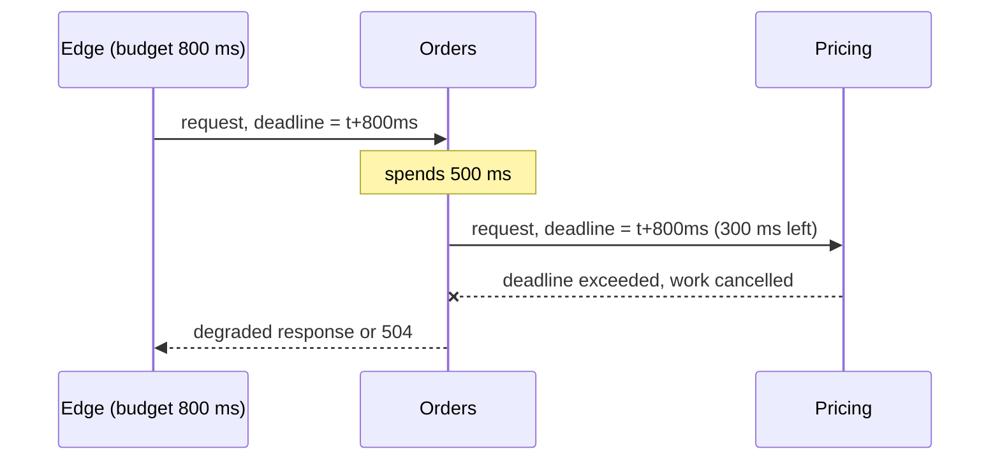
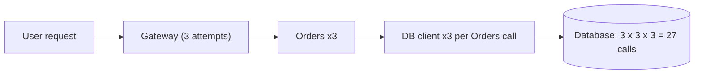
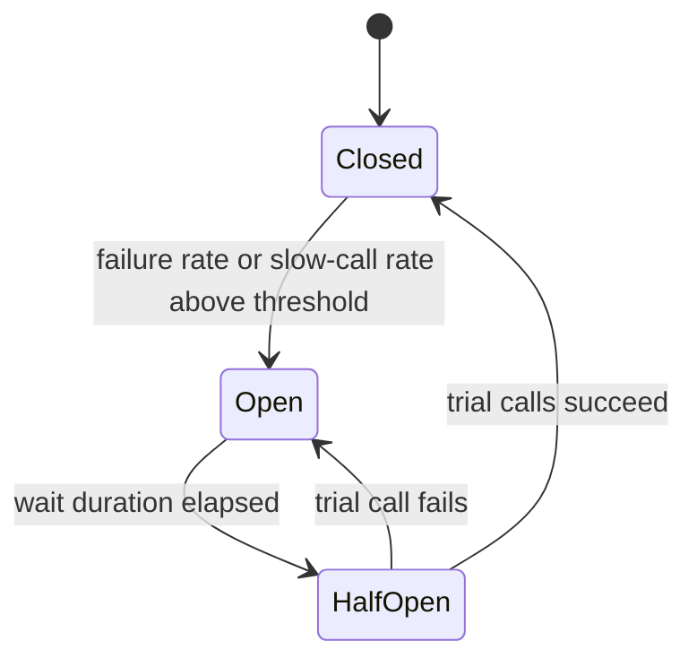

import Tabs from '@theme/Tabs';
import TabItem from '@theme/TabItem';

:::tip Key takeaways
- With fan-out, tail latency becomes the common case. At 100 calls, a 1-in-100 slow dependency hits **63%** of requests.
- Every remote call needs a **timeout**, and the deadline should be propagated so downstream work stops when the caller gives up.
- Retry at **one layer only**, with backoff, jitter and a budget. Retries at every layer multiply load during an outage.
- Retries are only safe on **idempotent** operations. Use idempotency keys for writes.
- Under overload, **shed load early** (reject cheaply) rather than queueing until everything times out.
:::

## Cheat sheet

| Pattern | Failure it addresses | Trap |
|---|---|---|
| Timeout + deadline | Slow dependency holds threads and connections | Timeouts longer than the caller's own deadline do nothing useful |
| Retry + backoff + jitter | Transient errors (blips, leader failover) | Retrying non-idempotent writes; retries at several layers |
| Retry budget | Retry storms during a real outage | Without a budget, retries add load exactly when capacity is lowest |
| Circuit breaker | A dependency that is down or degraded | Breaker per host vs. per endpoint; a half-open probe that's too aggressive |
| Bulkhead | One slow dependency exhausting a shared pool | Pools sized by guesswork; too many small pools waste capacity |
| Rate limiting | A noisy client or tenant | Limits per instance, not global, so they drift as you scale |
| Load shedding | Overload of the service itself | Shedding after the expensive work instead of at the door |
| Fallback / degradation | Non-critical dependency failing | Fallbacks that are never exercised and fail when needed |

Libraries such as **Resilience4j** implement these in-process. A **service mesh** (Envoy-based) can apply timeouts,
retries and outlier detection at the network layer. Pick one owner per concern: mesh retries plus library retries is
the classic double-retry bug. See [Cross-Cutting Concerns](./cross-cutting).

## Fan-out and tail latency

If one call is slow 1% of the time, a request that fans out to N calls is slow with probability **1 − 0.99^N**.
The P99 of a dependency becomes the median of the caller.

| Fan-out N | P(at least one slow call) |
|---|---|
| 1 | 1% |
| 10 | 10% |
| 100 | 63% |

<details>
<summary>What to do about it</summary>

- **Reduce fan-out.** Aggregate or cache data the request needs, or keep a local read model fed by events. See
  [Data Consistency](./data-consistency).
- **Parallelise** independent calls, so the request takes the slowest call, not the sum.
- **Hedged requests**: if a call hasn't returned by the P95, send a second copy to another replica and take the
  first response. This cuts the tail at the cost of a few percent extra load. Only safe for idempotent reads.
- **Measure P99 and P99.9 per dependency**, not just averages. Averages hide exactly this problem.

</details>

## Timeouts and deadline propagation

Set a timeout on every remote call, and derive it from the caller's remaining budget. If the edge gives a request
800 ms, a service that has already spent 500 ms should call downstream with at most 300 ms, not its own default of 2 s.

<details>
<summary>How deadline propagation works</summary>

- gRPC propagates deadlines natively (`grpc-timeout` header). Each hop sees the remaining time.
- For HTTP, pass a deadline or remaining-budget header and have the client library honour it.
- When the deadline passes, **cancel downstream work**. Otherwise you keep doing work that nobody will read.
- Separate connect timeout (short, e.g. 100–500 ms) from request timeout (based on the latency SLO).



</details>

## Retries: backoff, jitter and budgets

Retry only transient failures (connection reset, 503, 429 with `Retry-After`), only idempotent operations, and only
at one layer. Use exponential backoff with **full jitter** so clients don't retry in lockstep.

<details>
<summary>Retry amplification: 3 layers × 3 attempts = 27 calls</summary>

If the gateway, the service and its client library each try 3 times, one user request becomes 27 calls to the
failing database, right when it's least able to cope.



Fixes:
- **Retry at one layer**, usually the one closest to the failing dependency, and fail fast everywhere else.
- **Retry budget**: allow retries up to, say, 10% of normal traffic per client. Once the budget is spent, fail
  instead of retrying. Envoy and gRPC support this directly.
- Honour `Retry-After` and treat 429 and 503 as signals to slow down.

</details>

<details>
<summary>Backoff with full jitter (code)</summary>

```java
// sleep = random(0, min(cap, base * 2^attempt))
long backoffMillis(int attempt) {
    long exp = Math.min(CAP_MS, BASE_MS * (1L << attempt));
    return ThreadLocalRandom.current().nextLong(exp + 1);
}
```

Resilience4j equivalent: `IntervalFunction.ofExponentialRandomBackoff(base, 2.0, 0.5)`.

</details>

:::warning Idempotency is a prerequisite
A timeout doesn't mean the call failed; it means you don't know. Retrying `POST /payments` after a timeout can
charge twice. Give writes an **idempotency key** that the server stores with the result, and return the stored
result for repeats. The same applies to message consumers; see [Messaging](./messaging-brokers).
:::

## Circuit breakers

A breaker stops calling a dependency that is failing, so callers fail fast instead of waiting on timeouts, and the
dependency gets room to recover.

<details>
<summary>State machine</summary>



- Trip on **failure rate and slow-call rate** over a sliding window, with a minimum number of calls so a single
  error at low traffic doesn't trip it.
- Scope the breaker to the right unit. One breaker for a whole host can block healthy endpoints; one per endpoint
  is usually right.
- When open, return a fallback (cached value, default, partial response) or a fast error. Don't queue.
- Mesh equivalent: Envoy **outlier detection** ejects individual bad replicas, which a client-side breaker can't see.

</details>

## Bulkheads, rate limiting and load shedding

<Tabs>
<TabItem value="bulkhead" label="Bulkhead">

Isolate resources per dependency (separate thread pools, connection pools or semaphores), so a slow recommendation
service can't take all the threads the checkout path needs. In Kubernetes, separate deployments for critical and
non-critical traffic are a coarser bulkhead.

</TabItem>
<TabItem value="rate" label="Rate limiting">

Protects the service from a client: per API key, tenant or IP, usually at the gateway with a token bucket. Use a
shared store (Redis) or the gateway's global limiter if limits must hold across instances. Return 429 with
`Retry-After`.

</TabItem>
<TabItem value="shed" label="Load shedding">

Protects the service from itself. When concurrency or queue time exceeds a threshold, reject new work immediately
(503) instead of accepting it and timing out later. Shed by priority: drop batch and prefetch traffic before user
checkouts. Adaptive concurrency limits (e.g. Netflix `concurrency-limits`, Envoy adaptive concurrency) set the
threshold from observed latency.

</TabItem>
</Tabs>

:::danger Unbounded queues turn overload into an outage
A queue in front of a saturated service grows until every request waits longer than its caller's timeout. The
service then does 100% useless work. Bound queues and reject at the door.
:::

## Graceful degradation and fallbacks

Classify dependencies as **critical** (checkout can't work without payments) or **optional** (recommendations,
reviews). Optional ones get a fast timeout and a fallback, so their failure degrades the page instead of failing it.

<details>
<summary>Fallback options and their risks</summary>

| Fallback | Use when | Risk |
|---|---|---|
| Cached or stale value | Data changes slowly (catalogue, config) | Serving stale data for too long; set a max staleness |
| Default / empty | Feature is optional | Users may not notice it's broken; alert on fallback rate |
| Partial response | Aggregations (one panel fails) | Clients must handle missing sections |
| Queue for later | Writes that can be async (emails, analytics) | Needs durable storage and idempotent replay |

Test fallbacks with fault injection (mesh fault injection, chaos experiments). A fallback path that only runs during
incidents is usually broken.

</details>

## Health checks and readiness

Liveness answers "is this process stuck?"; readiness answers "should I receive traffic now?". Neither should check
downstream dependencies: if the database blips, failing liveness everywhere restarts the whole fleet at once.

<details>
<summary>What each check should test</summary>

| Check | Should test | Should not test |
|---|---|---|
| Liveness | Process responsive, no deadlock | Database, other services |
| Readiness | Warmed up, own pools initialised, not draining | Optional dependencies |
| Deep health (dashboards) | Dependency status for humans | Anything that drives restarts |

On shutdown, fail readiness first, drain in-flight requests, then exit. Kubernetes probe configuration is covered in
[Kubernetes](/docs/platform/kubernetes).

</details>

## References

- [The Tail at Scale (Dean and Barroso, CACM 2013)](https://research.google/pubs/the-tail-at-scale/)
- [Exponential Backoff and Jitter (AWS Architecture Blog)](https://aws.amazon.com/blogs/architecture/exponential-backoff-and-jitter/)
- [Timeouts, retries and backoff with jitter (Amazon Builders' Library)](https://aws.amazon.com/builders-library/timeouts-retries-and-backoff-with-jitter/)
- [Using load shedding to avoid overload (Amazon Builders' Library)](https://aws.amazon.com/builders-library/using-load-shedding-to-avoid-overload/)
- [Resilience4j documentation](https://resilience4j.readme.io/)
- [Google SRE Book: Handling Overload](https://sre.google/sre-book/handling-overload/)
