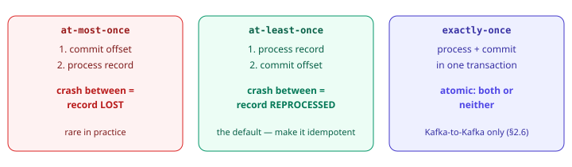
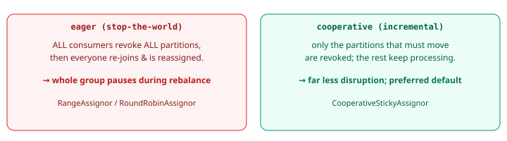

import Tabs from '@theme/Tabs';
import TabItem from '@theme/TabItem';

:::tip Key takeaways
- Delivery semantics are decided by **when you commit the offset** relative to when processing finishes.
- The pragmatic production default is **at-least-once + idempotent processing**.
- `max.poll.interval.ms` evicts consumers whose processing is slow, even if heartbeats are fine.
- Use **cooperative rebalancing + static membership** on Kubernetes.
- A record that fails forever blocks its partition. Route it to a **dead-letter topic (DLT)**.
:::

## Delivery semantics

| Semantics | Commit timing | Failure result |
|---|---|---|
| At-most-once | Commit **before** processing | A crash after commit loses the record |
| At-least-once | Commit **after** processing | A crash before commit reprocesses the record (duplicate) |
| Exactly-once | Offset and output commit atomically | Only within Kafka; see [Exactly-Once](./exactly-once) |

<details>
<summary>Diagram: where duplicates and data loss come from</summary>



</details>

<details>
<summary>Manual commit for at-least-once (code)</summary>

In Spring, control this with the container's **ack mode**, and turn off the client's auto-commit.

```java
// application.yml: spring.kafka.consumer.enable-auto-commit: false
// spring.kafka.listener.ack-mode: MANUAL   (you ack explicitly)

@KafkaListener(topics = "orders", groupId = "fulfilment")
void onOrder(OrderPlaced order, Acknowledgment ack) {
    processIdempotently(order);   // safe to run twice (upsert / dedup key)
    ack.acknowledge();            // commit ONLY after success → at-least-once
}
```

</details>

<details>
<summary>What "idempotent processing" means in practice</summary>

Give each event a natural key (e.g. `orderId`) and make the write an upsert, or record processed IDs and skip
duplicates. At-least-once then behaves like exactly-once from the outside, without the cost and constraints of
Kafka transactions.

</details>

## Rebalancing and the poll loop

A **rebalance** reassigns a group's partitions whenever membership changes: a consumer joins, leaves, or is presumed
dead. Two timers decide "dead":

| Timer | Checks | You're evicted when |
|---|---|---|
| `session.timeout.ms` + `heartbeat.interval.ms` | The consumer is alive (background heartbeat thread) | Heartbeats stop for the session window |
| `max.poll.interval.ms` | Your **processing** is alive | You don't call `poll()` again within the window |

:::warning The CommitFailedException trap
A batch takes too long, the coordinator reassigns your partitions mid-flight, and your commit is rejected because
you no longer own them. Fix it with a smaller `max.poll.records`, a larger `max.poll.interval.ms`, or by moving heavy
work off the poll thread. See [rebalance storms](./production#rebalance-storms).
:::

### Eager vs. cooperative rebalancing

<details>
<summary>Diagram and recommended config</summary>



```yaml title="application.yml"
spring:
  kafka:
    consumer:
      properties:
        partition.assignment.strategy: org.apache.kafka.clients.consumer.CooperativeStickyAssignor
        # static membership: a rolling restart won't trigger a rebalance
        # if the pod rejoins within session.timeout.ms with the same id
        group.instance.id: "${POD_NAME}"   # unique & stable per instance
```

</details>

Static membership matters on Kubernetes: without it, every pod restart reshuffles the whole group. With it, a quick
restart is invisible to the group.

## Error handling: retries and dead-letter topics

By default, a record that always fails blocks its partition forever, because the consumer keeps redelivering it.
Retry transient failures and quarantine permanent ones. Spring Kafka has two models:

<Tabs>
<TabItem value="blocking" label="Blocking retries">

`DefaultErrorHandler` retries in place with a backoff, then hands the record to a recoverer (usually publishing to
a `.DLT` topic). Simple, but the partition is paused during retries.

```java
@Bean
DefaultErrorHandler errorHandler(KafkaTemplate<?,?> template) {
    var recoverer = new DeadLetterPublishingRecoverer(template);  // → orders.DLT
    var backoff = new ExponentialBackOffWithMaxRetries(3);
    backoff.setInitialInterval(500); backoff.setMultiplier(2.0);
    var handler = new DefaultErrorHandler(recoverer, backoff);
    // permanent errors skip retries and go straight to the DLT
    handler.addNotRetryableExceptions(ValidationException.class);
    return handler;
}
```

</TabItem>
<TabItem value="non-blocking" label="Non-blocking retries">

`@RetryableTopic` routes failures to separate retry topics with increasing delays, then a DLT, so the main partition
keeps flowing. Better when one bad key shouldn't stall everyone.

```java
@RetryableTopic(attempts = "4", backoff = @Backoff(delay = 1000, multiplier = 2.0))
@KafkaListener(topics = "orders", groupId = "fulfilment")
void onOrder(OrderPlaced order) { /* throws → orders-retry-0, -1, ... then orders-dlt */ }

@DltHandler
void dlt(OrderPlaced order) { log.error("parked in DLT: {}", order.orderId()); }
```

</TabItem>
</Tabs>

:::danger Poison pill
A record that can't be deserialized fails **before** your listener runs, so retries loop forever on the same
offset. Wrap your real deserializer in `ErrorHandlingDeserializer`. It turns the failure into a handled record that
the error handler can route to the DLT.
:::
