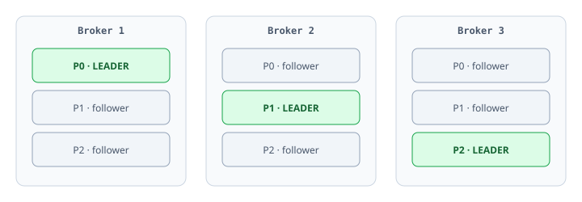
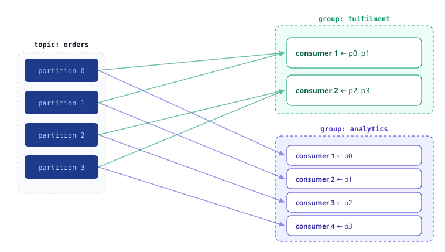

:::tip Key takeaways
- A topic is split into partitions; each partition has one **leader** replica and follower replicas. The **ISR** is the set of followers that are caught up.
- Within a group, **active consumers ≤ partitions**. Extra consumers sit idle.
- Same key → same partition → ordered. Adding partitions later can move a key to a different partition.
- A new consumer group with the default `auto-offset-reset=latest` sees nothing produced before it joined.
:::

## Topics, partitions, brokers, replicas

A **topic** is a named stream split into **partitions**. A **broker** is a server in the cluster, and partitions are
spread across brokers. Each partition has one **leader** that handles all reads and writes, plus N−1 **followers**
that copy the leader for durability.

<details>
<summary>In-sync replicas (ISR) and failover</summary>

The ISR is the set of replicas currently caught up with the leader. If the leader dies, a follower from the ISR is
promoted. How many replicas must acknowledge a write is controlled by `acks` and `min.insync.replicas`; see
[Producers](./producers).



Each partition's leader sits on a different broker to spread load. Every partition is replicated 3×, so any single
broker can fail without data loss.

</details>

## Consumer groups and parallelism

In Spring you don't write the poll loop; the listener container polls, deserializes, calls your method and commits
offsets.

:::info The rule that governs scaling
Within one group, a partition is assigned to **exactly one** consumer.
- Active consumers per group ≤ partition count.
- More consumers than partitions = idle consumers.
- Scale throughput by adding partitions and consumers together.
:::

<details>
<summary>Diagram: how groups divide partitions</summary>



- **fulfilment** has 2 consumers, so each owns 2 partitions.
- **analytics** has 4 consumers, 1 partition each.
- Both groups see all four partitions, at their own offsets.

</details>

<details>
<summary>Scaling with threads vs. pods</summary>

`@KafkaListener(concurrency = "3")` starts 3 consumer threads in one app instance. You can also scale with more app
instances (e.g. Kubernetes pods) sharing the same `groupId`; Kafka rebalances partitions across all group members.
A different `groupId` is a separate reader that gets its own copy of every record.

</details>

## Keys, partitioning and ordering

The default partitioner does roughly `partition = hash(key) % partitionCount`. Records with the same key go to the
same partition and are strictly ordered relative to each other. A **null key** spreads records across partitions
(modern clients batch "stickily"): more throughput, but **no ordering across partitions**.

:::warning Adding partitions changes the key mapping
`hash(key) % N` depends on N. Add partitions to an existing topic and a key can start landing on a different
partition, so old and new records for that key may sit in two partitions with no ordering between them. Get the
partition count right up front; see [Production](./production#how-many-partitions).
:::

<details>
<summary>How to choose a key</summary>

| Need | Key choice |
|---|---|
| Per-entity ordering | The entity id: `customerId`, `orderId`, `accountId` |
| Maximum throughput, order irrelevant | Null key; let records spread |
| One key dominates volume | Watch for hot partitions; you may need a composite key (see [Production](./production#consumer-lag-and-hot-partitions)) |

</details>

## Offsets: where a consumer "is"

Each group tracks a committed offset per partition, stored in the internal topic `__consumer_offsets`, not on the
consumer. A restarted or replaced instance resumes from the committed position. By default Spring commits after
your listener returns successfully.

When a group has no committed offset yet (a brand-new group, or offsets expired), `auto-offset-reset` decides
where to start:

| Value | Starts at | Use |
|---|---|---|
| `earliest` | Beginning of the log; reads all history | Dev, so you see your test messages |
| `latest` (default) | The head; only records produced after joining | Typical production default |

<details>
<summary>The classic "it's not working"</summary>

You produce 100 messages, then start a consumer with a fresh group and the default `latest`, and see nothing. The
messages are all there; the consumer just started reading past them. Set `earliest`, or produce again while it runs.

</details>

## Serialization

Kafka only moves **byte arrays**. Serializers/deserializers (SerDes) convert objects to bytes and back. JSON
(Spring's `JsonSerializer` / `JsonDeserializer`) is the zero-ceremony option.

:::warning Trusted packages
`JsonDeserializer` refuses to instantiate arbitrary classes. Whitelist your event packages with
`spring.json.trusted.packages` (or `"*"` in dev only), or every record fails at deserialization.
:::

<details>
<summary>The error you get without it</summary>

```text
org.springframework.kafka.support.serializer.DeserializationException:
  ... caused by IllegalArgumentException:
  The class 'com.example.orders.events.OrderPlaced' is not in the trusted packages.
  ... If you believe this class is safe to deserialize, add it to
  spring.json.trusted.packages.
```

</details>

<details>
<summary>Type headers, and why JSON isn't enough in production</summary>

`JsonSerializer` writes the Java class name into a record header, and the deserializer reads it to know what to
build. That's convenient, but it couples producer and consumer class names unless you configure type mapping.

JSON also has no enforced schema: a producer can add or rename a field and silently break consumers. That's why
most serious Kafka setups use Avro with a Schema Registry; see [Schemas](./schemas).

</details>
