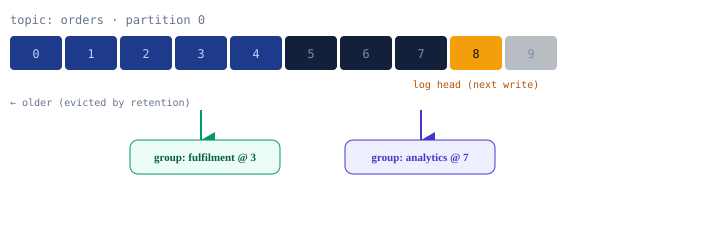

import DocCardList from '@theme/DocCardList';

:::tip Key takeaways
- A Kafka topic is an **append-only log**, not a queue. Reading a record doesn't delete it; retention does.
- The **partition** is the unit of ordering, parallelism and storage. Ordering only holds within a partition, i.e. per key.
- Within a **consumer group**, each partition has exactly one consumer. Different groups read the same log independently.
- Delivery semantics come down to **when you commit the offset** relative to when you finish processing.
:::

## The mental model: a log, not a queue

A traditional message queue (JMS, RabbitMQ) is a to-do list: the broker hands a message to one consumer, the consumer
acks, and the message is deleted. In Kafka, records stay on disk until a retention policy (time or size) evicts them,
no matter who has read them.

Why this matters: three consequences

- **Replay is free.** A consumer just moves its read position (offset) backwards. Reprocess a day of events by
  resetting an offset; nothing needs to be republished.
- **Many readers, one log.** Any number of consumer groups read the same topic at their own pace. Analytics, fraud
  and fulfilment can all consume `orders` without taking records from each other.
- **Position is separate from storage.** A consumer's offset is stored apart from the data, so a slow consumer never
  makes messages pile up for anyone else.

The same log has two readers at two offsets. Fulfilment is behind analytics; neither affects the other, and the
records at offsets 3–7 still exist for both.

## Cheat sheet

| Concept | One-liner |
|---|---|
| Log | Topics are append-only logs. Reading ≠ deleting; retention evicts, not consumption. |
| Partition | Unit of ordering, parallelism and storage. Ordering holds only within a partition. |
| Key | `hash(key) % N` picks the partition. Same key = ordered; null key = spread across partitions. |
| Consumer group | One consumer per partition per group. Parallelism ≤ partitions. A new group is an independent reader. |
| Replica | One leader plus followers. The ISR is the caught-up set; it lets the cluster survive a broker loss. |
| SerDe | Kafka moves bytes. JSON for learning; Avro + Schema Registry in production. |
| Offset | Per group and partition position, stored in `__consumer_offsets`. `auto-offset-reset` applies to new groups. |

## Pages in this section

<DocCardList />

Messaging concepts that aren't specific to Kafka (brokerless vs. broker-based, ordering, duplicates, transactional
messaging) are in [Messaging Communication](/docs/architecture/microservices/messaging-brokers).
