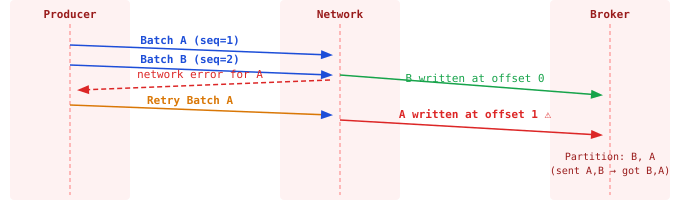
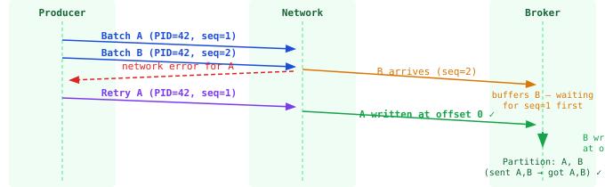

import Tabs from '@theme/Tabs';
import TabItem from '@theme/TabItem';

:::tip Key takeaways
- The standard safe setup is `acks=all` with `min.insync.replicas=2`.
- Leave **idempotence on** (the default). It dedupes the producer's own retries and preserves per-partition order.
- A little `linger.ms` plus compression is often the biggest throughput win.
:::

## How a send works

`send()` doesn't hit the broker immediately. The record is serialized, assigned a partition, and put in an in-memory
buffer. The client **batches** records per partition, and a background I/O thread ships the batches.

## The four knobs

| Setting | What it does | Trade-off |
|---|---|---|
| `acks` | `0`: fire-and-forget. `1`: leader-only ack. `all`: wait for all in-sync replicas. | `0` can lose data; `1` loses data if the leader dies before replicating; `all` is durable. |
| `enable.idempotence` | De-duplicates retries and keeps per-partition order. On by default. | Forces `acks=all`, `retries > 0`, `max.in.flight ≤ 5`. |
| `batch.size` + `linger.ms` | A batch is sent when it fills to `batch.size` bytes or after `linger.ms`. | 5–20 ms of linger trades a little latency for much higher throughput. |
| `compression.type` | `lz4` / `zstd` compress the whole batch. | Bigger batches compress better; often the biggest network win. |

<details>
<summary>Recommended producer config</summary>

```yaml title="application.yml"
spring:
  kafka:
    producer:
      acks: all
      properties:
        enable.idempotence: true
        linger.ms: 10          # wait up to 10ms to fill a batch
        batch.size: 65536       # 64 KB batches
        compression.type: zstd
        max.in.flight.requests.per.connection: 5
```

On a managed service (e.g. Confluent Cloud), `min.insync.replicas` is set by the provider, but `acks=all` is still
your call, and it's the default you want for anything that matters.

</details>

## Retries and ordering

:::warning Retries can reorder records without idempotence
With `max.in.flight.requests.per.connection > 1` and retries, a retried batch can land after a batch sent later,
reordering records within a partition. With idempotence on, the broker restores order using sequence numbers, so you
keep both pipelining and ordering. This is why you almost never turn idempotence off.
:::

<Tabs>
<TabItem value="without" label="Without idempotence">

`max.in.flight=2`, retries enabled: the retried batch is written after the later one.



</TabItem>
<TabItem value="with" label="With idempotence">

`enable.idempotence=true`: the broker uses sequence numbers to keep the original order.



</TabItem>
</Tabs>
