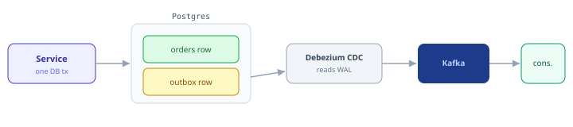
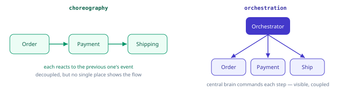

import Tabs from '@theme/Tabs';
import TabItem from '@theme/TabItem';

:::tip Key takeaways
- You can't atomically write to a database and publish to Kafka. Use the **transactional outbox**.
- **Consumer lag** is the most important health metric. Lag concentrated on one partition means a hot key.
- Size partitions to measured need plus ~30% headroom. Over-partitioning has real costs.
- Cross-cluster replication is async, so disaster recovery always has a non-zero RPO.
:::

## The dual-write problem and the transactional outbox

There's no shared transaction between your database and Kafka, so a crash between the two writes leaves them
inconsistent: the order is saved but the event is never sent, or the reverse. Retries don't fix it, because the
process can die mid-retry.

The **transactional outbox** writes the event to an outbox table **in the same local database transaction** as the
business data. A separate relay ships outbox rows to Kafka, usually **Debezium** (CDC reading the database's
write-ahead log); a polling publisher is the simpler fallback.

<details>
<summary>Diagram and code</summary>



```java
@Transactional                                  // DB transaction only
public void placeOrder(Order order) {
    orderRepository.save(order);
    outboxRepository.save(new OutboxEvent(       // same tx as the order
        "OrderPlaced", order.getId(), toJson(order)));
    // commit → both rows durable atomically. Debezium publishes the outbox row.
}
```

</details>

<details>
<summary>Outbox vs. Kafka exactly-once</summary>

[Kafka transactions](./exactly-once) give exactly-once **within Kafka**. The outbox gives consistency **between a
database and Kafka**. They solve different halves of the problem. Most services need the outbox, because they own
state in a database. Downstream consumers should still be idempotent, since CDC delivers at-least-once.

</details>

## Consumer lag and hot partitions

For each partition, **lag = log-end offset − committed offset**: how many records the consumer is behind. Steady lag
is fine; growing lag means the consumer can't keep up.

<details>
<summary>Diagram: consumer lag</summary>


</details>

When lag concentrates on **one partition**, you have a **hot partition**, usually from key skew. One dominant key
hashes to one partition, and only one consumer per group can work a partition, so you can't scale out of it.

<details>
<summary>Mitigations</summary>

| Option | When |
|---|---|
| Route the heavy key(s) to a dedicated topic or handling path | You need per-key ordering for everyone else |
| Composite / salted key to spread the hot key | You can relax ordering for that key |
| Custom partitioner | You need control over placement |

</details>

### Rebalance storms

:::danger The CommitFailedException incident
A group rebalances repeatedly and consumers throw `CommitFailedException`, never making progress. The root cause is
almost always processing that exceeds `max.poll.interval.ms` (or frequent restarts or long GC pauses). Each eviction
triggers a rebalance, which slows everyone, which causes more evictions.
:::

Break the cycle with [cooperative rebalancing and static membership](./consumers#eager-vs-cooperative-rebalancing),
a smaller `max.poll.records`, and moving slow work off the poll thread.

## How many partitions?

Partition count is the parallelism dial, but more isn't free. Teams often pick 100 partitions "to be safe" and
inherit the costs.

<Tabs>
<TabItem value="buy" label="More partitions buy">

- Higher maximum consumer parallelism (one consumer per partition per group)
- More producer and broker throughput headroom

</TabItem>
<TabItem value="cost" label="More partitions cost">

- More open file handles and memory
- Longer leader election and failover
- Slower, heavier rebalances
- Higher end-to-end latency (each partition adds replication overhead)

</TabItem>
<TabItem value="sizing" label="Sizing example">

```text
target throughput        = 60,000 msgs/sec
per-partition ceiling    ≈ 10,000 msgs/sec  (measure yours!)
partitions for producer  = 60,000 / 10,000  = 6

consumer side: one consumer handles ~5,000 msgs/sec
consumers needed         = 60,000 / 5,000   = 12
→ need ≥ 12 partitions so all 12 consumers get work

choose max(producer_need, consumer_need) = 12, then add ~30% headroom → ~16
```

</TabItem>
</Tabs>

Remember that increasing partitions later changes `hash(key) % N` and breaks per-key ordering across the boundary.
See [Core Concepts](./core-concepts#keys-partitioning-and-ordering).

## Cross-cluster replication and disaster recovery

A single cluster is one failure domain. For disaster recovery or geo-locality, replicate to a second cluster.

| Mechanism | How it works | Failover |
|---|---|---|
| MirrorMaker 2 | Built on Kafka Connect; replicates topics, configs and consumer-group offsets. Active-passive or active-active. | Offset translation lets consumers resume near where they left off |
| Cluster Linking (Confluent) | Broker-native, byte-for-byte replication that preserves offsets | Cleaner: no offset translation |

<details>
<summary>RPO and RTO</summary>

Disaster recovery planning is about **RPO** (how much data you can afford to lose) and **RTO** (how fast you must
recover). Async replication means a non-zero RPO by definition, since the failover cluster is always slightly
behind. Design consumers to tolerate a small replay window on failover.

</details>

## Event-driven design: choreography vs. orchestration

When services communicate through events, you choose how a multi-step business process is coordinated.

<details>
<summary>Diagram: choreography vs. orchestration</summary>



</details>

| Style | How | Pros | Cons |
|---|---|---|---|
| Choreography | Services emit events; others react | Maximally decoupled | End-to-end flow is emergent and hard to see |
| Orchestration | A central coordinator drives each step | Visible, easy to change | The coordinator is a coupling point |

Either way, a **saga** provides cross-service "transactions": a sequence of local transactions, each with a
compensating action that undoes earlier steps if a later one fails. See [Saga Pattern](/docs/architecture/patterns/sagas).

<details>
<summary>Also worth knowing: CQRS, event sourcing and event styles</summary>

- **CQRS + event sourcing:** treat the Kafka log as the source of truth and build read-optimized views (often Kafka
  Streams KTables) by replaying events.
- **Event style:** thin "notification" events carry just an ID and the consumer fetches the details. "Event-carried
  state transfer" puts the data in the event: fewer callbacks and looser coupling, but bigger payloads.

</details>

## Kafka in a typical company

<details>
<summary>What a developer usually owns</summary>

- **Managed Kafka** (e.g. Confluent Cloud, Amazon MSK): the provider runs brokers, replication and placement. You
  own topic design, client config and schemas; `acks` is still your call.
- **Schema governance:** schemas are registered through CI and compatibility-checked. See [Schemas](./schemas).
- **A shared Streams platform:** you build topologies; the platform runs them. See [Streams & Connect](./streams-connect).
- **Event standards:** conventions for topic naming and the shape of business events. Check your company's
  internal guides for the exact rules.

</details>
