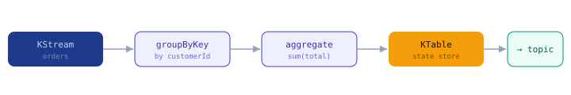

import Tabs from '@theme/Tabs';
import TabItem from '@theme/TabItem';

:::tip Key takeaways
- **Kafka Streams** is a library embedded in your JVM app, not a separate cluster.
- A **KStream** is a sequence of events; a **KTable** is the latest value per key (a changelog).
- State lives in local **state stores** (RocksDB) backed by compacted changelog topics, so it survives restarts.
- **Kafka Connect** moves data in and out of Kafka with configuration, not code.
:::

## Kafka Streams

Aggregations turn a stream into a table. Because state stores are backed by changelog topics, state is rebuilt after
restarts and rebalances.

<details>
<summary>Example: revenue per customer (diagram and code)</summary>



```java
StreamsBuilder b = new StreamsBuilder();
b.<String,OrderPlaced>stream("orders")
 .groupByKey()
 .aggregate(() -> 0.0,
            (custId, order, sum) -> sum + order.total(),
            Materialized.as("revenue-by-customer"))   // state store
 .toStream()
 .to("customer-revenue");
// windowing example: revenue per customer per rolling hour
// .windowedBy(TimeWindows.ofSizeWithNoGrace(Duration.ofHours(1)))
```

</details>

<Tabs>
<TabItem value="windows" label="Windowing">

Windows bound aggregations in time:

| Window | Behaviour |
|---|---|
| Tumbling | Fixed size, non-overlapping |
| Hopping | Fixed size, overlapping (advance < size) |
| Sliding | Defined by the time difference between records |
| Session | Bounded by gaps of inactivity per key |

</TabItem>
<TabItem value="joins" label="Joins">

| Join | Use |
|---|---|
| Stream–stream | Correlate two event streams; **must be windowed** |
| Stream–table | Enrich each event with the latest state for its key (local lookup, no window) |
| Table–table | Relate two changelogs |

</TabItem>
<TabItem value="eos" label="Exactly-once">

Set `processing.guarantee=exactly_once_v2` and Streams gives you exactly-once across the whole topology.

</TabItem>
</Tabs>

<details>
<summary>Running Streams apps in practice</summary>

Many companies run Kafka Streams apps on a shared internal platform. You write the topology, and the platform
handles deployment, scaling and state-store operations, so you don't stand up your own streams infrastructure.

</details>

## Kafka Connect

Connect is a cluster of worker processes that run **connectors** as configuration:

| Piece | Role |
|---|---|
| Source connector | Brings data **into** Kafka |
| Sink connector | Writes data **out of** Kafka |
| Task | A unit of parallelism; a connector splits into tasks |
| Converter | Serialization (e.g. Avro) |
| SMT (single message transform) | Lightweight per-record transforms |

<details>
<summary>Register a JDBC sink connector (code)</summary>

```bash
# POST to the Connect REST API
curl -X POST http://connect:8083/connectors -H "Content-Type: application/json" -d '{
  "name": "orders-jdbc-sink",
  "config": {
    "connector.class": "io.confluent.connect.jdbc.JdbcSinkConnector",
    "topics": "orders.enriched",
    "connection.url": "jdbc:postgresql://db/analytics",
    "tasks.max": "3",
    "value.converter": "io.confluent.connect.avro.AvroConverter"
  }
}'
```

</details>

**Connect or a custom consumer?** Use Connect for standard integrations (JDBC, S3, Elasticsearch, or Debezium CDC
to capture database changes). Write your own consumer when there's real business logic. Debezium is also the engine
behind the [transactional outbox](./production#the-dual-write-problem-and-the-transactional-outbox).
