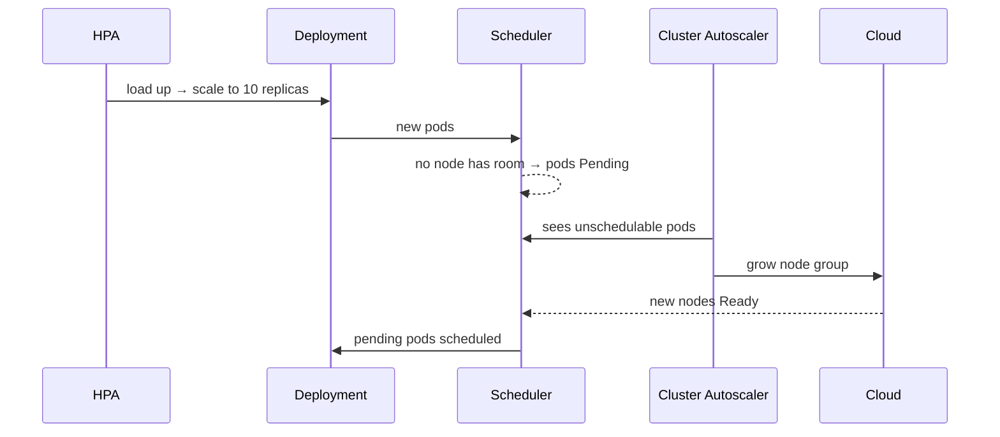

import Tabs from '@theme/Tabs';
import TabItem from '@theme/TabItem';

:::tip Key takeaways
- **HPA** adds or removes pods, **VPA** resizes them, and the **Cluster Autoscaler** (or Karpenter) adds or removes nodes. They work at different layers.
- HPA utilization is a percentage of **requests**, so without requests HPA can't work.
- Don't let **HPA and VPA both act on CPU/memory** for the same workload; they fight each other.
- **KEDA** scales on event sources (queue depth, Kafka lag, cron) and can scale **to zero**.
- Pod autoscaling only helps if there's room on the nodes. Pending pods are what trigger node autoscaling.
:::

## The autoscalers at a glance

| Autoscaler | Scales | Signal | Scale to zero | Notes |
|---|---|---|---|---|
| HPA | Replica count | CPU/memory utilization, custom metrics, external metrics | No (min 1) | Built in; needs metrics-server |
| VPA | Requests/limits per pod | Historical usage | n/a | Add-on; applies changes by recreating pods |
| KEDA | Replica count (drives an HPA) | 60+ event sources | **Yes** | Add-on; also `ScaledJob` for jobs |
| Cluster Autoscaler | Nodes in node groups | Pending pods / underused nodes | Node groups to min | Works with pre-defined node groups |
| Karpenter | Nodes (provisioned directly) | Pending pods | Yes | Picks instance types per workload; faster and bin-packs better |

<details>
<summary>How the layers chain together</summary>



</details>

## Horizontal Pod Autoscaler (HPA)

HPA checks metrics every 15 s and sets `replicas` on a Deployment or StatefulSet:

`desired = ceil(currentReplicas × currentMetric / targetMetric)`

For example, 4 pods at 90% CPU with a 60% target gives `ceil(4 × 90/60) = 6`. With several metrics, HPA computes a
count for each one and uses the **largest**.

<details>
<summary>HPA with scale-up and scale-down behaviour</summary>

```yaml
apiVersion: autoscaling/v2
kind: HorizontalPodAutoscaler
metadata:
  name: orders-service
  namespace: shop
spec:
  scaleTargetRef:
    apiVersion: apps/v1
    kind: Deployment
    name: orders-service
  minReplicas: 3
  maxReplicas: 20
  metrics:
    - type: Resource
      resource:
        name: cpu
        target: { type: Utilization, averageUtilization: 70 }   # % of requests
  behavior:
    scaleUp:
      stabilizationWindowSeconds: 0        # react immediately
      policies:
        - { type: Percent, value: 100, periodSeconds: 15 }
        - { type: Pods,    value: 4,   periodSeconds: 15 }
      selectPolicy: Max                    # use the more aggressive policy
    scaleDown:
      stabilizationWindowSeconds: 300      # wait 5 min of low load before shrinking
      policies:
        - { type: Percent, value: 50, periodSeconds: 60 }
```

Scaling up fast and down slowly prevents **flapping**, where traffic bursts make pods churn up and down.

</details>

<details>
<summary>Custom and external metrics</summary>

| Metric type | Source | Example |
|---|---|---|
| `Resource` | metrics-server | CPU, memory utilization |
| `Pods` | Custom metrics API (e.g. Prometheus Adapter) | `http_requests_per_second` per pod |
| `Object` | Custom metrics API | A metric on another object, e.g. Ingress requests |
| `External` | External metrics API | Queue depth in a cloud queue |

```yaml
metrics:
  - type: Pods
    pods:
      metric: { name: http_requests_per_second }
      target: { type: AverageValue, averageValue: "1000" }
  - type: External
    external:
      metric:
        name: queue_messages_ready
        selector: { matchLabels: { queue: orders } }
      target: { type: AverageValue, averageValue: "30" }
```

</details>

:::warning CPU is a poor signal for some workloads
I/O-bound services and queue consumers can be overloaded at low CPU. Scale them on request rate, latency, queue
depth or consumer lag instead. Memory-based HPA rarely works for the JVM, because the heap doesn't shrink after load drops.
:::

## Vertical Pod Autoscaler (VPA)

VPA watches actual usage and recommends or applies requests and limits. Use it to right-size workloads whose load doesn't
scale out well, such as singletons and batch jobs, or just to get sizing recommendations.

| Mode | Behaviour |
|---|---|
| `Off` | Recommendations only (`kubectl describe vpa`). The safe way to start. |
| `Initial` | Sets resources when a pod is created; never touches running pods |
| `Recreate` | Evicts pods to apply new values |
| `Auto` | Currently behaves like `Recreate`; uses in-place resize where the cluster supports it |

<details>
<summary>VPA example</summary>

```yaml
apiVersion: autoscaling.k8s.io/v1
kind: VerticalPodAutoscaler
metadata:
  name: report-generator
  namespace: shop
spec:
  targetRef:
    apiVersion: batch/v1
    kind: CronJob
    name: report-generator
  updatePolicy:
    updateMode: "Initial"
  resourcePolicy:
    containerPolicies:
      - containerName: app
        minAllowed: { cpu: 100m, memory: 512Mi }
        maxAllowed: { cpu: "2",  memory: 4Gi }
```

</details>

:::danger Don't combine HPA and VPA on the same resource metric
VPA raises requests, which lowers the utilization percentage, so HPA scales in, so per-pod usage goes up, and so on. If you
need both, have HPA scale on a custom or external metric and let VPA manage CPU and memory.
:::

## KEDA: event-driven autoscaling

KEDA reads an event source and feeds an HPA it manages. Below the activation threshold it scales the Deployment to
**zero**, then wakes it on the first event. Triggers include Kafka consumer lag, cloud queues, Prometheus queries and
cron schedules.

<Tabs>
<TabItem value="kafka" label="ScaledObject (Kafka lag)">

```yaml
apiVersion: keda.sh/v1alpha1
kind: ScaledObject
metadata:
  name: orders-consumer
  namespace: shop
spec:
  scaleTargetRef:
    name: orders-consumer          # a Deployment
  minReplicaCount: 0
  maxReplicaCount: 12              # no point exceeding the partition count
  pollingInterval: 30
  cooldownPeriod: 300
  triggers:
    - type: kafka
      metadata:
        bootstrapServers: kafka:9092
        consumerGroup: fulfilment
        topic: orders
        lagThreshold: "100"        # ~1 replica per 100 records of lag
```

Consumers beyond the partition count sit idle. See [Kafka consumer groups](/docs/platform/kafka/core-concepts).

</TabItem>
<TabItem value="job" label="ScaledJob (queue → Jobs)">

Creates one Job per batch of messages instead of scaling a long-running Deployment. This suits long, independent
tasks that shouldn't be interrupted by scale-in.

```yaml
apiVersion: keda.sh/v1alpha1
kind: ScaledJob
metadata:
  name: image-processor
  namespace: shop
spec:
  jobTargetRef:
    template:
      spec:
        containers:
          - name: processor
            image: registry.example.com/image-processor:2.1.0
        restartPolicy: Never
  maxReplicaCount: 10
  triggers:
    - type: rabbitmq
      metadata:
        queueName: images
        mode: QueueLength
        value: "5"
```

</TabItem>
</Tabs>

## Node autoscaling

The **Cluster Autoscaler** grows a node group when pods are Pending because nothing fits. It shrinks the group when a
node has been underused for a while and all of its pods can move elsewhere. **Karpenter** watches the same Pending pods
but creates right-sized nodes directly, without fixed node groups.

<details>
<summary>What blocks scale-down, and how pod priority helps</summary>

A node won't be removed if a pod on it can't move: a PodDisruptionBudget would be violated, the pod uses local
storage, or it isn't managed by a controller. Mark such pods with the annotation
`cluster-autoscaler.kubernetes.io/safe-to-evict: "true"` when it really is safe.

`PriorityClass` lets critical pods preempt lower-priority ones when capacity is short. A common trick is a
low-priority "overprovisioning" Deployment of placeholder pods: real pods preempt them instantly, and the evicted
placeholders trigger a node scale-up in the background.

```yaml
apiVersion: scheduling.k8s.io/v1
kind: PriorityClass
metadata:
  name: high-priority
value: 1000000
description: "Customer-facing services"
---
spec:
  priorityClassName: high-priority
```

</details>

## References
- [Horizontal Pod Autoscaling](https://kubernetes.io/docs/tasks/run-application/horizontal-pod-autoscale/)
- [Autoscaling workloads](https://kubernetes.io/docs/concepts/workloads/autoscaling/)
- [Vertical Pod Autoscaler](https://github.com/kubernetes/autoscaler/tree/master/vertical-pod-autoscaler)
- [Cluster Autoscaler](https://github.com/kubernetes/autoscaler/tree/master/cluster-autoscaler)
- [Node autoscaling](https://kubernetes.io/docs/concepts/cluster-administration/node-autoscaling/)
- [KEDA](https://keda.sh/docs/)
- [Karpenter](https://karpenter.sh/)
- [Pod priority and preemption](https://kubernetes.io/docs/concepts/scheduling-eviction/pod-priority-preemption/)
