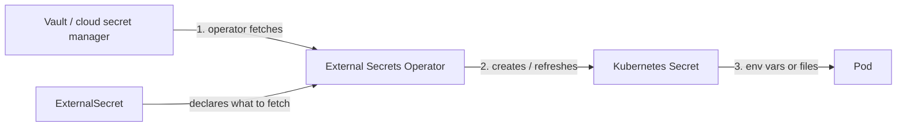

import Tabs from '@theme/Tabs';
import TabItem from '@theme/TabItem';

:::tip Key takeaways
- **ConfigMaps** hold non-sensitive config; **Secrets** hold credentials. Both are injected as env vars or mounted files.
- Env vars are read **once at container start**. Mounted files update in place (eventually), but your app must reload them.
- A Secret is **base64-encoded, not encrypted**. Turn on encryption at rest and lock down access with RBAC.
- Don't commit plain Secrets to Git. Sync them from a vault with **External Secrets Operator**, or encrypt them with **Sealed Secrets**.
:::

## ConfigMaps

A ConfigMap is a key-value object for non-sensitive settings: log levels, feature flags, whole `application.yaml` files.
It decouples config from the image, so one image can run in every environment.

| Created from | Command | Typical use |
|---|---|---|
| Literal values | `--from-literal=LOG_LEVEL=INFO` | A few simple keys |
| A file or directory | `--from-file=configs/` | Whole config files (one key per file) |
| An env file | `--from-env-file=.env.prod` | Existing `KEY=value` files |
| YAML manifest | `kubectl apply -f` | The normal, version-controlled way |

<details>
<summary>Creating ConfigMaps (commands and YAML)</summary>

```bash
kubectl create configmap app-config --from-file=configs/ -n shop
kubectl create configmap env-config \
  --from-literal=LOG_LEVEL=INFO \
  --from-literal=MAX_CONNECTIONS=100 -n shop
kubectl create configmap app-env --from-env-file=.env.prod -n shop
```

```yaml
apiVersion: v1
kind: ConfigMap
metadata:
  name: orders-config
  namespace: shop
data:
  LOG_LEVEL: INFO
  application.yaml: |
    server:
      port: 8080
```

</details>

### Env vars vs. mounted volumes

<Tabs>
<TabItem value="env" label="Env vars">

- Read once, when the container starts. **A change needs a pod restart** (`kubectl rollout restart deployment/orders-service`).
- Simple and works with any app.
- Use `envFrom` to import every key, or `valueFrom.configMapKeyRef` for one key.

```yaml
containers:
  - name: app
    image: registry.example.com/orders-service:1.4.0
    envFrom:
      - configMapRef:
          name: orders-config
    env:
      - name: LOG_LEVEL
        valueFrom:
          configMapKeyRef:
            name: orders-config
            key: LOG_LEVEL
```

</TabItem>
<TabItem value="volume" label="Mounted volume">

- Each key becomes a file. The kubelet **updates the files in place** after a change (with a delay of up to about a minute).
- The app must notice and reload: a file watcher, Spring Cloud Kubernetes, or a reloader sidecar/controller.
- `subPath` mounts **do not receive updates**.

```yaml
containers:
  - name: app
    volumeMounts:
      - name: config
        mountPath: /etc/config
        readOnly: true
volumes:
  - name: config
    configMap:
      name: orders-config
```

</TabItem>
</Tabs>

:::warning Updating a ConfigMap doesn't restart pods
Changing a ConfigMap leaves running pods on the old env vars. A common pattern is to put a hash of the config in a pod
template annotation (Helm `checksum/config`, or Kustomize's `configMapGenerator` name suffix), so a config change
triggers a rollout.
:::

<details>
<summary>Immutable ConfigMaps</summary>

Set `immutable: true` to prevent edits. To change one, create a new ConfigMap (e.g. `orders-config-v2`) and point
the Deployment at it, which also triggers a rollout. Benefits: no accidental live edits, and the kubelet stops
watching it, which reduces API server load on large clusters.

```yaml
apiVersion: v1
kind: ConfigMap
metadata:
  name: orders-config-v2
immutable: true
data:
  LOG_LEVEL: INFO
```

</details>

## Secrets

A Secret has the same shape as a ConfigMap but is meant for credentials, tokens, keystores and TLS certificates. The values
are **base64-encoded**, which anyone with read access can decode.

| Protection | What it does |
|---|---|
| RBAC | Restrict `get`/`list` on Secrets. `list` exposes every value in the namespace. |
| Encryption at rest | `EncryptionConfiguration` (or a cloud KMS provider) encrypts Secrets in etcd |
| Mount as files | Uses tmpfs, so values never touch the node disk, and they don't leak into `env` dumps or crash logs |
| External source of truth | The real secret lives in a vault; Kubernetes only holds a synced copy |

<details>
<summary>Creating and reading a Secret</summary>

```bash
kubectl create secret generic db-credentials \
  --from-literal=username=orders \
  --from-literal=password='s3cr3t' -n shop

# base64 is encoding, not encryption:
kubectl get secret db-credentials -n shop -o jsonpath='{.data.password}' | base64 -d
```

```yaml
env:
  - name: DB_PASSWORD
    valueFrom:
      secretKeyRef:
        name: db-credentials
        key: password
```

</details>

:::danger base64 is not encryption
Committing a Secret manifest to Git is the same as committing the plain password. Without encryption at rest, anyone
with access to etcd or its backups can read it too.
:::

## Managing secrets outside the cluster

<Tabs>
<TabItem value="eso" label="External Secrets Operator">

The secret lives in an external manager (HashiCorp Vault, AWS Secrets Manager, Azure Key Vault, GCP Secret Manager).
An `ExternalSecret` says what to fetch. The operator creates a normal Kubernetes Secret and refreshes it on a schedule.

- **Pros:** one source of truth, rotation happens in the vault, nothing secret in Git.
- **Cons:** another operator to run; pods still need a restart or reload to pick up rotated values.

```yaml
apiVersion: external-secrets.io/v1beta1
kind: ExternalSecret
metadata:
  name: db-credentials
  namespace: shop
spec:
  refreshInterval: 1h
  secretStoreRef:
    name: vault-backend          # a SecretStore with the vault URL and auth
    kind: SecretStore
  target:
    name: db-credentials         # the Kubernetes Secret to create
    creationPolicy: Owner
  data:
    - secretKey: password
      remoteRef:
        key: shop/orders-service
        property: db_password
```

The `SecretStore` usually authenticates with the pod's ServiceAccount token (Vault's Kubernetes auth) or cloud
workload identity, so no static credentials are needed.

</TabItem>
<TabItem value="sealed" label="Sealed Secrets">

`kubeseal` encrypts a Secret with the cluster controller's **public key**. The resulting `SealedSecret` is safe to
commit. Only the controller's private key can decrypt it into a real Secret, which suits GitOps well.

- **Pros:** secrets versioned with the manifests; no external vault needed.
- **Cons:** tied to one cluster's key (back it up!); rotation means re-sealing and committing again.

```bash
kubectl create secret generic db-credentials \
  --from-literal=password='s3cr3t' --dry-run=client -o yaml > secret.yaml
kubeseal --format yaml < secret.yaml > sealed-secret.yaml
git add sealed-secret.yaml     # never secret.yaml
```

```yaml
apiVersion: bitnami.com/v1alpha1
kind: SealedSecret
metadata:
  name: db-credentials
  namespace: shop
spec:
  encryptedData:
    password: AgBy3i4OJSWK+PiTySYZZA9rO43cGDEq...
```

</TabItem>
<TabItem value="csi" label="Secrets Store CSI driver">

Mounts secrets straight from the vault into the pod as files, through a CSI volume. It can skip creating a
Kubernetes Secret entirely.

- **Pros:** the secret never sits in etcd.
- **Cons:** only file mounts (env vars need an optional sync to a Secret); the pod fails to start if the vault is down.

</TabItem>
</Tabs>

<details>
<summary>Flow: External Secrets Operator</summary>



</details>

## References
- [ConfigMaps](https://kubernetes.io/docs/concepts/configuration/configmap/)
- [Secrets](https://kubernetes.io/docs/concepts/configuration/secret/)
- [Encrypting Secret data at rest](https://kubernetes.io/docs/tasks/administer-cluster/encrypt-data/)
- [Good practices for Kubernetes Secrets](https://kubernetes.io/docs/concepts/security/secrets-good-practices/)
- [External Secrets Operator](https://external-secrets.io/)
- [Sealed Secrets](https://github.com/bitnami-labs/sealed-secrets)
