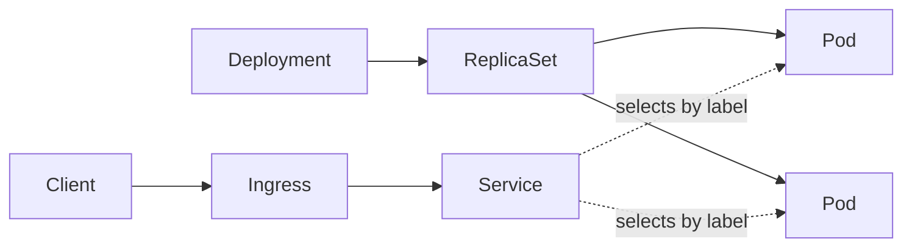
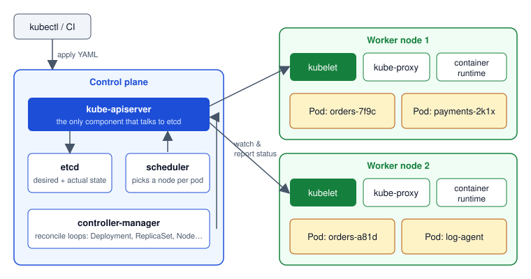

import Tabs from '@theme/Tabs';
import TabItem from '@theme/TabItem';

:::tip Key takeaways
- Kubernetes runs containers across many machines. You declare the **desired state**, and controllers keep making the actual state match it.
- The **API server** is the front door. Every component, and `kubectl`, reads and writes state through it, and only it talks to **etcd**.
- The **Pod** is the smallest unit you deploy: one or more containers that share a network namespace and volumes. Pods are disposable.
- **Labels and selectors** connect everything. A Deployment finds its pods, and a Service finds its endpoints, by label.
- **Namespaces** scope names, RBAC and quotas. They don't isolate the network by default.
:::

## From Docker to Kubernetes

Docker runs a container on one machine. Kubernetes schedules containers onto a cluster of machines and restarts,
scales, updates and connects them for you. Each object adds one responsibility on top of the one below it.

| Object | Responsibility | Analogy |
|---|---|---|
| Container | One process image (for example a Spring Boot JAR) | A JVM process |
| Pod | One or more containers sharing an IP and volumes | A host for the process |
| ReplicaSet | Keeps N identical pods running | A supervisor |
| Deployment | Manages ReplicaSets for rolling updates and rollback | A release manager |
| Service | Stable virtual IP and DNS name in front of the pods | A built-in service registry plus load balancer |
| Ingress | HTTP(S) routing from outside the cluster to Services | A reverse proxy (Nginx) |
| ConfigMap / Secret | Configuration and credentials injected into pods | `application.yml` and a vault |
| Namespace | A virtual cluster for names, RBAC and quotas | A Java package |

<details>
<summary>How the objects stack up</summary>



The Deployment creates a ReplicaSet, which creates the pods. The Service never references the Deployment. It
selects pods by label, so any pod with matching labels that passes its readiness probe receives traffic.

</details>

## Cluster architecture

A cluster has a **control plane**, which makes decisions, and **worker nodes**, which run pods. Components never call
each other directly. They **watch** the API server and act on changes.

| Component | Where | Job |
|---|---|---|
| kube-apiserver | Control plane | REST front door. Authenticates, authorizes, validates and persists objects. |
| etcd | Control plane | Consistent key-value store holding all cluster state. Back it up. |
| kube-scheduler | Control plane | Assigns each unscheduled pod to a node (resources, affinity, taints). |
| kube-controller-manager | Control plane | Runs the reconcile loops: Deployment, ReplicaSet, Job, Node, EndpointSlice… |
| kubelet | Every node | Starts the pod's containers through the runtime, runs probes, reports status. |
| kube-proxy | Every node | Programs iptables/IPVS rules so Service IPs reach pod IPs. |
| Container runtime | Every node | containerd or CRI-O. Pulls images and runs containers (via the CRI). |

<details>
<summary>Diagram: control plane and worker nodes</summary>



</details>

<details>
<summary>What happens when you run `kubectl apply -f deployment.yaml`</summary>

1. `kubectl` sends the manifest to the **API server**. It authenticates you, checks RBAC, runs admission controllers
   and stores the Deployment in **etcd**.
2. The **Deployment controller** notices a Deployment without a ReplicaSet and creates one.
3. The **ReplicaSet controller** sees 0 of 3 pods and creates 3 Pod objects with no node assigned.
4. The **scheduler** sees unscheduled pods, picks a node for each and writes `spec.nodeName`.
5. The **kubelet** on each chosen node sees a pod bound to it, pulls the image through the runtime and starts the
   containers.
6. Once the readiness probe passes, the **EndpointSlice controller** adds the pod IP to the Service, and
   **kube-proxy** routes traffic to it.

Nothing in this chain is a direct call. Every step is a controller reacting to a change in the API server.

</details>

## Desired state and reconciliation

You describe **what** you want (3 replicas of `orders-service:1.4`), not **how** to get there. Each controller runs a
loop: observe the actual state, diff it against `spec`, and act to close the gap. That's why Kubernetes heals itself.
Delete a pod and the ReplicaSet creates a new one.

<details>
<summary>Declarative vs. imperative</summary>

<Tabs>
<TabItem value="declarative" label="Declarative (preferred)">

```bash
kubectl apply -f k8s/            # desired state lives in Git
kubectl diff -f k8s/             # preview what would change
```

Repeatable, reviewable and the basis of GitOps. Re-running `apply` is idempotent.

</TabItem>
<TabItem value="imperative" label="Imperative">

```bash
kubectl create deployment orders --image=registry.example.com/orders:1.4
kubectl scale deployment orders --replicas=5
```

Fine for experiments and emergencies. The change isn't in Git, so the next `apply` or GitOps sync overwrites it.

</TabItem>
</Tabs>

</details>

:::warning Manual edits drift
`kubectl edit` or `kubectl scale` on a resource managed by Git or Argo CD is silently reverted on the next sync.
Change the manifest instead.
:::

## Pods

A Pod is one or more containers scheduled together on one node. They share an IP address, a port space and any
mounted volumes, and can talk over `localhost`. Usually it's one app container per pod, plus optional **sidecars**
(proxy, log shipper) and **init containers** that run to completion before the app starts.

<details>
<summary>Pod lifecycle and why you rarely create pods directly</summary>

**Phases:** `Pending` (not scheduled yet, or pulling the image) → `Running` → `Succeeded` / `Failed`. `Unknown`
means the node stopped reporting.

Pods are **ephemeral**. When one dies, it's replaced by a new pod with a new name and a new IP; it isn't restarted
in place on another node. A bare Pod with no controller isn't recreated if its node dies, so always create pods
through a workload: Deployment, StatefulSet, DaemonSet or Job. See [Workloads](./workloads).

```yaml
apiVersion: v1
kind: Pod
metadata:
  name: orders-debug
  namespace: shop
  labels:
    app: orders
spec:
  initContainers:
    - name: wait-for-db
      image: busybox:1.36
      command: ["sh", "-c", "until nc -z postgres 5432; do sleep 2; done"]
  containers:
    - name: app
      image: registry.example.com/orders:1.4.0
      ports:
        - containerPort: 8080
```

</details>

## Namespaces

A namespace is a virtual cluster inside the physical one. Object names only need to be unique within a namespace.
RBAC roles, ResourceQuotas, LimitRanges and most policies are applied per namespace. Typical splits are per team,
per app or per environment.

<details>
<summary>What namespaces do and don't isolate</summary>

| Isolated per namespace | Not isolated |
|---|---|
| Object names | Network traffic: any pod can reach any pod unless a [NetworkPolicy](./networking) says otherwise |
| RBAC permissions (Role, RoleBinding) | Nodes: pods from all namespaces share the same machines |
| Resource quotas and default limits | Cluster-scoped objects: Nodes, PersistentVolumes, ClusterRoles, CRDs |

```bash
kubectl get pods -n shop
kubectl config set-context --current --namespace=shop   # stop typing -n
kubectl api-resources --namespaced=false                # cluster-scoped kinds
```

</details>

## Labels, selectors and annotations

**Labels** are key-value pairs used to select objects. **Selectors** query them. **Annotations** hold non-identifying
metadata for tools (build info, Prometheus scrape hints) and can't be used in selectors.

| Selector | Example | Matches on |
|---|---|---|
| Equality-based | `-l app=orders,env=prod` | Labels |
| Set-based | `-l 'tier in (web,api),env notin (dev)'` | Labels |
| Field selector | `--field-selector status.phase=Running` | Built-in fields (phase, node name, namespace) |

<details>
<summary>Selector examples</summary>

```bash
kubectl get pods -l app=orders
kubectl get pods -l 'app in (orders,payments)'
kubectl get pods --field-selector status.phase!=Running        # find unhealthy pods
kubectl get pods -A --field-selector spec.nodeName=node-3      # what runs on a node
kubectl get pods -L app,version                                # show labels as columns
```

Use the recommended `app.kubernetes.io/*` labels (`name`, `instance`, `version`, `component`, `part-of`) so tools
can group resources consistently.

</details>

:::danger A Deployment's selector is immutable
`spec.selector` can't be changed after the Deployment is created, and it must match the pod template's labels. Don't
put a changing value such as `version` in the selector. Put it only in the template's labels.
:::

## Essential kubectl

`kubectl` is a REST client for the API server. Most work uses about a dozen verbs.

<details>
<summary>Cheat sheet</summary>

```bash
# Inspect
kubectl get pods -n shop -o wide            # node, IP, status
kubectl get deploy,svc,ingress -n shop
kubectl describe pod <pod> -n shop          # events at the bottom: start here when debugging
kubectl get pod <pod> -o yaml               # full live object
kubectl explain deployment.spec.strategy    # built-in schema docs

# Logs and access
kubectl logs <pod> -c app -f                # follow one container
kubectl logs <pod> --previous               # logs from the crashed container
kubectl exec -it <pod> -- sh
kubectl port-forward svc/orders 8080:80

# Change
kubectl apply -f k8s/
kubectl delete -f k8s/
kubectl rollout restart deployment/orders

# Context
kubectl config get-contexts
kubectl config use-context staging
kubectl auth can-i create deployments -n shop
```

</details>

## References
- [Kubernetes components](https://kubernetes.io/docs/concepts/overview/components/)
- [Pods](https://kubernetes.io/docs/concepts/workloads/pods/)
- [Namespaces](https://kubernetes.io/docs/concepts/overview/working-with-objects/namespaces/)
- [Labels and selectors](https://kubernetes.io/docs/concepts/overview/working-with-objects/labels/)
- [Field selectors](https://kubernetes.io/docs/concepts/overview/working-with-objects/field-selectors/)
- [kubectl quick reference](https://kubernetes.io/docs/reference/kubectl/quick-reference/)
