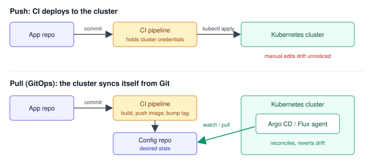

import Tabs from '@theme/Tabs';
import TabItem from '@theme/TabItem';

:::tip Key takeaways
- A Deployment supports only two strategies natively: **RollingUpdate** (default) and **Recreate**. Blue-green and canary are built on top, with Services, a mesh, or a tool like Argo Rollouts.
- Zero downtime needs more than a rolling update: **readiness probes**, a **preStop** delay, graceful shutdown, `maxUnavailable: 0` and a **PodDisruptionBudget**.
- **GitOps** reverses the flow. CI no longer pushes to the cluster; an in-cluster agent **pulls** the desired state from Git and keeps correcting drift.
- Argo CD's `prune` deletes what was removed from Git, and `selfHeal` reverts manual `kubectl` edits.
:::

The tool-agnostic view of deployment patterns (per-service hosts, containers, serverless) is in
[Deployment in Microservices](/docs/architecture/microservices/deployment). This page covers how they map onto
Kubernetes objects. Probes and graceful shutdown are covered in more depth in [Observability](./observability) and
[Spring Boot on Kubernetes](./spring-boot-on-kubernetes).

## Strategies at a glance

| Strategy | How it works | Extra capacity | Rollback | Mixed versions live? |
|---|---|---|---|---|
| Recreate | Kill all old pods, then start new ones | None | Redeploy old | No, but has downtime |
| Rolling update | Replace pods a few at a time | `maxSurge` pods | `kubectl rollout undo` | Yes, during the rollout |
| Blue-green | Run v2 fully next to v1, then switch the Service | 2× | Switch the selector back | No (instant cut-over) |
| Canary | Send a small % of traffic to v2, increase on good metrics | Small | Set weight to 0 | Yes, by design |

<Tabs>
<TabItem value="rolling" label="Rolling update">

Kubernetes creates a new ReplicaSet and scales it up while scaling the old one down. Two knobs control the pace:

- `maxSurge`: how many pods **above** `replicas` may exist during the rollout.
- `maxUnavailable`: how many pods **below** `replicas` may be unready.

`maxUnavailable: 0` with `maxSurge: 1` is the safe default: capacity never drops, and the rollout waits for each new pod
to pass readiness before removing an old one.

<details>
<summary>YAML and rollout commands</summary>

```yaml
apiVersion: apps/v1
kind: Deployment
metadata:
  name: orders-service
spec:
  replicas: 4
  revisionHistoryLimit: 5          # old ReplicaSets kept for rollback
  progressDeadlineSeconds: 600     # mark the rollout failed if stuck
  strategy:
    type: RollingUpdate
    rollingUpdate:
      maxSurge: 1
      maxUnavailable: 0
  template:
    spec:
      containers:
        - name: app
          image: registry.example.com/orders-service:1.4.0
```

```bash
kubectl set image deploy/orders-service app=registry.example.com/orders-service:1.5.0
kubectl rollout status deploy/orders-service --timeout=5m
kubectl rollout history deploy/orders-service
kubectl rollout undo deploy/orders-service              # back to the previous revision
kubectl rollout undo deploy/orders-service --to-revision=3
```

</details>

</TabItem>
<TabItem value="recreate" label="Recreate">

All old pods are terminated before any new pod starts. Use it only when two versions **must not** run together: a
schema migration that breaks v1, a singleton that holds a lock, or a `ReadWriteOnce` volume that only one pod can
mount.

<details>
<summary>YAML</summary>

```yaml
spec:
  strategy:
    type: Recreate
```

</details>

</TabItem>
<TabItem value="blue-green" label="Blue-green">

Run two Deployments, `blue` (live) and `green` (new). Test green privately, then switch traffic by changing the
Service selector. The cut-over is instant, and so is rollback.

The cost is double capacity during the release, and the database must work for both versions.

<details>
<summary>YAML: switch traffic with the Service selector</summary>

```yaml
apiVersion: apps/v1
kind: Deployment
metadata:
  name: orders-green
spec:
  replicas: 3
  selector:
    matchLabels: { app: orders, version: green }
  template:
    metadata:
      labels: { app: orders, version: green }
    spec:
      containers:
        - name: app
          image: registry.example.com/orders-service:1.5.0
---
apiVersion: v1
kind: Service
metadata:
  name: orders
spec:
  selector:
    app: orders
    version: blue        # change to "green" to cut over
  ports:
    - port: 80
      targetPort: 8080
```

```bash
kubectl patch svc orders -p '{"spec":{"selector":{"app":"orders","version":"green"}}}'
```

</details>

</TabItem>
<TabItem value="canary" label="Canary">

Release v2 to a small slice of traffic, watch error rate and latency, then promote step by step or abort.

- **Replica ratio (plain Kubernetes):** run 1 canary pod next to 9 stable pods behind the same Service, which gives
  about 10% of traffic. It's coarse, and the split depends on pod count.
- **Weighted routing:** a service mesh (Istio, Linkerd) or an ingress controller splits traffic by percentage,
  independent of replica count.
- **Progressive delivery:** **Argo Rollouts** or **Flagger** automate the steps and roll back when metrics fail.

<details>
<summary>YAML: Argo Rollouts canary with automated analysis</summary>

```yaml
apiVersion: argoproj.io/v1alpha1
kind: Rollout                       # replaces the Deployment
metadata:
  name: orders-service
spec:
  replicas: 10
  selector:
    matchLabels: { app: orders }
  template:
    metadata:
      labels: { app: orders }
    spec:
      containers:
        - name: app
          image: registry.example.com/orders-service:1.5.0
  strategy:
    canary:
      canaryService: orders-canary
      stableService: orders-stable
      trafficRouting:
        istio:
          virtualService: { name: orders, routes: [primary] }
      steps:
        - setWeight: 10
        - pause: { duration: 5m }
        - analysis:
            templates: [{ templateName: success-rate }]   # queries Prometheus
        - setWeight: 50
        - pause: { duration: 10m }
        # after the last step: 100%
```

If the `AnalysisTemplate` fails (for example, success rate below 99%), the Rollout aborts and sends all traffic back
to stable.

</details>

</TabItem>
</Tabs>

:::warning Every strategy except Recreate runs two versions at once
During a rolling update or canary, v1 and v2 serve traffic together. Database migrations must be
**backward compatible** (expand, migrate, then contract), and API and event changes must be additive.
:::

## Zero-downtime checklist

A rolling update alone can still drop requests. They fail in two places: new pods get traffic before they're ready,
and old pods are killed while requests are in flight or before every node stops routing to them.

| Setting | Prevents |
|---|---|
| Readiness probe | Traffic to a pod that hasn't warmed up |
| `maxUnavailable: 0` | Capacity dropping during the rollout |
| `preStop` sleep (5–15 s) | Requests routed to a terminating pod before endpoints update everywhere |
| Graceful shutdown + `terminationGracePeriodSeconds` | In-flight requests cut off by `SIGKILL` |
| PodDisruptionBudget | Node drains and upgrades taking out too many pods at once |

<details>
<summary>Why the preStop sleep is needed</summary>

When a pod is deleted, two things happen **in parallel**: the kubelet sends `SIGTERM`, and the endpoint controller
removes the pod from the Service. kube-proxy and ingress controllers on every node pick up the endpoint change a little
later. Without a delay, the app can stop accepting connections while some nodes still route to it.

```yaml
spec:
  terminationGracePeriodSeconds: 45     # must cover preStop + shutdown
  containers:
    - name: app
      lifecycle:
        preStop:
          exec:
            command: ["sh", "-c", "sleep 10"]
      readinessProbe:
        httpGet: { path: /actuator/health/readiness, port: 8080 }
        periodSeconds: 5
---
apiVersion: policy/v1
kind: PodDisruptionBudget
metadata:
  name: orders-pdb
spec:
  minAvailable: 2          # or maxUnavailable: 1
  selector:
    matchLabels: { app: orders }
```

Order of events: `preStop` runs → `SIGTERM` → the app drains in-flight requests → exit, or `SIGKILL` when the grace
period ends.

</details>

:::danger A PDB can block node drains
`minAvailable` equal to `replicas` (for example, 2 of 2) means no pod can ever be evicted, so `kubectl drain` and
cluster upgrades hang. Leave room for at least one disruption.
:::

## GitOps: push vs. pull

In **push**-based CD, the pipeline holds cluster credentials and runs `kubectl apply` or `helm upgrade`. In
**GitOps (pull)**, Git is the only source of truth. An agent inside the cluster (Argo CD or Flux) watches the repo and
reconciles the cluster to match it.

| | Push (CI runs kubectl) | Pull (GitOps) |
|---|---|---|
| Cluster credentials | Stored in CI | Stay inside the cluster |
| Drift (manual edits) | Goes unnoticed | Detected and optionally reverted |
| Audit and rollback | CI logs; re-run an old job | `git log`; `git revert` |
| Multi-cluster | One pipeline step per cluster | Each cluster's agent pulls its own path |

<details>
<summary>Diagram: push vs. pull deployment</summary>



With GitOps, CI ends when it has pushed the image and updated the image tag in the config repo. Applying the change
to the cluster is the agent's job.

</details>

<details>
<summary>Typical GitOps pipeline</summary>

1. A developer merges to the app repo. CI builds and tests, then pushes `orders-service:<git-sha>`.
2. CI (or a tool like Argo CD Image Updater or Renovate) opens a commit in the **config repo** that bumps the image
   tag in `overlays/dev`.
3. Argo CD sees the new commit and syncs `dev`.
4. Promotion to staging or prod is a pull request that changes the tag in the next overlay. Review and approval happen
   in Git.

Keep application code and deployment config in **separate repos**, or at least separate paths. Otherwise every
config commit triggers an app build.

</details>

## Argo CD Application

An `Application` tells Argo CD what to sync: a **source** (repo, revision and path, rendered as plain YAML, Kustomize
or Helm), a **destination** (cluster and namespace), and a **sync policy**.

| Field | Effect |
|---|---|
| `automated` | Sync automatically when Git changes. Without it, a human clicks **Sync**. |
| `prune: true` | Delete live resources that were removed from Git |
| `selfHeal: true` | Revert manual changes in the cluster back to the Git state |
| `syncOptions` | For example, `CreateNamespace=true` or `ServerSideApply=true` |
| `retry` | Back off and retry failed syncs |

<details>
<summary>YAML: Application with automated sync</summary>

```yaml
apiVersion: argoproj.io/v1alpha1
kind: Application
metadata:
  name: orders-service-prod
  namespace: argocd
spec:
  project: shop
  source:
    repoURL: https://github.com/example/shop-deploy
    targetRevision: main
    path: orders-service/overlays/prod      # a Kustomize overlay
  destination:
    server: https://kubernetes.default.svc
    namespace: shop
  syncPolicy:
    automated:
      prune: true
      selfHeal: true
    syncOptions:
      - CreateNamespace=true
    retry:
      limit: 5
      backoff: { duration: 5s, factor: 2, maxDuration: 3m }
```

For many apps or clusters, generate `Application`s with an **ApplicationSet**: one template that a generator fills in
from a list, a Git directory tree, or the registered clusters.

</details>

:::warning selfHeal vs. HPA
If Git sets `replicas` and an HPA also scales the Deployment, Argo CD keeps reverting the HPA's changes. Leave
`replicas` out of the manifest, or add it to `ignoreDifferences`, for HPA-managed workloads.
:::

## Interview questions

<details>
<summary>**How do you roll back a bad deployment?**</summary>

With plain kubectl, run `kubectl rollout undo deploy/<name>`. It scales the previous ReplicaSet back up, as long as
`revisionHistoryLimit` kept it. With GitOps, `git revert` the commit and let the agent sync. Running `rollout undo`
there would be reverted by `selfHeal`. With Argo Rollouts, a failed analysis aborts and rolls back automatically.

</details>

<details>
<summary>**Blue-green or canary: when would you choose each?**</summary>

Choose blue-green when you need an instant, all-or-nothing switch and can afford double capacity, for example a
release that must not mix versions. Choose canary when you want to limit the blast radius and decide from real
production metrics, at the cost of running mixed versions and needing traffic-splitting tooling.

</details>

<details>
<summary>**Users see 502s during every rollout even with readiness probes. Why?**</summary>

Old pods are killed before every node stops routing to them, or the app exits without draining in-flight requests. Add
a `preStop` sleep, enable graceful shutdown (in Spring Boot, `server.shutdown=graceful`), and make sure
`terminationGracePeriodSeconds` covers both.

</details>

## References
- [Kubernetes: Deployments (rolling update, rollback)](https://kubernetes.io/docs/concepts/workloads/controllers/deployment/)
- [Kubernetes: Pod lifecycle and termination](https://kubernetes.io/docs/concepts/workloads/pods/pod-lifecycle/#pod-termination)
- [Kubernetes: Specifying a Disruption Budget](https://kubernetes.io/docs/tasks/run-application/configure-pdb/)
- [Argo CD: Automated sync policy](https://argo-cd.readthedocs.io/en/stable/user-guide/auto_sync/)
- [Argo Rollouts: Canary strategy](https://argoproj.github.io/argo-rollouts/features/canary/)
- [OpenGitOps principles](https://opengitops.dev/)
