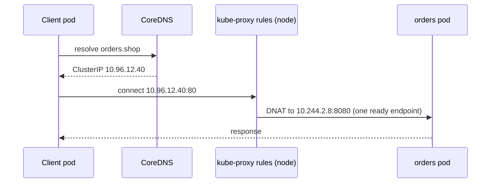
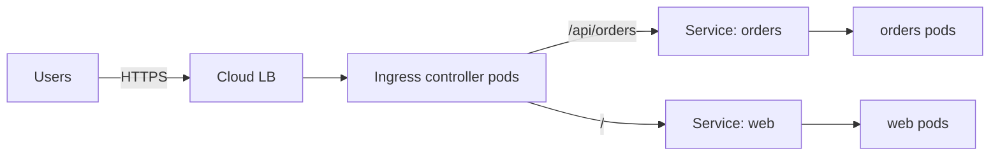

import Tabs from '@theme/Tabs';
import TabItem from '@theme/TabItem';

:::tip Key takeaways
- Every pod gets its own IP, and any pod can reach any other pod by default. Pod IPs change, so clients use a **Service**.
- A Service is a stable virtual IP plus DNS name in front of the **ready** pods its selector matches. **ClusterIP** is the default; the others build on it.
- In-cluster DNS: `orders` within a namespace, `orders.shop` across namespaces, `orders.shop.svc.cluster.local` in full.
- **Ingress** (or the newer Gateway API) handles L7 HTTP routing and TLS, but only if an Ingress **controller** is installed.
- **NetworkPolicy** is allow-list firewalling between pods. Start with default-deny and remember to allow DNS.
:::

How services find and call each other, independent of the platform, is covered in
[Deployment in Microservices](/docs/architecture/microservices/deployment). This page covers the Kubernetes objects.

## The networking model

| Rule | Consequence |
|---|---|
| Every pod has a unique, cluster-routable IP | No port mapping between pods. Containers in one pod share it and use `localhost`. |
| Pods reach each other without NAT | Flat network implemented by the CNI plugin (Calico, Cilium, AWS VPC CNI…) |
| Pod IPs are ephemeral | Never hard-code them. Go through a Service. |
| No isolation by default | Namespaces don't block traffic. NetworkPolicy does. |

## Service types

A Service selects pods by label and load-balances connections to the ones that are Ready. Each type adds a way in on
top of the previous one.

| Type | Reachable from | How | Typical use |
|---|---|---|---|
| ClusterIP (default) | Inside the cluster | Virtual IP and DNS name | Service-to-service calls |
| NodePort | Outside, via `nodeIP:30000-32767` | Opens the same port on every node, plus a ClusterIP | Bare metal, debugging |
| LoadBalancer | Outside, via a cloud LB | Provisions a cloud L4 load balancer, plus a NodePort | Exposing one service directly |
| ExternalName | Inside the cluster | DNS CNAME to an external host; no proxying | Alias for a managed DB or external API |
| Headless (`clusterIP: None`) | Inside the cluster | DNS returns the pod IPs directly | StatefulSets, client-side load balancing |

<details>
<summary>Manifests for each type</summary>

<Tabs>
<TabItem value="clusterip" label="ClusterIP">

```yaml
apiVersion: v1
kind: Service
metadata:
  name: orders
  namespace: shop
spec:
  selector:
    app: orders-service
  ports:
    - name: http
      port: 80          # what clients call
      targetPort: 8080  # container port (or a named port)
```

</TabItem>
<TabItem value="nodeport" label="NodePort">

```yaml
spec:
  type: NodePort
  selector:
    app: orders-service
  ports:
    - port: 80
      targetPort: 8080
      nodePort: 30080   # optional; otherwise one is picked from 30000-32767
```

</TabItem>
<TabItem value="lb" label="LoadBalancer">

```yaml
metadata:
  annotations:
    # cloud-specific; for example an internal network LB on AWS
    service.beta.kubernetes.io/aws-load-balancer-scheme: internal
spec:
  type: LoadBalancer
  selector:
    app: orders-service
  ports:
    - port: 80
      targetPort: 8080
```

</TabItem>
<TabItem value="externalname" label="ExternalName">

```yaml
spec:
  type: ExternalName
  externalName: orders-db.example.com   # resolved as a CNAME; no selector, no ports proxied
```

</TabItem>
<TabItem value="headless" label="Headless">

```yaml
spec:
  clusterIP: None
  selector:
    app: postgres
  ports:
    - port: 5432
```

</TabItem>
</Tabs>

</details>

<details>
<summary>Other Service options</summary>

- **Multi-port Services:** every port must have a `name`.
- **`sessionAffinity: ClientIP`:** sticky by source IP, with a timeout in `sessionAffinityConfig`. Prefer stateless
  apps instead.
- **`externalTrafficPolicy: Local`:** for NodePort and LoadBalancer. Keeps the client source IP and avoids an extra
  hop, but only nodes running a pod receive traffic.
- **`internalTrafficPolicy: Local`:** route only to pods on the same node, for example a node-local agent.

</details>

:::warning One LoadBalancer per Service gets expensive
Each `type: LoadBalancer` provisions its own cloud load balancer. For many HTTP services, use one Ingress or Gateway
in front of ClusterIP Services.
:::

## Endpoints and how traffic reaches a pod

The EndpointSlice controller keeps a list of the **ready** pod IPs behind each Service. kube-proxy on every node turns
that list into iptables/IPVS rules (or eBPF with Cilium), so a connection to the ClusterIP is rewritten to one pod IP.
There's no proxy process in the data path.

<details>
<summary>Request path and debugging commands</summary>



```bash
kubectl get svc orders -n shop -o wide
kubectl get endpointslices -l kubernetes.io/service-name=orders -n shop
kubectl describe svc orders -n shop        # "Endpoints: <none>" → selector or readiness problem
kubectl port-forward svc/orders 8080:80 -n shop
```

</details>

:::tip "Service has no endpoints" is the classic bug
Either the Service's `selector` doesn't match the pod labels (check with `kubectl get pods -l app=...`), or the pods
exist but aren't Ready because their readiness probe is failing.
:::

## DNS and service discovery

CoreDNS gives every Service a DNS name. Pods get a search path for their own namespace, so short names work locally.
This is built-in service discovery: there's no Eureka or Consul to run.

| Name | Resolves from | Example |
|---|---|---|
| `<svc>` | Same namespace | `http://orders` |
| `<svc>.<ns>` | Any namespace | `http://orders.shop` |
| `<svc>.<ns>.svc.cluster.local` | Anywhere (FQDN) | `http://orders.shop.svc.cluster.local` |
| `<pod>.<headless-svc>.<ns>.svc.cluster.local` | Anywhere, per StatefulSet pod | `postgres-0.postgres.shop.svc.cluster.local` |

<details>
<summary>Headless Services and StatefulSets</summary>

A normal Service name resolves to one ClusterIP. A **headless** Service name resolves to the A records of every
ready pod, and each StatefulSet pod gets its own stable record:

```
postgres.shop.svc.cluster.local      → 10.244.1.5, 10.244.2.8, 10.244.3.9
postgres-0.postgres.shop.svc.cluster.local → 10.244.1.5
```

Clients such as Kafka or Cassandra drivers use this to connect to specific members. See
[StatefulSets](./workloads#statefulsets).

</details>

<details>
<summary>The ndots performance trap</summary>

Pods default to `ndots:5`, so a name with fewer than 5 dots (`api.example.com`) is first tried against every search
domain (`api.example.com.shop.svc.cluster.local`, …) before the real lookup. For apps that make many external calls,
use a trailing dot (`api.example.com.`) or lower `ndots` in `dnsConfig`.

</details>

## Ingress

An **Ingress** is a set of L7 rules: host and path → Service, plus TLS. An **Ingress controller** (ingress-nginx,
Traefik, a cloud controller such as the AWS Load Balancer Controller) watches Ingress objects and does the actual
proxying. Without a controller, an Ingress does nothing.

| | LoadBalancer Service | Ingress | Gateway API |
|---|---|---|---|
| Layer | L4 (TCP/UDP) | L7 (HTTP/HTTPS) | L4 and L7 |
| Routing | One Service per LB | Host/path rules across many Services | Host/path/header rules, traffic splitting |
| TLS | At the LB, if supported | Terminated by the controller | Terminated by the gateway |
| Status | Core | Stable, frozen | Successor to Ingress; role-oriented (`Gateway`, `HTTPRoute`) |

<details>
<summary>Ingress manifest</summary>

```yaml
apiVersion: networking.k8s.io/v1
kind: Ingress
metadata:
  name: shop
  namespace: shop
spec:
  ingressClassName: nginx            # selects which controller handles it
  tls:
    - hosts: [shop.example.com]
      secretName: shop-tls           # often issued by cert-manager
  rules:
    - host: shop.example.com
      http:
        paths:
          - path: /api/orders
            pathType: Prefix
            backend:
              service:
                name: orders
                port:
                  number: 80
          - path: /
            pathType: Prefix
            backend:
              service:
                name: web
                port:
                  number: 80
```



Controller-specific behaviour (rewrites, timeouts, auth) is set through **annotations**, which aren't portable between
controllers.

</details>

## NetworkPolicy

NetworkPolicies are pod-level firewall rules selected by labels. Once a policy selects a pod for a direction (Ingress
or Egress), only the traffic that policy allows gets through. Rules are additive, with no explicit deny. They're only
enforced if the CNI supports them (Calico and Cilium do; plain flannel doesn't).

<details>
<summary>Default-deny plus allow rules</summary>

<Tabs>
<TabItem value="deny" label="Default deny">

```yaml
apiVersion: networking.k8s.io/v1
kind: NetworkPolicy
metadata:
  name: default-deny
  namespace: shop
spec:
  podSelector: {}            # every pod in the namespace
  policyTypes: [Ingress, Egress]
```

</TabItem>
<TabItem value="ingress" label="Allow ingress">

```yaml
# Only orders-service may reach postgres on 5432
apiVersion: networking.k8s.io/v1
kind: NetworkPolicy
metadata:
  name: postgres-from-orders
  namespace: shop
spec:
  podSelector:
    matchLabels:
      app: postgres
  policyTypes: [Ingress]
  ingress:
    - from:
        - podSelector:
            matchLabels:
              app: orders-service
      ports:
        - protocol: TCP
          port: 5432
```

</TabItem>
<TabItem value="egress" label="Allow egress + DNS">

```yaml
apiVersion: networking.k8s.io/v1
kind: NetworkPolicy
metadata:
  name: orders-egress
  namespace: shop
spec:
  podSelector:
    matchLabels:
      app: orders-service
  policyTypes: [Egress]
  egress:
    - to:
        - podSelector:
            matchLabels:
              app: postgres
      ports:
        - { protocol: TCP, port: 5432 }
    - to:
        - namespaceSelector:          # same list item as podSelector → AND
            matchLabels:
              kubernetes.io/metadata.name: kube-system
          podSelector:
            matchLabels:
              k8s-app: kube-dns
      ports:
        - { protocol: UDP, port: 53 }
        - { protocol: TCP, port: 53 }
```

</TabItem>
</Tabs>

</details>

:::danger Two NetworkPolicy traps
- **Default-deny egress breaks DNS.** Every outbound call then fails name resolution. Always allow UDP and TCP 53 to
  CoreDNS.
- **AND vs. OR is decided by YAML indentation.** `namespaceSelector` and `podSelector` in the **same** `from` item
  means both must match. As **separate** items (each starting with `-`), either one matches, which can open the
  policy to every pod in that namespace, or to every pod in your own.
:::

## Service mesh

A service mesh (Istio, Linkerd) puts a proxy next to every pod, as an Envoy sidecar or with Istio's sidecar-less
ambient mode. A control plane configures the proxies. It moves mTLS, retries, timeouts, circuit breaking, traffic
splitting and per-request metrics out of application code.

<details>
<summary>When it's worth it, and an Istio example</summary>

<Tabs>
<TabItem value="pros" label="Gains">

- Automatic **mTLS** and service identity between all services.
- **Traffic management**: weighted canaries, header-based routing, retries, timeouts, outlier ejection.
- Uniform **golden-signal metrics** and tracing headers without changing code.

</TabItem>
<TabItem value="cons" label="Costs">

- One extra hop and extra CPU/memory per pod (sidecar mode).
- Another control plane to upgrade and debug. Failures can look like network issues.
- Overkill for a handful of services. Libraries such as Resilience4j and Ingress features may be enough.

</TabItem>
</Tabs>

```yaml
# 90/10 canary by weight, with retries and a timeout
apiVersion: networking.istio.io/v1
kind: VirtualService
metadata:
  name: orders
  namespace: shop
spec:
  hosts: [orders]
  http:
    - route:
        - destination: { host: orders, subset: v1 }
          weight: 90
        - destination: { host: orders, subset: v2 }
          weight: 10
      retries: { attempts: 3, perTryTimeout: 2s }
      timeout: 10s
---
apiVersion: networking.istio.io/v1
kind: DestinationRule
metadata:
  name: orders
  namespace: shop
spec:
  host: orders
  trafficPolicy:
    outlierDetection:              # eject pods that keep failing (circuit breaking)
      consecutive5xxErrors: 5
      interval: 30s
      baseEjectionTime: 30s
  subsets:
    - name: v1
      labels: { version: v1 }
    - name: v2
      labels: { version: v2 }
```

Canary rollouts built on this are covered in [Deployment Strategies](./deployment-strategies).

</details>

## References
- [Services, load balancing and networking](https://kubernetes.io/docs/concepts/services-networking/)
- [Service](https://kubernetes.io/docs/concepts/services-networking/service/)
- [DNS for Services and Pods](https://kubernetes.io/docs/concepts/services-networking/dns-pod-service/)
- [Ingress](https://kubernetes.io/docs/concepts/services-networking/ingress/)
- [Gateway API](https://kubernetes.io/docs/concepts/services-networking/gateway/)
- [Network policies](https://kubernetes.io/docs/concepts/services-networking/network-policies/)
- [Istio traffic management](https://istio.io/latest/docs/concepts/traffic-management/)
