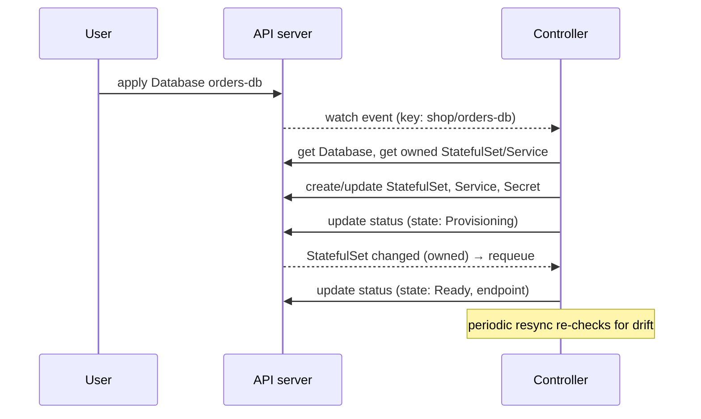

import Tabs from '@theme/Tabs';
import TabItem from '@theme/TabItem';

:::tip Key takeaways
- A **CRD** adds a new resource type to the API server. Once installed, you can `kubectl get` it, apply it and RBAC it like a built-in type.
- A CRD alone only **stores** data. A **controller** watches it and makes the real world match `spec`, then reports back in `status`.
- **Operator = CRD + controller + operational know-how** (install, upgrade, backup, failover) for one piece of software.
- Reconcile must be **level-triggered and idempotent**: read the current state, compute the difference from desired state, act, and requeue. Never assume what the last event was.
- Use **owner references** so child objects are garbage-collected, and **finalizers** to clean up external resources before deletion.
:::

Every built-in controller works this way. The Deployment controller reconciles ReplicaSets, and the ReplicaSet
controller reconciles Pods (see [Workloads](./workloads)). Operators apply the same loop to your own types.

## Custom resources

| Term | Is |
|---|---|
| CustomResourceDefinition (CRD) | The schema and name of the new type, for example `databases.example.com` |
| Custom resource (CR) | One instance, for example `kind: Database`, `name: orders-db` |
| `spec` | The desired state, written by users |
| `status` | The observed state, written by the controller via the `/status` subresource |
| Versions | `v1alpha1` → `v1`. One version is the **storage** version; others are converted, via a conversion webhook if the schemas differ. |

<details>
<summary>YAML: CRD with schema, status subresource and printer columns</summary>

```yaml
apiVersion: apiextensions.k8s.io/v1
kind: CustomResourceDefinition
metadata:
  name: databases.example.com          # <plural>.<group>
spec:
  group: example.com
  scope: Namespaced
  names:
    kind: Database
    plural: databases
    singular: database
    shortNames: [db]
  versions:
    - name: v1
      served: true
      storage: true
      subresources:
        status: {}                     # spec and status updated separately
      additionalPrinterColumns:
        - { name: Engine, type: string, jsonPath: .spec.engine }
        - { name: State,  type: string, jsonPath: .status.state }
      schema:
        openAPIV3Schema:
          type: object
          properties:
            spec:
              type: object
              required: [engine, version, size]
              properties:
                engine:  { type: string, enum: [postgres, mysql] }
                version: { type: string }
                size:    { type: string, enum: [small, medium, large] }
                backup:
                  type: object
                  properties:
                    enabled:  { type: boolean }
                    schedule: { type: string }
            status:
              type: object
              properties:
                state:    { type: string }
                endpoint: { type: string }
```

```yaml
apiVersion: example.com/v1
kind: Database
metadata:
  name: orders-db
  namespace: shop
spec:
  engine: postgres
  version: "16"
  size: medium
  backup: { enabled: true, schedule: "0 2 * * *" }
```

```bash
kubectl get db -n shop
# NAME        ENGINE     STATE
# orders-db   postgres   Ready
```

</details>

:::warning Validate in the schema, not only in the controller
The API server rejects invalid CRs at `kubectl apply` time only if the OpenAPI schema (or CEL
`x-kubernetes-validations` rules) says so. Validation that exists only in the controller surfaces later, as a failed
status that users may never look at.
:::

## The reconcile loop

A controller **watches** its CR type and the child objects it owns. Any change queues the object's key
(`namespace/name`). The `Reconcile` function then runs: it reads the current state, compares it with `spec`, creates,
updates or deletes children, writes `status`, and either finishes or **requeues**.

<details>
<summary>Diagram: watch → queue → reconcile</summary>



</details>

<details>
<summary>Level-triggered vs. edge-triggered</summary>

Events can be dropped, merged or replayed, for example when the controller restarts. So reconcile must not depend on
**which** event happened (edge-triggered). It looks at the **whole current state** every time (level-triggered). The
same reconcile then handles "created", "edited", "child deleted by someone" and "controller was down for an hour".

That's why reconcile must be idempotent. Running it twice in a row must not create a second StatefulSet.

</details>

## The operator pattern

An operator puts a human operator's runbook into code for one specific system: provisioning, scaling, version
upgrades, backups, failover, certificate rotation. Users declare *what* they want in a CR, and the operator handles *how*.

| Operator | CRs | Does |
|---|---|---|
| cert-manager | `Certificate`, `Issuer`, `ClusterIssuer` | Requests TLS certs (ACME, Vault, private CA), stores them in Secrets, renews before expiry |
| Prometheus Operator | `Prometheus`, `ServiceMonitor`, `PrometheusRule` | Runs Prometheus and generates scrape config from label selectors |
| Strimzi | `Kafka`, `KafkaTopic`, `KafkaUser` | Runs Kafka clusters, rolling broker upgrades, topics and ACLs as YAML. See [Kafka](/docs/platform/kafka). |
| External Secrets | `ExternalSecret`, `SecretStore` | Syncs secrets from Vault or a cloud secret manager into Secrets |
| Database operators (CloudNativePG, Zalando Postgres) | `Cluster`, `postgresql` | Replication, failover, backups and point-in-time restore |

<details>
<summary>YAML: cert-manager Certificate</summary>

```yaml
apiVersion: cert-manager.io/v1
kind: Certificate
metadata:
  name: shop-tls
  namespace: shop
spec:
  secretName: shop-tls          # operator writes tls.crt / tls.key here
  duration: 2160h               # 90 days
  renewBefore: 360h             # renew 15 days before expiry
  issuerRef:
    name: letsencrypt-prod
    kind: ClusterIssuer
  dnsNames:
    - shop.example.com
```

</details>

<details>
<summary>YAML: Prometheus Operator ServiceMonitor</summary>

```yaml
apiVersion: monitoring.coreos.com/v1
kind: ServiceMonitor
metadata:
  name: orders-service
  namespace: shop
  labels:
    release: prometheus            # must match the Prometheus CR's serviceMonitorSelector
spec:
  selector:
    matchLabels: { app: orders }
  endpoints:
    - port: http
      path: /actuator/prometheus
      interval: 30s
```

</details>

:::tip When not to write an operator
If Helm or Kustomize plus built-in controllers can do the job, use them. An operator is long-lived software you must
version, test and secure, and its RBAC is often cluster-wide. Write one when the system needs **ongoing, stateful
operational logic**, not just installation.
:::

## Writing an operator (conceptually)

Most operators are written in Go with **controller-runtime**, scaffolded by **Kubebuilder** or the **Operator SDK**
(which also supports Ansible and Helm-based operators). Java teams can use the Java Operator SDK.

| Concept | Why |
|---|---|
| Idempotent reconcile | Safe to run any number of times. Use create-or-update, never "create because an event said so". |
| Owner references | Children (StatefulSet, Service) point to the CR, so deleting the CR garbage-collects them, and child changes requeue the parent |
| Finalizers | Block deletion until the controller cleans up **external** resources (cloud DB, DNS record), then remove the finalizer |
| Status conditions | Standard `conditions` (`Ready`, `Progressing`, `Degraded`) with `observedGeneration`, so users and tools can tell whether the latest spec has been processed |
| Leader election | Run 2+ replicas for availability, with only one reconciling at a time |
| Least-privilege RBAC | Only the verbs and resources the controller really touches |

<Tabs>
<TabItem value="reconcile" label="Reconcile (Go)">

```go
func (r *DatabaseReconciler) Reconcile(ctx context.Context, req ctrl.Request) (ctrl.Result, error) {
    db := &examplev1.Database{}
    if err := r.Get(ctx, req.NamespacedName, db); err != nil {
        return ctrl.Result{}, client.IgnoreNotFound(err)   // deleted: nothing to do
    }

    // Desired child, owned by the CR → garbage-collected with it.
    sts := &appsv1.StatefulSet{ObjectMeta: metav1.ObjectMeta{Name: db.Name, Namespace: db.Namespace}}
    _, err := controllerutil.CreateOrUpdate(ctx, r.Client, sts, func() error {
        r.mutateStatefulSet(sts, db)                       // set replicas, image, resources from spec
        return controllerutil.SetControllerReference(db, sts, r.Scheme)
    })
    if err != nil {
        return ctrl.Result{}, err                          // returned error → requeue with backoff
    }

    db.Status.State = readiness(sts)
    db.Status.ObservedGeneration = db.Generation
    if err := r.Status().Update(ctx, db); err != nil {
        return ctrl.Result{}, err
    }
    if db.Status.State != "Ready" {
        return ctrl.Result{RequeueAfter: 30 * time.Second}, nil
    }
    return ctrl.Result{}, nil
}

func (r *DatabaseReconciler) SetupWithManager(mgr ctrl.Manager) error {
    return ctrl.NewControllerManagedBy(mgr).
        For(&examplev1.Database{}).
        Owns(&appsv1.StatefulSet{}).                       // child changes requeue the parent
        Complete(r)
}
```

</TabItem>
<TabItem value="finalizer" label="Finalizer">

```go
const finalizer = "example.com/cleanup"

if db.DeletionTimestamp.IsZero() {
    if controllerutil.AddFinalizer(db, finalizer) {
        return ctrl.Result{}, r.Update(ctx, db)
    }
} else {
    // Being deleted: clean up things Kubernetes can't garbage-collect.
    if err := r.deleteExternalBackups(ctx, db); err != nil {
        return ctrl.Result{}, err                          // retry; deletion stays blocked
    }
    controllerutil.RemoveFinalizer(db, finalizer)
    return ctrl.Result{}, r.Update(ctx, db)
}
```

</TabItem>
</Tabs>

:::danger Stuck in Terminating
A CR (or namespace) whose finalizer is never removed stays in `Terminating` forever. This happens when the operator
has been uninstalled or keeps failing its cleanup. Fix the operator if you can. Patching the finalizer away
(`kubectl patch … -p '{"metadata":{"finalizers":null}}' --type=merge`) skips the cleanup and can leave orphaned
external resources.
:::

## Interview questions

<details>
<summary>**What's the difference between a CRD and an operator?**</summary>

A CRD only extends the API. You can store `Database` objects, but nothing happens. An operator is the controller that
watches those objects and continuously reconciles real resources to match them, along with the domain-specific
operational logic (upgrades, backups, failover).

</details>

<details>
<summary>**Why must reconcile be idempotent and level-triggered?**</summary>

Events can be missed, merged or replayed (restarts, resyncs, several changes at once). If reconcile always computes
the difference between the full desired state and the full current state, any number of runs converges on the same
result and recovers from drift. Event-driven "do X because Y happened" logic double-creates or misses changes.

</details>

<details>
<summary>**How does deleting a CR clean up its StatefulSet, and an external cloud database?**</summary>

In-cluster children carry an **owner reference** to the CR, so the garbage collector deletes them. Kubernetes can't
see external resources, so the operator adds a **finalizer**. Deletion then only sets `deletionTimestamp`, the
operator deletes the cloud database, removes the finalizer, and only after that does the API server delete the object.

</details>

## References
- [Kubernetes: Custom Resources](https://kubernetes.io/docs/concepts/extend-kubernetes/api-extension/custom-resources/)
- [Kubernetes: Operator pattern](https://kubernetes.io/docs/concepts/extend-kubernetes/operator/)
- [Kubernetes: Finalizers](https://kubernetes.io/docs/concepts/overview/working-with-objects/finalizers/)
- [The Kubebuilder Book](https://book.kubebuilder.io/)
- [Operator SDK](https://sdk.operatorframework.io/)
- [OperatorHub.io](https://operatorhub.io/)
