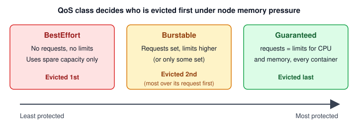

import Tabs from '@theme/Tabs';
import TabItem from '@theme/TabItem';

:::tip Key takeaways
- The **scheduler places pods by requests**; the **kubelet enforces limits** at runtime.
- Going over the CPU limit gets a container **throttled**. Going over the memory limit gets it **OOMKilled**.
- Requests and limits decide the **QoS class**, and the QoS class decides eviction order under node pressure.
- **Taints** keep pods off nodes; **affinity** pulls pods toward nodes or other pods. You often need both.
- Use **topology spread constraints** or pod anti-affinity so one node or zone failure can't take out every replica.
:::

## Requests and limits

| | Requests | Limits |
|---|---|---|
| Used by | Scheduler (does the pod fit on a node?) | Kubelet / container runtime |
| Meaning | Reserved minimum | Hard cap |
| CPU over the value | Fine if the node has spare CPU | **Throttled** (slowed down, not killed) |
| Memory over the value | Fine until the node is under pressure, then a likely eviction target | **OOMKilled** (exit code 137) |

<details>
<summary>Example and how to size a JVM container</summary>

```yaml
resources:
  requests:
    cpu: 500m        # 0.5 core reserved
    memory: 1Gi
  limits:
    cpu: "1"         # throttled above 1 core
    memory: 1Gi      # OOMKilled above 1Gi
```

For a JVM, heap is only part of the memory. Metaspace, thread stacks, direct buffers and GC overhead all count
against the limit. Size the heap as a percentage of the container (`-XX:MaxRAMPercentage=75`) rather than with a
fixed `-Xmx`, and leave headroom. See [Spring Boot on Kubernetes](./spring-boot-on-kubernetes).

</details>

:::warning Common traps
- **Memory limit = request** is the safe default: memory can't be reclaimed, so overcommitting it leads to evictions.
- **Tight CPU limits** cause latency spikes from CFS throttling, even when the node is idle. Many teams set CPU
  requests but leave out the CPU limit.
- **No requests at all** lets the scheduler overpack nodes and puts your pod first in line for eviction.
:::

## QoS classes

Kubernetes assigns each pod a QoS class from its requests and limits. When a node runs out of memory, the kubelet evicts pods in
QoS order.

| Class | Rule | Eviction priority |
|---|---|---|
| BestEffort | No requests or limits on any container | First |
| Burstable | At least one request or limit, not Guaranteed | Second (pods furthest over their request go first) |
| Guaranteed | Every container has requests = limits for CPU **and** memory | Last |

<details>
<summary>Diagram: eviction order</summary>



Check a pod's class with `kubectl get pod orders-service-7d9f -o jsonpath='{.status.qosClass}'`.

</details>

## Namespace guardrails: ResourceQuota and LimitRange

<Tabs>
<TabItem value="quota" label="ResourceQuota">

Caps the **total** a namespace can consume: CPU and memory sums, and object counts. Once a namespace has a compute quota,
every pod **must** declare requests and limits, or the API server rejects it.

```yaml
apiVersion: v1
kind: ResourceQuota
metadata:
  name: shop-quota
  namespace: shop
spec:
  hard:
    requests.cpu: "50"
    requests.memory: 100Gi
    limits.cpu: "100"
    limits.memory: 200Gi
    persistentvolumeclaims: "10"
    services.loadbalancers: "2"
    count/deployments.apps: "20"
```

`kubectl describe resourcequota shop-quota -n shop` shows used vs. hard.

</TabItem>
<TabItem value="limitrange" label="LimitRange">

Sets **per-container or per-pod** defaults and min/max values. Containers without resources get the defaults, which
pairs well with a quota.

```yaml
apiVersion: v1
kind: LimitRange
metadata:
  name: shop-defaults
  namespace: shop
spec:
  limits:
    - type: Container
      defaultRequest: { cpu: 100m, memory: 256Mi }
      default:        { cpu: 500m, memory: 512Mi }   # default limits
      min:            { cpu: 50m,  memory: 128Mi }
      max:            { cpu: "2",  memory: 4Gi }
    - type: PersistentVolumeClaim
      min: { storage: 1Gi }
      max: { storage: 100Gi }
```

</TabItem>
</Tabs>

## Placing pods on nodes

| Mechanism | Direction | Hard or soft | Use it for |
|---|---|---|---|
| `nodeSelector` | Pod → node labels | Hard | Simple "only on these nodes" |
| Node affinity | Pod → node labels | `required…` (hard) or `preferred…` (weighted) | Zones, instance types, "avoid spot" |
| Taints + tolerations | Node repels pods | `NoSchedule`, `PreferNoSchedule`, `NoExecute` | Dedicated nodes (GPU, batch) |
| Pod affinity | Pod → other pods | Hard or soft | Co-locate with a cache for latency |
| Pod anti-affinity | Pod away from other pods | Hard or soft | One replica per node or zone |
| Topology spread | Even spread across domains | `DoNotSchedule` / `ScheduleAnyway` | Balanced replicas across zones and nodes |

:::warning A toleration is not an attraction
A toleration only **allows** a pod onto a tainted node; it doesn't send it there. To dedicate nodes, taint them
**and** give the pods a toleration plus a node selector or affinity for the same label.
:::

<details>
<summary>Taints and tolerations</summary>

| Effect | New pods | Running pods |
|---|---|---|
| `NoSchedule` | Blocked unless they tolerate it | Stay |
| `PreferNoSchedule` | Avoided if possible | Stay |
| `NoExecute` | Blocked | **Evicted** unless they tolerate it (optionally after `tolerationSeconds`) |

```bash
kubectl taint nodes node-2 dedicated=batch:NoSchedule
kubectl taint nodes node-2 dedicated:NoSchedule-        # remove
```

```yaml
spec:
  tolerations:
    - key: dedicated
      operator: Equal
      value: batch
      effect: NoSchedule
  nodeSelector:
    dedicated: batch          # the node is also labelled, so the pod is actually attracted
```

</details>

<details>
<summary>Node affinity: required vs. preferred</summary>

`IgnoredDuringExecution` means the rule only applies at scheduling time. If node labels change later, running pods
are not moved.

```yaml
affinity:
  nodeAffinity:
    requiredDuringSchedulingIgnoredDuringExecution:
      nodeSelectorTerms:
        - matchExpressions:
            - key: topology.kubernetes.io/zone
              operator: In
              values: [zone-a, zone-b]
            - key: node.kubernetes.io/instance-type
              operator: NotIn
              values: [small, micro]
    preferredDuringSchedulingIgnoredDuringExecution:
      - weight: 80
        preference:
          matchExpressions:
            - key: node-role.example.com/spot
              operator: DoesNotExist        # prefer on-demand nodes
```

</details>

<details>
<summary>Pod anti-affinity for high availability</summary>

`topologyKey` defines the failure domain: `kubernetes.io/hostname` means per node, and `topology.kubernetes.io/zone` means
per zone.

```yaml
affinity:
  podAntiAffinity:
    requiredDuringSchedulingIgnoredDuringExecution:     # never two replicas on one node
      - labelSelector:
          matchLabels: { app: orders-service }
        topologyKey: kubernetes.io/hostname
    preferredDuringSchedulingIgnoredDuringExecution:    # try to spread across zones
      - weight: 100
        podAffinityTerm:
          labelSelector:
            matchLabels: { app: orders-service }
          topologyKey: topology.kubernetes.io/zone
```

Required anti-affinity with more replicas than nodes leaves the extra pods **Pending**. Prefer topology spread
constraints for anything that isn't strictly one replica per node.

</details>

<details>
<summary>Topology spread constraints</summary>

`maxSkew` is the largest allowed difference in matching pods between any two domains.

```yaml
topologySpreadConstraints:
  - maxSkew: 1
    topologyKey: topology.kubernetes.io/zone
    whenUnsatisfiable: DoNotSchedule      # hard
    labelSelector:
      matchLabels: { app: orders-service }
  - maxSkew: 2
    topologyKey: kubernetes.io/hostname
    whenUnsatisfiable: ScheduleAnyway     # soft
    labelSelector:
      matchLabels: { app: orders-service }
```

With 6 replicas over 3 zones and `maxSkew: 1`, you get 2/2/2. If you lose a zone, the other two still serve traffic.

</details>

## References
- [Resource management for pods and containers](https://kubernetes.io/docs/concepts/configuration/manage-resources-containers/)
- [Pod Quality of Service classes](https://kubernetes.io/docs/concepts/workloads/pods/pod-qos/)
- [Resource quotas](https://kubernetes.io/docs/concepts/policy/resource-quotas/)
- [Limit ranges](https://kubernetes.io/docs/concepts/policy/limit-range/)
- [Assigning pods to nodes](https://kubernetes.io/docs/concepts/scheduling-eviction/assign-pod-node/)
- [Taints and tolerations](https://kubernetes.io/docs/concepts/scheduling-eviction/taint-and-toleration/)
- [Topology spread constraints](https://kubernetes.io/docs/concepts/scheduling-eviction/topology-spread-constraints/)
- [Node-pressure eviction](https://kubernetes.io/docs/concepts/scheduling-eviction/node-pressure-eviction/)
