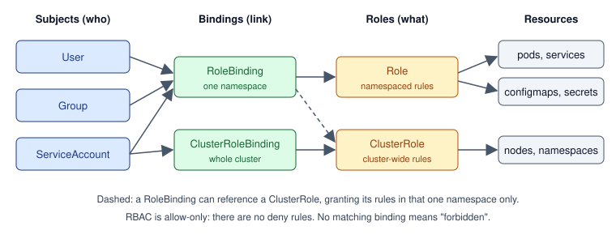

import Tabs from '@theme/Tabs';
import TabItem from '@theme/TabItem';

:::tip Key takeaways
- RBAC answers **who** (subject) can do **what** (verbs on resources) **where** (namespace or cluster). It is allow-only; there are no deny rules.
- A **Role** or **ClusterRole** defines permissions. A **RoleBinding** or **ClusterRoleBinding** grants them to a subject.
- Every pod runs as a **ServiceAccount**. Give each workload its own, with the smallest role that works.
- Use **workload identity** (IRSA / EKS Pod Identity, GKE Workload Identity, Azure Workload Identity) instead of cloud keys stored in Secrets.
- Enforce **Pod Security Standards** per namespace, and run containers as non-root with a read-only filesystem and no extra capabilities.
:::

Who may call the API is RBAC's job. Which pods may talk to each other is a separate control:
see NetworkPolicy in [Networking](./networking).

## RBAC building blocks

| Object | Scope | Purpose |
|---|---|---|
| **Role** | Namespace | A list of rules: `apiGroups` + `resources` + `verbs` (e.g. `get`, `list`, `watch`, `create`) |
| **ClusterRole** | Cluster | Same, but for cluster-scoped resources (nodes, namespaces) or for reuse across namespaces |
| **RoleBinding** | Namespace | Grants a Role, or a ClusterRole, to subjects inside one namespace |
| **ClusterRoleBinding** | Cluster | Grants a ClusterRole to subjects in every namespace |
| **ServiceAccount** | Namespace | The identity a pod uses to call the API server |

Subjects are **users** and **groups** (from your authenticator, e.g. OIDC; Kubernetes stores no user objects)
and **ServiceAccounts** (real API objects).

<details>
<summary>Diagram: subject → binding → role → resources</summary>



</details>

<details>
<summary>Least-privilege ServiceAccount (YAML)</summary>

The app can read exactly one ConfigMap and one Secret, nothing else.

```yaml
apiVersion: v1
kind: ServiceAccount
metadata:
  name: orders-service
  namespace: shop
---
apiVersion: rbac.authorization.k8s.io/v1
kind: Role
metadata:
  name: orders-config-reader
  namespace: shop
rules:
  - apiGroups: [""]                       # "" = core API group
    resources: ["configmaps", "secrets"]
    resourceNames: ["orders-config", "orders-secrets"]   # only these objects
    verbs: ["get"]
---
apiVersion: rbac.authorization.k8s.io/v1
kind: RoleBinding
metadata:
  name: orders-config-reader
  namespace: shop
subjects:
  - kind: ServiceAccount
    name: orders-service
    namespace: shop
roleRef:
  kind: Role
  name: orders-config-reader
  apiGroup: rbac.authorization.k8s.io
```

Reference it from the pod with `spec.serviceAccountName: orders-service`.

</details>

:::warning The default ServiceAccount
Pods that don't set `serviceAccountName` run as `default`, and its token is mounted automatically. Set
`automountServiceAccountToken: false` on pods that never call the API, so a compromised container can't use the token.
:::

## RBAC patterns

| Pattern | How |
|---|---|
| Least privilege | Separate ServiceAccount per workload, `resourceNames` where possible, avoid `*` verbs |
| Cross-namespace access | Put the Role and RoleBinding in the **target** namespace; the subject is a ServiceAccount from the source namespace |
| Reusable permissions | Define a ClusterRole once, bind it with a RoleBinding in each namespace that needs it |
| Aggregated roles | A ClusterRole with an `aggregationRule` collects rules from ClusterRoles that carry a matching label |
| Check permissions | `kubectl auth can-i <verb> <resource> --as <subject>` |
| Debug as someone else | `kubectl ... --as=<user>` / `--as-group=<group>` (impersonation, which itself needs the `impersonate` verb) |

<details>
<summary>Cross-namespace access (YAML)</summary>

A ServiceAccount in `billing` reads ConfigMaps in `shop`. Permissions always live where the resources are.

```yaml
apiVersion: rbac.authorization.k8s.io/v1
kind: Role
metadata:
  name: configmap-reader
  namespace: shop               # the namespace that owns the ConfigMaps
rules:
  - apiGroups: [""]
    resources: ["configmaps"]
    verbs: ["get", "list"]
---
apiVersion: rbac.authorization.k8s.io/v1
kind: RoleBinding
metadata:
  name: billing-reads-shop-config
  namespace: shop
subjects:
  - kind: ServiceAccount
    name: billing-service
    namespace: billing          # the caller's namespace
roleRef:
  kind: Role
  name: configmap-reader
  apiGroup: rbac.authorization.k8s.io
```

</details>

<details>
<summary>Aggregated ClusterRoles (YAML)</summary>

The built-in `admin`, `edit` and `view` roles work this way, which is how CRDs can add their resources to `view`.

```yaml
apiVersion: rbac.authorization.k8s.io/v1
kind: ClusterRole
metadata:
  name: pod-reader
  labels:
    rbac.example.com/aggregate-to-monitoring: "true"
rules:
  - apiGroups: [""]
    resources: ["pods"]
    verbs: ["get", "list", "watch"]
---
apiVersion: rbac.authorization.k8s.io/v1
kind: ClusterRole
metadata:
  name: monitoring
aggregationRule:
  clusterRoleSelectors:
    - matchLabels:
        rbac.example.com/aggregate-to-monitoring: "true"
rules: []   # filled in by the controller from every matching ClusterRole
```

</details>

<details>
<summary>Checking and impersonating (commands)</summary>

```bash
# Can I delete pods in shop?
kubectl auth can-i delete pods -n shop

# Everything a ServiceAccount may do in its namespace
kubectl auth can-i --list -n shop --as=system:serviceaccount:shop:orders-service

# Run a command as another user or group
kubectl get pods -n shop --as=jane --as-group=developers
```

A common setup gives humans read-only access and lets them impersonate a more privileged identity for writes. The
`--as` flag makes those writes deliberate and shows up in the audit log.

</details>

## Workload identity: pods calling cloud APIs

Don't put cloud access keys in Secrets. Map the pod's ServiceAccount to a cloud identity, and the pod gets
short-lived credentials automatically.

| Cloud | Mechanism | Link |
|---|---|---|
| AWS (EKS) | **IRSA** (ServiceAccount annotation + OIDC trust), or the newer **EKS Pod Identity** (association managed by EKS) | IAM role |
| GCP (GKE) | **Workload Identity Federation** | Google service account / IAM principal |
| Azure (AKS) | **Microsoft Entra Workload ID** | Managed identity / app registration |

<details>
<summary>How IRSA works</summary>

1. The cluster has an **OIDC issuer**, registered as an identity provider in IAM.
2. The ServiceAccount is annotated with an IAM role ARN.
3. A mutating webhook injects a projected ServiceAccount token plus `AWS_ROLE_ARN` and
   `AWS_WEB_IDENTITY_TOKEN_FILE` into the pod.
4. The AWS SDK calls `sts:AssumeRoleWithWebIdentity` with that token and receives temporary credentials.
5. The IAM role's **trust policy** only accepts tokens whose `sub` is `system:serviceaccount:<namespace>:<name>`.

```yaml
apiVersion: v1
kind: ServiceAccount
metadata:
  name: orders-service
  namespace: shop
  annotations:
    eks.amazonaws.com/role-arn: arn:aws:iam::111122223333:role/orders-service
```

```json
{
  "Effect": "Allow",
  "Principal": { "Federated": "arn:aws:iam::111122223333:oidc-provider/oidc.eks.us-east-1.amazonaws.com/id/EXAMPLE" },
  "Action": "sts:AssumeRoleWithWebIdentity",
  "Condition": {
    "StringEquals": {
      "oidc.eks.us-east-1.amazonaws.com/id/EXAMPLE:sub": "system:serviceaccount:shop:orders-service",
      "oidc.eks.us-east-1.amazonaws.com/id/EXAMPLE:aud": "sts.amazonaws.com"
    }
  }
}
```

With **EKS Pod Identity**, you skip the annotation and per-cluster OIDC trust: an EKS agent hands out credentials
based on a pod identity association, and the role trusts `pods.eks.amazonaws.com`.

</details>

## Pod Security Standards and securityContext

**Pod Security Admission** (built in since 1.25, replacing PodSecurityPolicy) enforces one of three levels per
namespace, via labels:

| Level | Allows | Use for |
|---|---|---|
| `privileged` | Anything | System components (CNI, storage drivers) |
| `baseline` | Blocks known escalations (host namespaces, privileged containers, hostPath) | Most workloads, as a minimum |
| `restricted` | Baseline + non-root, no privilege escalation, drop all capabilities, seccomp | Application namespaces |

Each level can be applied in `enforce` (reject), `audit` (log) or `warn` (warn the client) mode.

<Tabs>
<TabItem value="namespace" label="Namespace labels">

```yaml
apiVersion: v1
kind: Namespace
metadata:
  name: shop
  labels:
    pod-security.kubernetes.io/enforce: restricted
    pod-security.kubernetes.io/warn: restricted
    pod-security.kubernetes.io/audit: restricted
```

</TabItem>
<TabItem value="pod" label="Pod that passes 'restricted'">

```yaml
apiVersion: v1
kind: Pod
metadata:
  name: orders-service
spec:
  securityContext:
    runAsNonRoot: true
    runAsUser: 1000
    fsGroup: 2000
    seccompProfile:
      type: RuntimeDefault
  containers:
    - name: app
      image: registry.example.com/orders-service:1.4.2
      securityContext:
        allowPrivilegeEscalation: false
        readOnlyRootFilesystem: true
        capabilities:
          drop: ["ALL"]
      volumeMounts:
        - name: tmp
          mountPath: /tmp          # writable scratch space, since root fs is read-only
  volumes:
    - name: tmp
      emptyDir: {}
```

</TabItem>
</Tabs>

:::warning readOnlyRootFilesystem breaks apps that write to disk
Many frameworks write temp files: the JVM, Tomcat's work directory, Python caches. Mount an `emptyDir` at `/tmp`, or
wherever the app writes, instead of turning the setting off.
:::

## Common questions

Short answers to questions that come up in interviews. Quiz-style questions are in [Interview Questions](./interview-questions).

<details>
<summary>Role vs. ClusterRole: when do you need a ClusterRole?</summary>

When the resource is cluster-scoped (nodes, namespaces, PersistentVolumes, CRDs), when you need non-resource URLs
like `/healthz`, or when you want to define permissions once and reuse them. A ClusterRole bound with a
**RoleBinding** only grants access in that binding's namespace, which is the usual way to reuse it.

</details>

<details>
<summary>A pod gets "forbidden" when listing pods. How do you debug it?</summary>

1. Find the identity: `kubectl get pod <pod> -o jsonpath='{.spec.serviceAccountName}'`.
2. Test it: `kubectl auth can-i list pods -n shop --as=system:serviceaccount:shop:<sa>`.
3. Check bindings: `kubectl get rolebindings,clusterrolebindings -A -o wide | grep <sa>`.
4. Common causes: the RoleBinding is in the wrong namespace, the subject's namespace is wrong, or the rule's `apiGroups`
   doesn't match (Deployments are in `apps`, not `""`).

</details>

<details>
<summary>Are Secrets secure because RBAC protects them?</summary>

Only partly. Anyone who can create a pod in the namespace can mount any Secret there, so `create pods` effectively
means `read secrets`. `list`/`watch` on Secrets also return their values. Restrict those verbs, enable encryption at
rest for etcd, and consider an external secret store. See [Configuration & Secrets](./configuration-secrets).

</details>

<details>
<summary>Why use IRSA or Pod Identity instead of an access key in a Secret?</summary>

Credentials are short-lived and rotated automatically, scoped to one ServiceAccount, and never stored in the
cluster. A leaked static key works from anywhere until someone revokes it.

</details>

## References

- [Kubernetes: Using RBAC Authorization](https://kubernetes.io/docs/reference/access-authn-authz/rbac/)
- [Kubernetes: Service Accounts](https://kubernetes.io/docs/concepts/security/service-accounts/)
- [Kubernetes: Pod Security Standards](https://kubernetes.io/docs/concepts/security/pod-security-standards/)
- [Kubernetes: Configure a Security Context](https://kubernetes.io/docs/tasks/configure-pod-container/security-context/)
- [AWS: IAM roles for service accounts](https://docs.aws.amazon.com/eks/latest/userguide/iam-roles-for-service-accounts.html)
- [AWS: EKS Pod Identity](https://docs.aws.amazon.com/eks/latest/userguide/pod-identities.html)
- [GKE: Workload Identity Federation](https://cloud.google.com/kubernetes-engine/docs/concepts/workload-identity)
- [AKS: Microsoft Entra Workload ID](https://learn.microsoft.com/azure/aks/workload-identity-overview)
