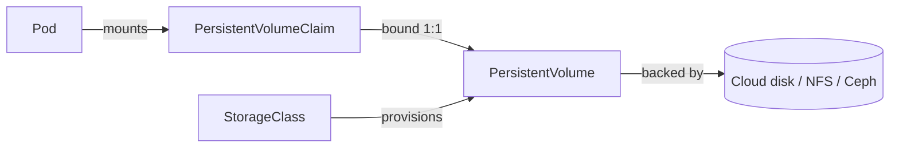

import Tabs from '@theme/Tabs';
import TabItem from '@theme/TabItem';

:::tip Key takeaways
- A **PVC** is a request for storage, a **PV** is the actual volume, and a **StorageClass** says how to create PVs on demand.
- **Dynamic provisioning** is the norm: create a PVC, and the CSI driver creates the disk and the PV.
- Most block storage is **ReadWriteOnce**: only one node can mount it read-write. Shared read-write needs a file system (NFS-style).
- `reclaimPolicy: Delete` destroys the disk when the PVC is deleted. Use `Retain` for data you can't lose.
- StatefulSets get **one PVC per replica** via `volumeClaimTemplates`, and those PVCs outlive the pods.
:::

## The storage abstraction

Pods never refer to disks directly. They mount a claim, and the cluster binds that claim to a volume.

| Object | Who creates it | What it is |
|---|---|---|
| PersistentVolumeClaim (PVC) | App team | "I need 50Gi, RWO, class `fast-ssd`". Namespaced. |
| PersistentVolume (PV) | Usually the provisioner (or an admin, for static PVs) | The real volume. Cluster-scoped. |
| StorageClass | Platform team | Provisioner + parameters + reclaim and binding policy |
| CSI driver | Platform team | The plugin that talks to the storage backend (cloud disks, NFS, Ceph…) |

<details>
<summary>Diagram: how the objects relate</summary>



</details>

## Dynamic provisioning

A PVC names a StorageClass. The CSI driver then creates the disk and a matching PV, and binds the two. If a PVC names no class,
it gets the cluster's default class.

<details>
<summary>StorageClass and PVC (YAML)</summary>

```yaml
apiVersion: storage.k8s.io/v1
kind: StorageClass
metadata:
  name: fast-ssd
provisioner: ebs.csi.aws.com          # any CSI driver; parameters are driver-specific
parameters:
  type: gp3
  encrypted: "true"
allowVolumeExpansion: true
volumeBindingMode: WaitForFirstConsumer
reclaimPolicy: Delete
---
apiVersion: v1
kind: PersistentVolumeClaim
metadata:
  name: postgres-data
  namespace: shop
spec:
  accessModes: [ReadWriteOnce]
  storageClassName: fast-ssd
  resources:
    requests:
      storage: 50Gi
```

</details>

:::warning Use `WaitForFirstConsumer` for zonal disks
With `Immediate` binding, the disk is created before the pod is scheduled, possibly in a zone where the pod can't
run. The pod then stays Pending with a volume node-affinity conflict. `WaitForFirstConsumer` creates the disk in the
zone the scheduler picks.
:::

## Access modes and reclaim policy

| Access mode | Meaning | Typical backend |
|---|---|---|
| `ReadWriteOnce` (RWO) | Read-write by **one node** (several pods on that node can share it) | Block storage: cloud disks |
| `ReadWriteOncePod` (RWOP) | Read-write by **one pod** only | CSI block storage |
| `ReadOnlyMany` (ROX) | Read-only by many nodes | Shared static content |
| `ReadWriteMany` (RWX) | Read-write by many nodes | File storage: NFS, managed file shares, CephFS |

| Reclaim policy | When the PVC is deleted |
|---|---|
| `Delete` | The PV **and the underlying disk** are deleted (the default for dynamic provisioning) |
| `Retain` | The PV becomes `Released`; the data stays until an admin cleans it up or reuses it |

:::danger Deleting a namespace deletes its PVCs
With `reclaimPolicy: Delete`, that also deletes the disks. For important data, use a `Retain` class or patch the PV's
`persistentVolumeReclaimPolicy` to `Retain`, and take snapshots.
:::

## Expansion and snapshots

<Tabs>
<TabItem value="expand" label="Volume expansion">

If the StorageClass has `allowVolumeExpansion: true`, edit the PVC to request more space. The driver grows the disk and
the kubelet grows the file system. Volumes **can't shrink**.

```bash
kubectl patch pvc postgres-data -n shop \
  -p '{"spec":{"resources":{"requests":{"storage":"100Gi"}}}}'
kubectl describe pvc postgres-data -n shop    # look for FileSystemResizeSuccessful
```

</TabItem>
<TabItem value="snapshot" label="Snapshots and restore">

Snapshots need a CSI driver that supports them, plus the snapshot CRDs and controller.

```yaml
apiVersion: snapshot.storage.k8s.io/v1
kind: VolumeSnapshot
metadata:
  name: postgres-snap-2024-03-11
  namespace: shop
spec:
  volumeSnapshotClassName: csi-snapclass
  source:
    persistentVolumeClaimName: postgres-data
---
# Restore: a new PVC whose dataSource is the snapshot
apiVersion: v1
kind: PersistentVolumeClaim
metadata:
  name: postgres-data-restored
  namespace: shop
spec:
  accessModes: [ReadWriteOnce]
  storageClassName: fast-ssd
  dataSource:
    name: postgres-snap-2024-03-11
    kind: VolumeSnapshot
    apiGroup: snapshot.storage.k8s.io
  resources:
    requests:
      storage: 50Gi
```

A snapshot is crash-consistent, not application-consistent. For databases, prefer native backups, or quiesce the
database before taking the snapshot.

</TabItem>
</Tabs>

## StatefulSets and volumeClaimTemplates

A StatefulSet creates one PVC per replica from a template (`data-postgres-0`, `data-postgres-1`, …). A pod that is
rescheduled gets **its own** volume back. Scaling down or deleting the StatefulSet **keeps** the PVCs by default.
See [Workloads](./workloads) for StatefulSet identity and ordering.

<details>
<summary>volumeClaimTemplates example</summary>

```yaml
apiVersion: apps/v1
kind: StatefulSet
metadata:
  name: postgres
spec:
  serviceName: postgres
  replicas: 3
  selector:
    matchLabels: { app: postgres }
  template:
    metadata:
      labels: { app: postgres }
    spec:
      containers:
        - name: postgres
          image: postgres:16
          volumeMounts:
            - name: data
              mountPath: /var/lib/postgresql/data
  volumeClaimTemplates:
    - metadata:
        name: data
      spec:
        accessModes: [ReadWriteOnce]
        storageClassName: fast-ssd
        resources:
          requests:
            storage: 50Gi
```

</details>

## Ephemeral and special volume types

| Volume | Lifetime | Use it for |
|---|---|---|
| `emptyDir` | The pod's lifetime (survives container restarts) | Scratch space, caches, sharing files between containers |
| `emptyDir` with `medium: Memory` | The pod's lifetime, in RAM (counts against the memory limit) | Fast temp files |
| `configMap` / `secret` | Updated as the object changes | Config files, certificates (see [Configuration & Secrets](./configuration-secrets)) |
| `projected` | The pod's lifetime | Combine a ConfigMap, a Secret and a short-lived ServiceAccount token in one mount |
| `hostPath` | The node's lifetime | Node agents only. A security risk, usually blocked by Pod Security. |

<details>
<summary>Volume types example</summary>

```yaml
spec:
  containers:
    - name: app
      image: registry.example.com/orders-service:1.4.0
      volumeMounts:
        - { name: cache,  mountPath: /cache }
        - { name: bundle, mountPath: /etc/app, readOnly: true }
  volumes:
    - name: cache
      emptyDir:
        sizeLimit: 1Gi
    - name: bundle
      projected:
        sources:
          - configMap: { name: orders-config }
          - secret:    { name: db-credentials }
          - serviceAccountToken:
              path: token
              expirationSeconds: 3600
```

</details>

## References
- [Volumes](https://kubernetes.io/docs/concepts/storage/volumes/)
- [Persistent Volumes](https://kubernetes.io/docs/concepts/storage/persistent-volumes/)
- [Storage Classes](https://kubernetes.io/docs/concepts/storage/storage-classes/)
- [Dynamic Volume Provisioning](https://kubernetes.io/docs/concepts/storage/dynamic-provisioning/)
- [Volume Snapshots](https://kubernetes.io/docs/concepts/storage/volume-snapshots/)
- [Ephemeral Volumes](https://kubernetes.io/docs/concepts/storage/ephemeral-volumes/)
