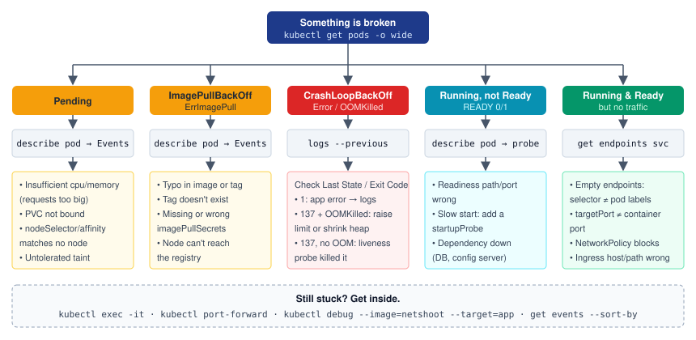

import Tabs from '@theme/Tabs';
import TabItem from '@theme/TabItem';

:::tip Key takeaways
- Work outside in: **`get` → `describe` (Events) → `logs --previous` → `exec` / `port-forward` → `kubectl debug`**.
- The pod's **STATUS tells you where to look**. `Pending` is a scheduling problem, `ImagePullBackOff` is an image or registry problem, and `CrashLoopBackOff` is a problem in your app or its config.
- **Exit code 137** means SIGKILL. Check `Reason: OOMKilled` to tell a memory kill from a failed liveness probe.
- If a Service gets no traffic, **check the endpoints first**. When they're empty, the selector doesn't match any Ready pods.
- Use `kubectl logs --previous` for crashes. The plain `logs` command shows the new container, which hasn't failed yet.
:::

## A systematic debugging flow

Start with the cheapest and broadest command, and only narrow down once you know where the problem is. Most problems
show up in the pod's **STATUS** column and the **Events** section of `kubectl describe`. You only need to get inside
the container for problems those two don't explain.

| Step | Command | What it answers |
|---|---|---|
| 1. Status | `kubectl get pods -o wide` | Which phase is the pod in, how many restarts, on which node? |
| 2. Events | `kubectl describe pod <pod>` | Why wasn't it scheduled, pulled or started? Did a probe fail? |
| 3. Logs | `kubectl logs <pod> --previous` | What did the app print before it died? |
| 4. Inside | `kubectl exec` / `kubectl port-forward` | Does the app answer locally? Are DNS and env vars correct? |
| 5. Debug | `kubectl debug` (ephemeral container) | Same as 4, for distroless images that have no shell |

<details>
<summary>Diagram: debugging decision tree</summary>



</details>

<details>
<summary>Commands for each step</summary>

```bash
# 1. Status
kubectl get pods -n shop -o wide
kubectl get pod orders-7c9f -n shop -o yaml          # full spec + status

# 2. Events (the bottom of describe is usually the answer)
kubectl describe pod orders-7c9f -n shop
kubectl get events -n shop --sort-by=.lastTimestamp
kubectl get events -n shop --field-selector involvedObject.name=orders-7c9f

# 3. Logs
kubectl logs orders-7c9f -n shop --previous          # the container that crashed
kubectl logs orders-7c9f -n shop -c app --tail=100 -f
kubectl logs -l app=orders -n shop --all-containers --since=1h

# 4. Inside
kubectl exec -it orders-7c9f -n shop -- sh
kubectl port-forward svc/orders 8080:80 -n shop      # then curl localhost:8080
kubectl top pod -n shop --containers

# 5. Ephemeral debug container (shares the target's process namespace)
kubectl debug -it orders-7c9f -n shop --image=nicolaka/netshoot --target=app
```

</details>

<details>
<summary>Debugging distroless images and crashing pods with `kubectl debug`</summary>

Minimal images often have no shell, so `exec` fails. `kubectl debug` attaches an **ephemeral container** with your
tools to the running pod. With `--target`, it shares the process namespace, so you can see the app's processes.

```bash
# Tools container inside a running pod
kubectl debug -it orders-7c9f --image=busybox --target=app

# Pod crashes too fast to exec into: copy it and override the command
kubectl debug orders-7c9f -it --copy-to=orders-debug --container=app -- sh

# Node-level problems (disk, kubelet, registry reachability): runs a pod on the node
kubectl debug node/worker-3 -it --image=ubuntu    # host filesystem at /host

# Throwaway network toolbox in the namespace
kubectl run netshoot --rm -it --image=nicolaka/netshoot -n shop -- bash
#   nslookup orders  ·  curl http://orders:80/actuator/health  ·  cat /etc/resolv.conf
```

</details>

## Pod states and fixes

Each STATUS points to a different layer: the scheduler, the kubelet and registry, or your app.

| Status | Layer | Usual causes | Fix |
|---|---|---|---|
| `Pending` | Scheduler | Requests exceed free node capacity; PVC not bound; `nodeSelector`/affinity matches no node; untolerated taint; namespace quota | Read the `FailedScheduling` event; lower requests, add nodes, or fix labels, tolerations or the PVC |
| `ImagePullBackOff` / `ErrImagePull` | Kubelet + registry | Typo in image or tag; tag doesn't exist; missing `imagePullSecrets`; node can't reach the registry | Check the image in `describe`, the pull secret, and registry access from the node |
| `CrashLoopBackOff` | Your container | App exits on startup (bad config, missing env, dependency down); liveness probe kills it | `logs --previous` and the exit code; check config and probes |
| `OOMKilled` (exit 137) | Kernel cgroup | Container memory went over `limits.memory` | Raise the limit, or size the heap to the container (`-XX:MaxRAMPercentage`) |
| `CreateContainerConfigError` | Kubelet | Referenced ConfigMap/Secret or key doesn't exist | Create it or fix the name or key; `describe` names the missing object |
| `Evicted` | Kubelet (node pressure) | Node ran low on memory or disk; `BestEffort`/`Burstable` pods go first | Set requests (better QoS), limit `emptyDir`/log growth, clean up evicted pods |
| `Terminating` (stuck) | API server | Finalizer not removed; node unreachable; app ignores SIGTERM until the grace period ends | Check `metadata.finalizers`, node status; force delete only as a last resort |
| Running but `READY 0/1` | Readiness probe | Wrong probe path or port; slow start; dependency check in readiness | Fix the probe, add a `startupProbe`, keep readiness dependency-light |

<details>
<summary>Reading exit codes</summary>

| Exit code | Meaning | Look at |
|---|---|---|
| 0 | Process finished. In a Deployment that's still a "crash", because it should run forever | Wrong command, or the workload should be a Job |
| 1 | Application error | `logs --previous` |
| 137 | SIGKILL (128 + 9) | `Reason: OOMKilled` → memory; otherwise a failed liveness probe or eviction |
| 143 | SIGTERM (128 + 15) | Normal shutdown: rollout, scale-down, drain |

```bash
kubectl describe pod orders-7c9f | grep -A5 "Last State"
#   Last State:  Terminated
#     Reason:    OOMKilled
#     Exit Code: 137
```

</details>

<Tabs>
<TabItem value="pending" label="Pending">

```bash
kubectl describe pod orders-7c9f | sed -n '/Events/,$p'
#   0/5 nodes are available: 3 Insufficient memory, 2 node(s) had untolerated taint ...

kubectl describe nodes | grep -A5 "Allocated resources"   # requests vs capacity
kubectl get pvc -n shop                                   # STATUS should be Bound
kubectl get nodes --show-labels                           # do labels match nodeSelector?
kubectl describe node worker-3 | grep Taints
kubectl describe quota -n shop                            # namespace quota exhausted?
```

The scheduler places pods by **requests**, not by actual usage. A node can look idle in `kubectl top` and still be
"full".

</TabItem>
<TabItem value="crash" label="CrashLoopBackOff">

```bash
kubectl logs orders-7c9f --previous
kubectl describe pod orders-7c9f | grep -E "Exit Code|Reason|Liveness"
kubectl get pod orders-7c9f -o jsonpath='{.spec.containers[0].env}'
```

The back-off between restarts doubles up to 5 minutes, so a pod can sit in `CrashLoopBackOff` while nothing seems
to be happening. If the logs are clean and the exit code is 137 without `OOMKilled`, the **liveness probe** is
probably killing a slow-starting app. Add a `startupProbe` instead of increasing `initialDelaySeconds`.

</TabItem>
<TabItem value="image" label="ImagePullBackOff">

```bash
kubectl describe pod orders-7c9f | grep -E "Image:|Failed"
#   Failed to pull image "registry.example.com/orders:1.4.2": ... not found / unauthorized

kubectl get pod orders-7c9f -o yaml | grep -A3 imagePullSecrets
kubectl get secret regcred -n shop          # exists in the SAME namespace?
```

`not found` means a wrong name or tag. `unauthorized` means a missing or wrong pull secret. A timeout means a
network or proxy problem between the node and the registry.

</TabItem>
<TabItem value="oom" label="OOMKilled">

```bash
kubectl top pod orders-7c9f --containers
kubectl get pod orders-7c9f -o jsonpath='{.spec.containers[0].resources}'
```

For the JVM, the heap is only part of the memory use. Metaspace, thread stacks, direct buffers and the code cache are
on top of it. Leave roughly 25% headroom: `-XX:MaxRAMPercentage=75` with `limits.memory` equal to `requests.memory`.
See [Spring Boot on Kubernetes](./spring-boot-on-kubernetes).

</TabItem>
</Tabs>

:::warning Don't "fix" a crash loop by deleting the pod
The ReplicaSet recreates it with the same spec, so it crashes the same way and you lose the `--previous` logs.
Read the logs and events first, then change the Deployment.
:::

## Service has no endpoints

The pods are Running, but calls to the Service time out or return `503`. Check the **endpoints**. If there are none,
the Service selector doesn't match any **Ready** pods. If there are endpoints, look further along the path: port
mapping, NetworkPolicy, then Ingress.

<details>
<summary>Step by step</summary>

```bash
# 1. Does the Service have endpoints?
kubectl get endpointslices -n shop -l kubernetes.io/service-name=orders
kubectl get endpoints orders -n shop          # empty ENDPOINTS column = problem

# 2. Empty → compare selector with pod labels (and check pods are Ready)
kubectl get svc orders -n shop -o jsonpath='{.spec.selector}'
kubectl get pods -n shop -l app=orders --show-labels

# 3. Endpoints exist → is targetPort the port the container actually listens on?
kubectl get svc orders -n shop -o yaml | grep -A4 ports

# 4. Test from inside the cluster (bypasses Ingress)
kubectl run curl --rm -it --image=curlimages/curl -n shop -- \
  curl -sv http://orders.shop.svc.cluster.local/actuator/health

# 5. Works by pod IP but not by name → DNS; works in-namespace but not across → NetworkPolicy
kubectl get networkpolicy -n shop
```

</details>

:::danger Readiness probes that check dependencies
If readiness fails whenever the database is slow, **every** pod goes unready together and the Service has no
endpoints. One slow dependency then becomes a full outage. Keep readiness about "can this pod serve" and handle
dependency failures in the app (timeouts, circuit breakers).
:::

## Debugging Jobs and CronJobs

A CronJob creates Jobs, and each Job creates pods. Debug one level down at a time: did the CronJob **schedule** a Job,
did the Job **create pods**, and did the pods **succeed**?

<details>
<summary>Commands</summary>

```bash
kubectl get cronjob report -n shop                    # LAST SCHEDULE, ACTIVE, SUSPEND
kubectl describe cronjob report -n shop               # events: missed schedules, concurrency skips
kubectl get jobs -n shop --sort-by=.status.startTime
kubectl logs job/report-28761234 -n shop

# Run it now, without waiting for the schedule
kubectl create job --from=cronjob/report report-manual-$(date +%s) -n shop
```

</details>

<details>
<summary>Common CronJob surprises</summary>

- **It didn't run.** `suspend: true`; `concurrencyPolicy: Forbid` while the previous run is still active; or more than
  100 missed schedules (e.g. the controller was down) without `startingDeadlineSeconds`.
- **Wrong time.** Schedules use the controller's time zone (usually UTC) unless you set `spec.timeZone`.
- **It ran twice.** Scheduling is "at least once" in rare cases, so make the job idempotent.
- **History disappeared.** `successfulJobsHistoryLimit` / `failedJobsHistoryLimit` (defaults 3 and 1) prune old Jobs,
  and their logs with them. Ship logs to a central store.
- **The Job retries forever or gives up too soon.** Tune `backoffLimit` and `activeDeadlineSeconds`;
  `ttlSecondsAfterFinished` cleans up finished Jobs.

</details>

## Rollouts that get stuck

`kubectl rollout status` hangs when new pods never become Ready. The old ReplicaSet keeps serving, so a stuck
rollout usually isn't an outage, but it blocks your release. After `progressDeadlineSeconds` (default 600 s), the
Deployment reports `ProgressDeadlineExceeded`.

<details>
<summary>Commands</summary>

```bash
kubectl rollout status deployment/orders -n shop
kubectl get rs -n shop -l app=orders                  # new RS stuck at 0/1 ready?
kubectl rollout history deployment/orders -n shop
kubectl rollout undo deployment/orders -n shop        # back to the previous revision
kubectl rollout undo deployment/orders --to-revision=3 -n shop
```

</details>

## kubectl cheat sheet

| Task | Command |
|---|---|
| Everything in a namespace | `kubectl get all -n shop` |
| Wide output / full YAML | `kubectl get pods -o wide` · `kubectl get pod <p> -o yaml` |
| Filter by label | `kubectl get pods -l 'app in (orders,payments),env!=dev'` |
| Filter by field | `kubectl get pods --field-selector status.phase!=Running` |
| Extract a value | `kubectl get svc orders -o jsonpath='{.spec.clusterIP}'` |
| Recent events | `kubectl get events --sort-by=.lastTimestamp` |
| Resource usage | `kubectl top node` · `kubectl top pod --containers` |
| Scale / restart | `kubectl scale deploy/orders --replicas=5` · `kubectl rollout restart deploy/orders` |
| Copy files | `kubectl cp shop/orders-7c9f:/tmp/heap.hprof ./heap.hprof` |
| What can I do? | `kubectl auth can-i delete pods -n shop` |
| Explain a field | `kubectl explain deployment.spec.strategy` |

<details>
<summary>Tools and aliases</summary>

| Tool | Use |
|---|---|
| `k9s` | Terminal UI: browse resources, logs, exec and port-forward with a few keystrokes |
| `kubectx` / `kubens` | Switch cluster context and default namespace quickly |
| `stern` | Tail logs from many pods at once, by label or regex, colour-coded per pod |
| `krew` | kubectl plugin manager (`tree`, `neat`, `ctx`, `ns`) |
| `kubectl tree` | Show owner hierarchy: Deployment → ReplicaSet → Pod |
| `kubectl neat` | Remove managed fields and status from `-o yaml` output |

```bash
# ~/.zshrc
alias k='kubectl'
alias kgp='kubectl get pods'
alias kdp='kubectl describe pod'
alias kl='kubectl logs'
alias kex='kubectl exec -it'
alias kn='kubectl config set-context --current --namespace'

stern -n shop 'orders-.*' --since 10m
```

</details>

## References
- [Kubernetes docs: Debug Pods](https://kubernetes.io/docs/tasks/debug/debug-application/debug-pods/)
- [Kubernetes docs: Debug Services](https://kubernetes.io/docs/tasks/debug/debug-application/debug-service/)
- [Kubernetes docs: Ephemeral containers](https://kubernetes.io/docs/concepts/workloads/pods/ephemeral-containers/)
- [Kubernetes docs: kubectl quick reference](https://kubernetes.io/docs/reference/kubectl/quick-reference/)
- [Kubernetes docs: CronJob](https://kubernetes.io/docs/concepts/workloads/controllers/cron-jobs/)
