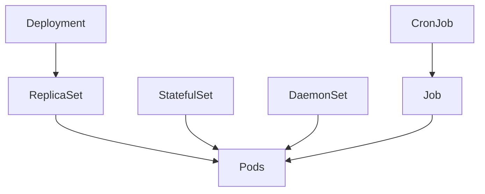

import Tabs from '@theme/Tabs';
import TabItem from '@theme/TabItem';

:::tip Key takeaways
- **Deployment** for stateless apps, **StatefulSet** when each replica needs a stable name and its own disk,
  **DaemonSet** for one pod per node, **Job/CronJob** for work that finishes.
- A rolling update is shaped by `maxSurge` and `maxUnavailable`. `maxUnavailable: 0` plus a good readiness probe gives
  zero-downtime releases.
- Each rollout creates a new ReplicaSet. `kubectl rollout undo` scales an old one back up, limited by
  `revisionHistoryLimit`.
- For CronJobs, set `concurrencyPolicy: Forbid`, `backoffLimit` and `activeDeadlineSeconds`, or a stuck run can pile up
  or retry forever.
:::

## Choosing a workload

| Workload | Use for | Pod identity | Storage | Example |
|---|---|---|---|---|
| Deployment | Stateless services | Random names, interchangeable | Shared or none | REST APIs, web frontends |
| StatefulSet | Clustered or stateful systems | Stable: `db-0`, `db-1` | One PVC per pod | Postgres, Kafka, Cassandra, ZooKeeper |
| DaemonSet | Node-level agents | One per (matching) node | Usually `hostPath` | Log shippers, metrics agents, CNI |
| Job | Run to completion once | Disposable | Ephemeral | DB migration, batch import |
| CronJob | Run to completion on a schedule | Creates a Job each run | Ephemeral | Nightly report, cleanup |

<details>
<summary>How the controllers relate</summary>



Only Deployments go through a ReplicaSet. That's how they keep old revisions for rollback.

</details>

## Deployments and rolling updates

Changing anything in the pod template (image, env, resources) triggers a rollout. The Deployment creates a new
ReplicaSet and shifts replicas from old to new within the limits you set.

| Setting | Meaning | Safe default for an API |
|---|---|---|
| `maxSurge` | Extra pods allowed above `replicas` during the rollout | `1` or `25%` |
| `maxUnavailable` | Pods allowed below `replicas` during the rollout | `0` |
| `revisionHistoryLimit` | Old ReplicaSets kept for rollback | `5`–`10` |
| `progressDeadlineSeconds` | Time before the rollout is marked as failed | `600` |
| `minReadySeconds` | Time a new pod must stay Ready before it counts | `5`–`10` |

<details>
<summary>Deployment manifest</summary>

```yaml
apiVersion: apps/v1
kind: Deployment
metadata:
  name: orders-service
  namespace: shop
spec:
  replicas: 3
  revisionHistoryLimit: 10
  progressDeadlineSeconds: 600
  selector:
    matchLabels:
      app: orders-service            # immutable; must match the template labels
  strategy:
    type: RollingUpdate              # or Recreate: kill all, then start all (has downtime)
    rollingUpdate:
      maxSurge: 1
      maxUnavailable: 0
  template:
    metadata:
      labels:
        app: orders-service
        version: "1.4.0"
    spec:
      terminationGracePeriodSeconds: 30
      containers:
        - name: app
          image: registry.example.com/orders-service:1.4.0
          ports:
            - name: http
              containerPort: 8080
          readinessProbe:
            httpGet: { path: /actuator/health/readiness, port: http }
            periodSeconds: 5
          lifecycle:
            preStop:
              exec:
                command: ["sh", "-c", "sleep 10"]   # let endpoints and load balancers drain
```

</details>

<details>
<summary>Rollout commands</summary>

```bash
kubectl set image deployment/orders-service app=registry.example.com/orders-service:1.5.0 -n shop
kubectl rollout status deployment/orders-service -n shop      # blocks; non-zero exit on failure (CI gate)
kubectl rollout history deployment/orders-service -n shop
kubectl rollout undo deployment/orders-service -n shop        # back to the previous revision
kubectl rollout undo deployment/orders-service --to-revision=3 -n shop
kubectl rollout pause deployment/orders-service -n shop       # batch several edits into one rollout
kubectl rollout resume deployment/orders-service -n shop
kubectl rollout restart deployment/orders-service -n shop     # new pods, same spec (for example to pick up a Secret)
kubectl annotate deployment/orders-service kubernetes.io/change-cause="release 1.5.0" -n shop
```

</details>

<details>
<summary>Zero-downtime checklist</summary>

1. A **readiness probe** that fails until the app can serve. The new pod gets no traffic before it's Ready.
2. `maxUnavailable: 0`, so capacity never drops during the rollout.
3. A **`preStop` sleep** of 5–15s. Endpoint removal and SIGTERM happen in parallel, so without it the pod can shut
   down while load balancers still send it requests.
4. **Graceful shutdown** in the app (for Spring Boot, `server.shutdown=graceful`) within
   `terminationGracePeriodSeconds`.
5. `kubectl rollout status` in CI, so a failed rollout fails the pipeline.

Blue-green and canary releases are covered in [Deployment Strategies](./deployment-strategies).

</details>

:::warning Rollback only restores the pod template
`rollout undo` brings back the old image and pod spec. It doesn't undo ConfigMap or Secret changes, database
migrations or Service edits.
:::

## StatefulSets

A StatefulSet gives each replica a **stable identity**: a fixed ordinal name (`postgres-0`), a stable DNS name
through a **headless Service**, and its **own PersistentVolumeClaim** that follows it across rescheduling. By default,
pods start in order (0, 1, 2) and are updated in reverse order.

<details>
<summary>StatefulSet manifest</summary>

```yaml
apiVersion: apps/v1
kind: StatefulSet
metadata:
  name: postgres
  namespace: shop
spec:
  serviceName: postgres            # headless Service providing per-pod DNS
  replicas: 3
  podManagementPolicy: OrderedReady  # or Parallel when order doesn't matter
  selector:
    matchLabels:
      app: postgres
  template:
    metadata:
      labels:
        app: postgres
    spec:
      containers:
        - name: postgres
          image: postgres:16
          ports:
            - containerPort: 5432
          volumeMounts:
            - name: data
              mountPath: /var/lib/postgresql/data
  volumeClaimTemplates:            # one PVC per pod: data-postgres-0, data-postgres-1, ...
    - metadata:
        name: data
      spec:
        accessModes: ["ReadWriteOnce"]
        resources:
          requests:
            storage: 10Gi
```

Each pod is reachable as `postgres-0.postgres.shop.svc.cluster.local`. See [Networking](./networking).

</details>

<details>
<summary>Deployment vs. StatefulSet</summary>

<Tabs>
<TabItem value="deployment" label="Deployment">

- Pods are interchangeable, with random suffixes.
- All replicas share one volume (if any) or use none.
- Pods start and stop in parallel.
- Scales and rolls fast.

</TabItem>
<TabItem value="statefulset" label="StatefulSet">

- Pods have stable names and DNS: `name-0`, `name-1`.
- `volumeClaimTemplates` give each pod its own PVC, reattached after rescheduling.
- Ordered start, scale-down and rolling updates (`partition` allows staged updates).
- Deleting the StatefulSet or scaling it down **keeps the PVCs**, unless `persistentVolumeClaimRetentionPolicy` says otherwise.

</TabItem>
</Tabs>

</details>

:::tip Running databases on Kubernetes
A StatefulSet handles identity and storage, not replication, failover or backups. In production, use a managed
database or an [operator](./operators-crds) that encodes that logic.
:::

## DaemonSets

A DaemonSet runs one copy of a pod on every node, or on every node matching a `nodeSelector`/affinity. New nodes get
the pod automatically. Typical uses are log collectors, node metrics exporters, CNI plugins and storage drivers.

<details>
<summary>DaemonSet manifest (log shipper)</summary>

```yaml
apiVersion: apps/v1
kind: DaemonSet
metadata:
  name: log-agent
  namespace: logging
spec:
  selector:
    matchLabels:
      app: log-agent
  template:
    metadata:
      labels:
        app: log-agent
    spec:
      tolerations:                         # also run on control-plane nodes
        - key: node-role.kubernetes.io/control-plane
          effect: NoSchedule
      containers:
        - name: fluent-bit
          image: fluent/fluent-bit:3.0
          volumeMounts:
            - name: varlog
              mountPath: /var/log
              readOnly: true
      volumes:
        - name: varlog
          hostPath:
            path: /var/log
```

Tainted nodes only get a DaemonSet pod if the pod **tolerates** the taint. See
[Resources and Scheduling](./resources-scheduling).

</details>

## Jobs and CronJobs

A **Job** runs pods until a set number succeed. A **CronJob** creates a Job on a cron schedule. Both need
`restartPolicy: OnFailure` or `Never`.

| Field | On | Purpose |
|---|---|---|
| `completions` / `parallelism` | Job | Total successes needed, and how many pods run at once |
| `backoffLimit` | Job | Retries before the Job is marked Failed (default 6) |
| `activeDeadlineSeconds` | Job | Hard timeout for the whole Job |
| `ttlSecondsAfterFinished` | Job | Auto-delete the Job and its pods after it finishes |
| `schedule` / `timeZone` | CronJob | Cron expression; the time zone defaults to the controller's |
| `concurrencyPolicy` | CronJob | `Allow` (default), `Forbid` (skip if still running), `Replace` |
| `startingDeadlineSeconds` | CronJob | Skip a run that's later than this |
| `successfulJobsHistoryLimit` / `failedJobsHistoryLimit` | CronJob | Finished Jobs kept for inspection |

<details>
<summary>CronJob manifest</summary>

```yaml
apiVersion: batch/v1
kind: CronJob
metadata:
  name: nightly-report
  namespace: shop
spec:
  schedule: "30 2 * * *"
  timeZone: "Etc/UTC"
  concurrencyPolicy: Forbid
  startingDeadlineSeconds: 300
  successfulJobsHistoryLimit: 3
  failedJobsHistoryLimit: 3
  jobTemplate:
    spec:
      backoffLimit: 3
      activeDeadlineSeconds: 3600
      ttlSecondsAfterFinished: 86400
      template:
        spec:
          restartPolicy: OnFailure
          containers:
            - name: report
              image: registry.example.com/report-job:2.1.0
```

```bash
kubectl create job manual-run --from=cronjob/nightly-report -n shop   # trigger now
kubectl patch cronjob nightly-report -p '{"spec":{"suspend":true}}' -n shop
```

</details>

<details>
<summary>Job patterns</summary>

<Tabs>
<TabItem value="single" label="Single run">

`completions: 1`, `parallelism: 1` (the defaults). For example, a schema migration before a release.

</TabItem>
<TabItem value="fixed" label="Fixed completion count">

```yaml
spec:
  completions: 10
  parallelism: 3
  completionMode: Indexed   # each pod gets JOB_COMPLETION_INDEX 0..9 to pick its shard
```

</TabItem>
<TabItem value="queue" label="Work queue">

```yaml
spec:
  parallelism: 5            # no completions: workers drain a queue, then exit 0
```

The Job succeeds when any pod exits successfully and all pods have finished.

</TabItem>
</Tabs>

</details>

:::warning CronJobs can run twice, or not at all
Kubernetes only guarantees **roughly once** per schedule. Make jobs idempotent. Without `concurrencyPolicy: Forbid`,
a slow run overlaps the next one. If the controller misses more than 100 schedules, the CronJob stops creating Jobs.
:::

## Complete example: Deployment plus Service

One file covering config, credentials, an identity, the workload, a stable address and autoscaling.

<details>
<summary>All-in-one manifest</summary>

```yaml
apiVersion: v1
kind: ConfigMap
metadata:
  name: orders-config
  namespace: shop
data:
  SPRING_PROFILES_ACTIVE: prod
  LOGGING_LEVEL_ROOT: INFO
---
apiVersion: v1
kind: Secret
metadata:
  name: orders-secrets
  namespace: shop
type: Opaque
stringData:
  DB_PASSWORD: change-me             # in practice, sync from a secret manager
---
apiVersion: v1
kind: ServiceAccount
metadata:
  name: orders-service
  namespace: shop
---
apiVersion: apps/v1
kind: Deployment
metadata:
  name: orders-service
  namespace: shop
spec:
  replicas: 3
  selector:
    matchLabels:
      app: orders-service
  template:
    metadata:
      labels:
        app: orders-service
    spec:
      serviceAccountName: orders-service
      containers:
        - name: app
          image: registry.example.com/orders-service:1.4.0
          ports:
            - name: http
              containerPort: 8080
          envFrom:
            - configMapRef:
                name: orders-config
            - secretRef:
                name: orders-secrets
          resources:
            requests: { cpu: 250m, memory: 512Mi }
            limits: { memory: 1Gi }
          readinessProbe:
            httpGet: { path: /actuator/health/readiness, port: http }
          livenessProbe:
            httpGet: { path: /actuator/health/liveness, port: http }
---
apiVersion: v1
kind: Service
metadata:
  name: orders-service
  namespace: shop
spec:
  selector:
    app: orders-service
  ports:
    - name: http
      port: 80
      targetPort: http
---
apiVersion: autoscaling/v2
kind: HorizontalPodAutoscaler
metadata:
  name: orders-service
  namespace: shop
spec:
  scaleTargetRef:
    apiVersion: apps/v1
    kind: Deployment
    name: orders-service
  minReplicas: 3
  maxReplicas: 10
  metrics:
    - type: Resource
      resource:
        name: cpu
        target: { type: Utilization, averageUtilization: 75 }
```

Related pages: [Configuration and Secrets](./configuration-secrets), [Autoscaling](./autoscaling) and
[Spring Boot on Kubernetes](./spring-boot-on-kubernetes).

</details>

## Deleting and cleaning up

Deleting an owner deletes its dependents through **garbage collection**: Deployment → ReplicaSets → Pods. The
`--cascade` flag controls how.

| `--cascade=` | Behaviour |
|---|---|
| `background` (default) | Owner is deleted immediately; dependents are removed afterwards |
| `foreground` | Dependents are deleted first, then the owner |
| `orphan` | Only the owner is deleted. Pods keep running without a controller. |

<details>
<summary>Cleanup commands</summary>

```bash
kubectl delete deployment,service orders-service -n shop
kubectl delete all -l env=preview-123 -n shop                      # tear down a preview environment
kubectl delete jobs -n shop --field-selector status.successful=1   # finished Jobs
kubectl delete pod <pod> -n shop --grace-period=0 --force          # last resort for stuck pods
```

`kubectl delete all` doesn't cover ConfigMaps, Secrets, PVCs, Ingresses or ServiceAccounts. Delete them by label
explicitly. Prefer `ttlSecondsAfterFinished` over manual Job cleanup.

</details>

:::danger Force delete
`--force --grace-period=0` removes the object from the API server without confirming that the container stopped.
For StatefulSet pods, this can leave two pods with the same identity writing to the same volume.
:::

## References
- [Deployments](https://kubernetes.io/docs/concepts/workloads/controllers/deployment/)
- [StatefulSets](https://kubernetes.io/docs/concepts/workloads/controllers/statefulset/)
- [DaemonSet](https://kubernetes.io/docs/concepts/workloads/controllers/daemonset/)
- [Jobs](https://kubernetes.io/docs/concepts/workloads/controllers/job/)
- [CronJob](https://kubernetes.io/docs/concepts/workloads/controllers/cron-jobs/)
- [Garbage collection](https://kubernetes.io/docs/concepts/architecture/garbage-collection/)
